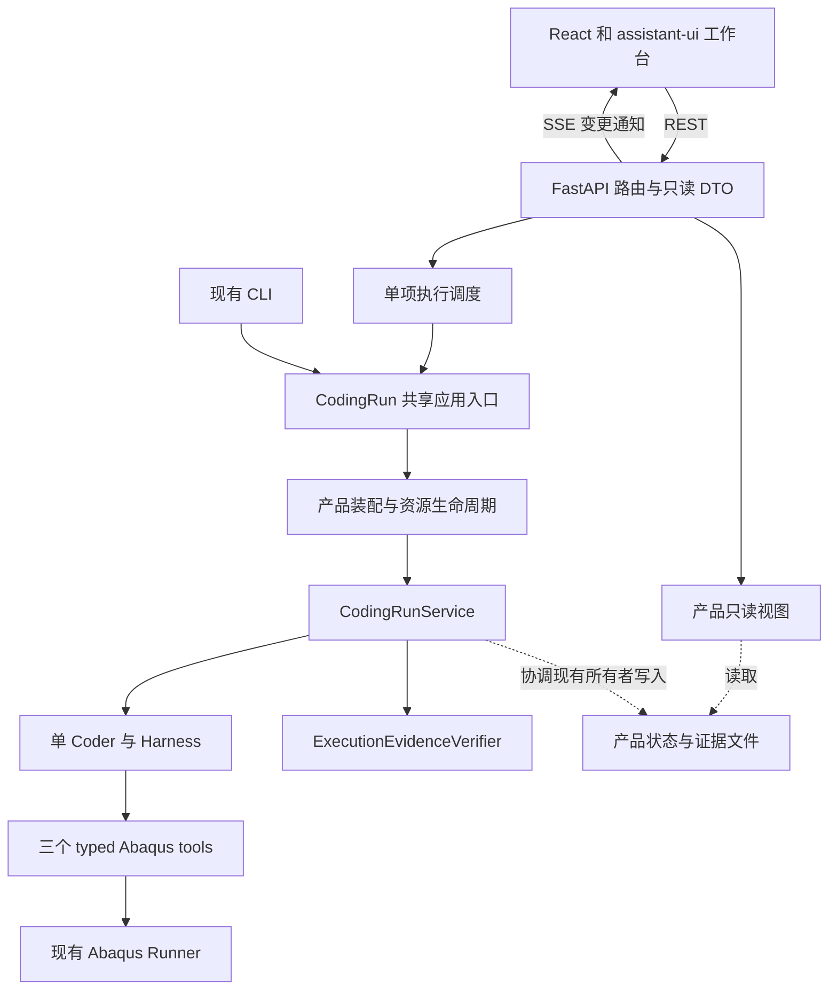

# ADR-0025：在 CodingRun 宿主之上增加本地 Web 工作台

## 状态与证据

目录范围后来由 [ADR-0034](0034-bind-selected-workspaces-for-web-runs.md) 局部替代；下面保留首版当时的背景与决定。

已采纳（Accepted），2026-09-13。接受依据：用户在明确方案后回复“可以。计入计划，评估”。采用 FastAPI + React/TypeScript + assistant-ui，通信为 REST + 轻量 SSE 变更通知；采纳时产品尚未实施。实施与验收分别由[PLAN-0008：组件接线资格](../plans/done/0008-assistant-ui-integration-qualification.md)、[PLAN-0009：任务API](../plans/done/0009-coding-run-web-api.md)、[PLAN-0010：工作台集成](../plans/todo/0010-local-web-workbench.md)拥有。本节保留当时接受依据，后续落实见文末。

落实更新：用户随后授权三路隔离比较，PLAN-0008已完成；下面的未验证描述保留为采纳时依据，最新证据见末尾“落实与确认”。

现状依据为当前工作树源码及 ADR-0015、0017、0019、0020、0021、0024。工作树包含大量先前改动，本次不修改它们。既有实测使用 Pydantic AI 2.33.0、Harness 0.24.0、官方 ai-chat-ui 2.1.0；完整[兼容验证报告](../research/official-ui-compatibility-20260913.md)继续保留原始结果。assistant-ui 目前只有官方接口文档核查，尚无本项目运行证据，不把官方 UI 实验成绩迁移给新前端。新增依赖的具体兼容版本在首个接线验证前锁定，不改变本方案的职责边界。

## 推荐决定与理由

让用户通过浏览器完成“提交简单建模任务 → 回答缺参问题 → 查看执行 → 获取产物与验证结果”。保留一个 `abaqus_2024_coder`、现有 Harness 和三个 typed Abaqus 工具。

后端选 FastAPI，定义本项目的任务命令与只读接口；CLI 与 Web 调用同一 CodingRun 应用入口。前端使用 React + TypeScript + Vite，复用 assistant-ui 的聊天、消息和工具展示组件，通过 ExternalStoreRuntime 读取本项目拥有的状态；项目自己编写任务列表、问答组件、产物与验证面板。

这是面向当前任务工作台职责的工程选择：FastAPI 负责 typed HTTP 边界，assistant-ui 负责可组合的展示，现有宿主保留运行真值。用户必须能够理解和维护这些相关前端代码；本方案不承诺零 React/TS 学习成本，也不以覆盖秋招技术名词为理由增加组件。

选择 assistant-ui 的依据是其[ExternalStoreRuntime](https://www.assistant-ui.com/docs/runtimes/custom/external-store)允许应用提供消息、运行状态和操作回调，编辑、重新生成、取消等能力可按回调选择启用；[工具展示](https://www.assistant-ui.com/docs/tools/tool-ui)有专门扩展入口。这与本项目只开放已实现操作的要求匹配。该依据支持选型，不证明它已在本项目通过验证或总开发成本最低。

既有官方 UI 实验已证明宿主可以接 Web，并暴露默认请求 ID 不稳定、ask_user 显示 Running、历史仅在浏览器、自定义 data/file 不渲染等适配点。它不是失败方案，但本次选择组件库扩展方式，避免继续维护官方聊天应用的会话行为 fork。官方页面与 bridge 保留为研究证据，不再作为产品前端基线。

通信使用 REST 操作任务与读取快照，SSE 只通知“需要刷新状态”。首版不推送逐 token 增量、不接 Vercel AI/AG-UI 聊天运行协议，不建立完整事件回放系统。assistant-ui 的 ExternalStoreRuntime 消费本项目状态，不要求采用其云端、内置 Agent loop 或存储服务。

## 已排除的首版路线

- 不 fork 官方 ai-chat-ui；已有兼容实验不删除、不改成绩。
- 不引入 Chainlit/NiceGUI 的额外会话或页面生命周期，首版不继续并行选型。
- 不自己实现通用聊天组件、代码高亮、Markdown 引擎或三维引擎。
- 不增加数据库、Redis、Celery、DBOS、WebSocket、远程 worker 或云端会话服务。

## 第一版产品边界

| 纳入第一版 | 明确行为 |
| --- | --- |
| 本地单用户 | 只监听 `127.0.0.1`，一个 Web 实例、一项主动执行；可保存多个待答或历史任务。 |
| 新建任务 | 输入自然语言目标；服务在固定 ASCII 根目录下分配空 workspace 和独立 state。用户不通过网页提交任意宿主路径。 |
| 固定运行配置 | 沿用新普通 CLI 的有效默认配置与 `ask_user_v1`、`execution_evidence`；服务启动时显式选定现有 provider/model。页面展示有效配置和预算，首版不做设置编辑器。 |
| 问答 | 显示原问题，按 `question_id` 提交答案；已保存的答案可在中断后继续使用。没有缺参预填值。 |
| 执行和错误 | 显示真实的模型工作段、三类运行工具开始/结束、验证过程、错误摘要与有限日志详情；不展示推测的百分比。 |
| 历史和继续 | 支持本 Web 实例管理根下创建的新协议任务；Provider 中断或已答未启动可显式继续，资格仍由宿主复核。 |
| 产物 | 在主动执行暂停或结束后查看脚本、JSON、日志与下载产物；已有真实 PNG 可内联显示。 |
| 完成语义 | 展示宿主 outcome、verification scope、失败项、产物 freshness。普通任务显示“执行证据通过；物理正确性未自动验收”。 |

页面结构固定为：左侧任务列表，中间任务说明、问答与执行记录，右侧产物、图片和验证摘要。普通消息复用 assistant-ui；问题卡片和宿主验证卡片由项目拥有，清楚区分模型话语与宿主结论。工具原始详情折叠展示；内部 schema 版本、hash 等放详情，不占据主操作流程。

首版不包括：三维查看器、自动截图生成、上传参考图片、任意 `.cae` 导入或模型修改、网页编辑代码、任意终端、作业取消/暂停、问题取消按钮、运行中追加自由消息、任务 goal/config amendment 编辑器、任意旧 CLI/evaluator run 导入、任务队列、多用户、远程部署、数据库、跨进程许可证调度、桌面安装包。

排除 Web 手动 amendment 不得关闭已有“晚到问答自动形成 task revision”的产品语义。完成任务不能以继续按钮重开；需要新任务目标时首版新建空工作区任务。Catalog、Concept、ACI、document policy、probe 等实验 profile 在首版 Web 均不暴露、不自动启用。

没有 PNG 时明确显示“尚无模型预览”，不生成示意图充当模型。自动截图需要独立验证 Abaqus 2024 下的导出路径、预算和 stage evidence，再决定是否增加；不能由 Web 后端偷偷运行额外 CAE 或宿主 oracle。

## 现有结构与需要补齐的入口

以下是核对过的现有实现，不是已经存在的 Web 能力：

| 现有责任 | 实现与观察 | 对方案的约束 |
| --- | --- | --- |
| CLI 装配 | `coding/cli.py::_run_cli_once` 同时解析配置、解析 workspace、加载绑定、创建模型/client、runner、Agent、dependencies、service 并执行。 | Web 不导入 CLI 私有函数，不构造 argparse 参数，不解析终端输出。先提取共享装配。 |
| 工作段执行 | `coding/service.py::CodingRunService.run_step` 拿 state OS 锁并返回 `CodingRunResult` 或 `WaitingForUser`。 | 所有产品执行仍经过此入口；不在外层重复持有同一 state 锁。 |
| 问答 | `coding/user_questions.py::submit_answer` 已有 ID 校验、幂等、快照/未决 effect 检查和 late-answer revision。 | 复用其写入语义，Web 只做传输适配。 |
| 问题检查 | `coding/user_questions.py::inspect_question` 会调用 revision/frontier 修复并可能写 resume state。 | 名称中的 inspect 不代表只读；禁止 GET 和列表刷新调用它。 |
| 运行配置 | `coding/launch.py::LaunchManifest` 与 `coding/model.py::ModelExecutionConfig` 拥有有效配置和版本兼容。 | 不新增 Web 自己的模型默认值或执行配置来源。 |
| 状态和证据 | `coding/resume.py`、`amendments.py`、`user_questions.py` 和 service 写入现有记录。 | Web 不能直接改 request、launch、resume、question、outcome 或 verification 文件。 |
| 进度 | `ProgressSink = Callable[[str], None]`，service 的 events/history 是宿主记录，不是已定义的 Web 事件 API。 | 需要结构化观察与展示投影；不能用日志正则判断成功或解析阶段。 |
| 凭据 | `coding/model.py::take_gateway_api_key_from_environment` 取得凭据后删除子进程可继承的模型环境变量。 | 长驻服务启动时捕获所选凭据并在内存保留；不能每个新任务都重新从已清空环境取值。 |

## 目标代码职责与依赖

下列新增位置均为拟建。按 ADR-0017 的组件结构增加 `web` 入口组件，不恢复旧全局 `application/services/repositories` 分层。

| 逻辑组件 | 主要实现位置 | 拥有的责任 | 不拥有的责任 |
| --- | --- | --- | --- |
| CodingRun 应用入口 | 新 `coding/application.py` | 接收 typed 启动/继续命令；协调现有配置、问答、恢复；提供 `prepare_new_run`、`execute_step`、`answer_question`、`continue_run` 等窄入口。名称为设计候选。 | HTTP、React、队列、外部 Job 重附着。 |
| 产品装配和资源生命周期 | 新 `coding/composition.py`；沿用 `launch.py` | 从 CLI 提取模型/client、runner、Agent、dependencies、verifier 装配；异步上下文负责创建和关闭 client；新建与恢复均使用 effective request/launch。 | Console 输入、API 路由、复制默认值。 |
| 产品只读视图 | 新 `coding/read_model.py` | 读取并验证已落盘的 request、revision、question、history、execution、verification、outcome，形成与 HTTP 无关的 typed 只读快照。 | 修复 ledger、补写 revision、启动运行、产生新的 outcome。 |
| 结构化观察 | 新 `coding/progress.py`；接入 service/runtime owner 的确切生命周期点 | 提供工作段、runtime、verification 的 typed progress；包含 run/revision/turn 和可用的 invocation ID。兼容现有文本 progress_sink。 | 重新执行工具或把未开始执行的请求标为执行成功。 |
| CLI | 现有 `coding/cli.py` | argparse、终端输入输出、exit code；调用共享入口。 | 新增第二套装配规则。 |
| Web 应用外壳 | 新 `web/app.py`、`web/cli.py` | 应用 lifespan、同源静态资源、启动配置、会话防护、单实例锁；拟新增独立 `abaqus-sim-agent-web` 入口。 | Agent 运行循环、产品状态机。 |
| HTTP 合同和路由 | 新 `web/contracts.py`、`web/routes.py` | FastAPI 校验请求、返回 DTO、映射错误码、适配产品入口。前端类型由其 OpenAPI 生成。 | 接受用户指定 launcher/任意路径、调用 service 私有方法。 |
| 显示变更通知 | 新 `web/events.py` | 管理只读 SSE 订阅，发送 sync/run.changed 提示，合并慢消费者通知并清理断开的订阅。 | 持久运行日志、模型流式请求、命令执行、外部 Job 恢复。 |
| Web 运行调度 | 新 `web/dispatch.py` | 管理一个专用执行线程及 Future、容量占位、命令去重、实例退出时收尾；每个工作段在该线程中拥有自己的事件循环。 | 第二套 Agent loop、自动重试 Provider、队列、把线程结束当作完成。 |
| Web 管理记录 | 新 `web/registry.py` | 服务管理的 run 标识、目录映射、创建请求摘要和命令回执；原子保存、可恢复枚举。 | 产品运行真值、用户问答 ledger、物理结果。 |
| 产物访问 | 新 `web/artifacts.py` | 根据只读快照生成 artifact ID；边界校验、有限内容预览、校验下载快照与内容类型。 | Abaqus 执行、修改工作区、自动转换 ODB、触发 verifier。 |
| 浏览器接入 | 新 `webui/src/api/`、`webui/src/runtime/CodingRunRuntime.tsx` | typed API client、SSE 订阅、快照与 timeline 缓存、稳定 run ID；将只读消息投影给 assistant-ui ExternalStoreRuntime。 | 运行 Agent、用浏览器消息覆盖宿主 history、接收模型凭据。 |
| 浏览器页面 | 新 `webui/src/features/`，按 tasks/conversation/execution/artifacts/verification 组织组件 | React/TS 页面、问题表单、三种工具展示、产物与验证面板；布局和通用聊天基于 assistant-ui 组件组合。 | 决定可恢复性/成功、补造物理参数、保存权威任务状态。 |

内部文件可以在实现时按体量合并；上述逻辑责任和依赖方向不得因合并而混淆。现有 `execution`、`verification`、`retrieval`、`api_catalog` 的所有权不变。

`coding` 不导入 `web`、FastAPI 或前端协议；`web` 不导入 evaluator、Case oracle 或直接装配 runner。当前显式 RAG profile 仍有借用 evaluation 服务的既有债务，本次不借架构图声称已经清理，也不顺带迁移它们。

## 状态与写入所有权

UI 的 `registration_state`（registered/dispatch_pending 等）与 `execution_activity`（idle/active/unknown）属于 Web 管理信息；产品 `resume_status` 仍只有现有 running/waiting_for_user/interrupted/needs_reconcile/completed/failed。三个字段分开，禁止合成一个会冒充产品真值的 success 状态。

最终 outcome 仍只由 CodingRunService 与独立 verifier 形成。运行阶段来自结构化运行记录，模型文本作为文本展示。预算显示累计已记录值和更新时间；框架 usage.requests 标为框架已计数请求，不声称包含最后失败的全部 HTTP/逻辑请求。

`request.json`/`launch.json` 仍是 immutable base；问答和 amendment 各自保持现有锁与原子写入，Web registry 不做产品文件的镜像写入。产品 schema 不因展示而升级；需要给 answer source 增加 `web` 时，只扩展来源标签的读取兼容，保留旧值与旧文件，并补回归。

读取多文件不具有数据库事务语义。只读视图核对 run ID、revision、amendment sequence 及引用记录；发现采样跨越边界时有限重读，仍不一致则返回 `updating` 或 `unavailable`，不用旧 outcome 给新 revision 标绿。JSONL 正在追加时只读取完整行；settled 后的损坏记录明确报错，不以忽略尾部或回放 event log 的方式修复产品账本。SSE 通知丢失不影响执行正确性；刷新通过产品证据重建已完成事实。

任务快照至少包含 run_id、task_revision、amendment_sequence、view_version、registration_state、execution_activity、resume_status、当前问题、累计 usage、验证摘要和可用操作提示。view_version 是展示采样版本，不能代替产品 revision 或作为恢复账本。前端按 run/revision 隔离缓存；命令在锁内重新检查条件，不能相信过期快照中的 can_answer/can_continue。晚答导致 revision 改变时清空当前结果缓存并重新读取，不把旧结果沿用为新结果。

assistant-ui 只作为界面运行时：不提供前端工具 execute，不自动注册新的模型工具；已有三种 Abaqus 工具仅注册 render-only 展示。人类答案必须发送至项目答案接口，并由宿主返回已接收状态。首版不接 onEdit/onReload/onCancel、分支写入或消息队列；不启用重试、编辑、取消、分叉按钮。宿主记录中的模型消息和工具记录使用稳定 ID，问题和验证结论保持独立语义，不因组件默认合并规则混成一条模型结论。

## HTTP 和交互合同

API 使用 `/api/v1`。以下为拟定合同，实施时由 strict Pydantic DTO 定义；客户端不接收可提交回服务的完整 `CodingRunRequest`。

| 请求 | 语义 |
| --- | --- |
| `POST /runs` | 提交 goal 和创建幂等键，分配 run/空 workspace；返回 registered 任务，不隐含执行。相同键同内容返回原任务，异内容返回409。 |
| `POST /runs/{id}/start` | 显式启动已登记的新任务；携带 command ID。202只表示已接收，不表示模型或 Abaqus 已开始。 |
| `GET /runs`、`GET /runs/{id}` | 只读列表/快照，含状态、当前问题、累计用量、配置与当前 revision 的验证摘要。 |
| `GET /runs/{id}/timeline` | 分页返回宿主允许展示的消息、工具和验证记录；游标仅用于展示去重，不成为恢复日志。 |
| `GET /runs/{id}/events` | SSE 只读变更通知；订阅不启动、不继续、不取消任务。 |
| `POST /runs/{id}/answers` | 按问题 ID 保存答案并尝试继续，返回分别明确的 `answer_saved` 和 `execution_accepted`。保存后调度失败不能回报“答案丢失”，由继续按钮补下一步。 |
| `POST /runs/{id}/continue` | 使用现有配置和累计预算显式恢复；不自动追加 amendment，不重开 terminal，遇未决 runtime 仍拒绝。 |
| `GET /runs/{id}/artifacts`、`GET /runs/{id}/artifacts/{artifact_id}` | 列出或读取被服务识别的产物；客户端不给绝对路径。主动执行时只返回已公布的元数据，内容读取等到 settled 边界。 |

新建表单可以顺序调用 create/start，因此用户只需点一次“开始建模”。创建后 start 失败时保留可见的未启动任务，不偷偷创建替代 run。相同 start/continue command ID 只返回原回执；新的显式 continue 才可发起另一个工作段。回执保存失败不执行。崩溃发生在回执与调度之间时标为调度结果待核对，不自动重放；再次显式操作须先由产品入口核查 state/effect。该去重不是外部作业 exactly-once。

多标签页同一命令通过去重合并；不同命令争用主动执行槽时返回409，不排队。答案幂等先核对已保存的 question ID/内容，同答复的重复 HTTP 请求不追加 revision 或重新调度；异答复冲突保留原记录。答案已保存但未能执行时展示“答复已保存，尚未继续”。待答任务释放执行槽，其他任务可运行。

答案提交携带 question_id、expected_task_revision 和 command_id；同 command ID 同请求优先返回既有回执，异请求拒绝。新命令才按当前问题及 revision 校验，不能用旧页面的文本覆盖已回答或已取消的问题。预算/Provider 等配置在首版页面只读，输入框在执行中和 terminal 时禁用；明确待答时提供问题表单，interrupted 时提供经后端复核的继续操作。

### SSE 的精确范围

SSE 只定义两类通知：`sync` 与 `run.changed`，payload 只带 run_id 和展示失效提示。连接建立后先登记订阅，再发送 sync；前端收到后 GET 当前任务和对应 timeline。任务状态、问题、工具或验证记录发布后发 run.changed，前端重新读取相关视图；它不直接把通知解释成 completed。连接期间约15秒发送一次 sync 作为低频校对，防止显示通知遗漏后页面永久停在旧状态。

通知可合并、可重复、可丢弃；慢客户端只保留一次“需要同步”的标记，不能拖住执行线程。断开只移除订阅，不能取消任务。重新连接或回到前台后重新 GET 快照；不依靠 Last-Event-ID 回放、不承诺逐事件恢复，也不在 SSE 中传用户答案。侧栏在任务选择、命令响应和同步时更新，不单独建立全局消息总线。

首版显示已完成的模型消息和近实时工具/验证阶段，不做逐 token 回复；不能用逐字动画假装模型流。timeline 按稳定 ID 增量读取，响应包含所属 revision/view_version；采样不一致时清楚显示同步中并重取。GET/订阅不扫描或哈希整个 workspace、大型 ODB；昂贵快照仍在产品执行/验收边界完成。网络断开单独显示连接状态，上次运行状态带时间戳。

错误区分为非法输入（422）、状态/并发/答案冲突（409）、只读记录暂不可用（503或 DTO 明确状态）、基础设施失败和产品失败。细节不得返回凭据或完整宿主环境。GET 不调用 `inspect_question`、`submit_answer`、`select_resume_history` 等恢复/写入路径，也不产生新的模型或 Abaqus 调用。

## 进程、线程、锁和退出

FastAPI 事件循环只负责 HTTP 与轻量协调。模型/client 的建立、使用、关闭及 `run_step` 全部在专用执行线程所属事件循环内完成，避免同步 workspace snapshot 或其他宿主文件工作阻塞 HTTP，也不跨线程复用异步 client。

不把长任务绑定到 HTTP 请求的生存期或 FastAPI BackgroundTasks；dispatch 持有 Future 强引用并记录异常。执行槽预占和释放用显式同步保护，观察回调通过线程安全消息通道传回 Web，不能在执行线程直接操作 ASGI loop 对象。饱和时允许丢弃可重建的显示进度并报告缺口，不能阻塞 runtime，也不能丢弃产品证据。

Web 管理根的单实例 OS 锁在 lifespan 持有，禁止多 Uvicorn worker 和运行中 reload。专用线程只是本进程的执行承载，不提供线程强杀或持久 worker。`CodingRunService` 与 answer/amendment 函数继续自己取得 state 锁；Web 调度锁不冒充产品锁。CLI 对同一 state 的竞争仍由已有 OS 锁拒绝；不同 CLI workspace 的 Abaqus 并行不受 Web 控制，首版不声称全机器许可证串行。

关闭标签页不取消任务。正常服务退出先停止接收命令，等待当前主动工作段在其现有累计 wall budget 内结束或进入待答，再关闭资源；不通过 `Future.cancel()` 假称外部进程已取消。等待时间可能较长，这是第一版没有作业取消功能的明确代价。

强制退出或崩溃后不自动续跑；重启只恢复只读列表。持久 running 不足以证明仍在执行，显示 activity unknown，并由显式 continue 的既有恢复检查裁决。未决三类 runtime effect 进入 needs_reconcile；无未决 effect 且满足现有恢复合同才继续。不按 PID 猜测归属，不重新附着外部 Job，不提供清除 needs_reconcile 的按钮。初始化中断且 base 不完整时显示初始化错误并拒绝覆盖，用户另建新任务。

## 文件、网络与凭据边界

Web 管理根下分开 `workspaces/<id>`、`states/<id>` 和 `registry/<id>`，部署时指定绝对 ASCII 根路径；所有路径仍经过产品 resolver 检查。registry 记录创建请求摘要和 Web 命令回执，不能进入模型 workspace。文件根来自服务配置，页面只提交服务生成的 run/artifact ID。

首版仅承诺本机可信用户。绑定 loopback 之外，还限制 Host/Origin，禁止宽泛 CORS；服务启动生成本地会话凭证，供浏览器建立同源 HttpOnly 会话，写入请求校验 CSRF。启动凭证不记到访问日志或模型上下文，模型 API key 始终只由宿主内存持有。这里处理的是浏览器入口新增的访问面，不声称 OS 沙箱或多租户安全。

产物绑定 `(run_id, task_revision, relative_path, sha256)`。每次内容访问重查路径归属及 Windows symlink/junction/reparse point，拒绝 `..`、绝对路径、UNC、驱动器路径和 alternate data stream。不能把 workspace 或 state 直接 mount 为静态目录。

文本预览有长度上限且只按文本渲染；PNG 验证实际格式、大小和像素上限。模型生成的 HTML/SVG/脚本不作为同源活动内容执行。原始 state 全目录不开放，日志通过有界读取和敏感值处理返回。

首次内容访问先在工作区外的临时展示缓存形成副本，并核对预期 hash 后发布；这是只读传输快照，不是产品 artifact store，不改变 verifier freshness。拟将文本预览限制为256 KiB、单次下载快照为200 MiB，更大文件只显示本地位置和大小，避免为下载默默复制大型 ODB。缓存按需、有总量上限，hash 不符则报告产物已变化并拒绝冒用旧验收。内容操作与本 Web 的执行启动互斥；外部文件修改通过副本 hash 检出。不能恢复已覆盖的历史 bytes，旧 revision 没有保留副本时只显示历史 metadata。

Python 的 FastAPI/Uvicorn Web 依赖放可选 `web` extra；前端使用 React/TypeScript/Vite 与 assistant-ui，保留独立锁文件，暂不增加 Redux 等额外状态框架。首个接线验证锁定兼容的实际版本，避免将最新网页中的 API 自动当成安装版本的合同；尤其检查工具 toolkit/render-only 与 ExternalStoreRuntime 接口。CLI 安装不强制引入 Web 运行栈；本地 Web 运行由 FastAPI 提供打包静态文件，不常驻 Node、不从 CDN 动态获取页面。新增依赖锁定须作为实现改动，既有源码/uv.lock 绑定的评测 spec 若失配必须新 seal，旧报告不回填。

## 自审结果与纠正

以下是对前述建议的设计审查，不是已完成的实现测试。

| 审查点 | 源码或边界依据 | 本方案的处理 |
| --- | --- | --- |
| 直接 to_web 会漏宿主流程 | 默认 Web 入口接 Agent；预算、问答落盘和 verifier 编排在 CodingRunService。 | Web 通过共享应用入口，只复用现有 Agent/Harness 内核。 |
| “查询问题”可能写状态 | inspect_question 含 ensure_answer_revision、frontier 修复与 write_resume_state。 | 新建纯读取投影；有副作用的恢复只在命令中调用。 |
| 表面异步仍会卡页面 | service/恢复含同步 snapshot、文件校验；普通 HTTP coroutine 并不自动隔离它们。 | 专用执行线程及独立 loop；HTTP 不承担运行工作段。 |
| 刷新、双击或断连可能产生重复执行 | HTTP 请求和宿主工作段没有相同生命周期；现有 state 锁只防同时执行，不负责命令重放。 | Web 回执去重、独立执行生命周期、显式继续，保持底层锁。 |
| 长驻服务的第二次启动可能丢凭据 | take_gateway_api_key_from_environment 会消费并删除环境变量。 | 启动时捕获到宿主内存，每段新建 client，继续清理子进程环境。 |
| 旧 outcome/图片可能装作新结果 | late-answer revision 会改变验收基线；workspace 路径可被后续覆盖。 | 跨文件 revision 核对、图片/文件 hash 绑定、历史 bytes 缺失时明确不可用。 |
| “宿主顺手截图”越过执行边界 | 首轮仅三类受预算 Abaqus 工具；新 CAE 调用影响 stage evidence。 | 首版只展示已有 PNG，自动导出另做真实 fixture 验证。 |
| 停止按钮的含义未实现 | 文件续跑不等于外部 Job cancel/reconcile。 | 首版无取消按钮；正常退出 drain，崩溃恢复保留不确定性。 |
| 页面显示成功不等于物理通过 | 普通 CLI verifier 为 execution_evidence，固定 evaluator 才有 oracle。 | scope 驱动文案，模型自述不参与成功判定，不接 evaluator。 |
| 组件库可能引入未授权操作 | 聊天库有工具执行、编辑、重新生成及恢复回调。 | 仅接状态和受控命令；工具只展示，不把库的 resume 名称当成宿主恢复实现。 |
| SSE 容易被误写成恢复机制 | 通知可能丢失；宿主运行和浏览器连接生命周期不同。 | 通知只触发 GET，重连重读快照，运行继续由独立命令和宿主裁决。 |

设计核查未发现必须更换 Harness、增加数据库或通用多 Agent 才能完成首版的理由。剩余工程风险集中在共享装配提取的兼容性、执行线程退出、只读视图的一致性和 Web 文件边界；下面的验证门槛用于证明它们，不能凭本文自审宣告已解决。

## 实施验收门槛

| 场景 | 必须观察到的结果与验证方式 |
| --- | --- |
| CLI/Web 配置和工具一致 | 同一配置的 effective launch、完整工具 schema、请求 header 和预算相同；沿用 CLI/schema parity 的离线测试方法。旧 legacy profile 仍按旧协议运行。 |
| assistant-ui 接线 | 用锁定版本完成最小 React build；fake 宿主状态能显示普通消息、工具、待答、宿主失败；运行期间输入禁用，禁止操作不出现；浏览器无额外工具执行与自动重新生成请求。这是新方案必须独立通过的门槛。 |
| 生命周期和响应性 | fake model/runtime 被有界屏障阻塞时 GET 仍能响应；一个槽内没有第二个工作段；client 创建与关闭属于同一 loop。真实异步/线程测试。 |
| 待答刷新 | fake model 发出 ask_user，页面显示原问题；刷新和重启不重新问、不读 Console，不增加 active wall。浏览器与宿主合同测试。 |
| 重复与冲突 | 双标签重复 start、同答复重传、异答复重传、save 后调度失败、receipt 后断进程；只有允许的一个工作段/revision，无自动重放。故障注入测试。 |
| 只读和状态一致性 | GET 前后产品文件 hash 不变；并发 revision 切换不显示旧绿标；损坏账本可见且不能继续。读取测试与并发注入。 |
| 断连与退出 | 标签页关闭后 fake runtime 能完成；正常退出等待并保留证据；崩溃后不自动执行，未决 runtime 不绕过 reconcile。进程级测试。 |
| SSE 与一致性 | 连接登记与首个同步间状态改变、重复/遗漏/慢订阅、页面刷新、断开重连、late-answer revision 切换时，都能重取正确快照；订阅数量回落，事件丢失不导致命令重放或旧结果标绿。 |
| 产物边界 | traversal、UNC、ADS、symlink/junction、替换/超大文件、伪 PNG、HTML/SVG、旧 revision 均按合同拒绝或降级；浏览器不执行产物代码。 |
| 基本页面可用性 | 新建、错误、待答、已答未继续、执行中、完成、失败、连接丢失、无预览、旧产物状态都有可读呈现；实际浏览器检查桌面布局、键盘操作和控制台错误。 |
| 两条真实产品主线 | 单独运行缺厚度板与完整三维杆各一次，保留全部成功/失败/Provider 中断；板须实际先问厚度且无猜值执行，完整杆不得凭空补问已给输入。经 UI 回答和交付，核对原始日志/manifest/宿主结果。 |

最后两题是新的 Web 产品 E2E 观察，不回填旧 pair spec/batch，不复用 Gold 标识宣称新 smoke gate。UI 功能可以用 fake 验证，但模型漏问、Provider 超时和 Abaqus 失败必须作为真实结果保留；真实主线未交付就不能声称该主线验收完成。数值/物理检查如需开展，应由独立评测或人工审查另行记录，不成为 Web 运行中的隐式 oracle。

## 实施顺序与证据边界

1. 先在隔离目录验证锁定版本的 assistant-ui 最小接线：显示假宿主消息、问题、工具与失败结论，验证禁用操作。该步尚未执行，不沿用官方 UI 的成功结论。
2. 提取共享 CodingRun 应用入口、装配与只读视图；完成 CLI 配置/schema/问答恢复回归。
3. 接入 FastAPI 的注册、启动、答案、继续、查询、产物接口及单项执行管理，用 fake 验证命令与状态边界。
4. 完成页面、SSE 同步、专用卡片和浏览器边界测试；保持全部模型/物理执行在既有宿主路径。
5. 开展单独的新 Web 真实产品 E2E，保留全部结果，不回填旧评测。

这是一条具体实施路线，不再同时维护官方 fork、Chainlit 和自建聊天三个方向。若第1步暴露无法满足合同的库限制，应记录实际失败再调整本提案，不能一边换栈一边继续声称已验证。

代价是本项目需要维护一份前端和一个外部状态适配器；收益是任务/问答合同由宿主定义，通用 UI 由组件库复用。FastAPI 在此承担真实 API 责任，不保证作业恢复；assistant-ui 在此承担展示责任，不保证持久化或物理正确性。API 和 SSE 均是拟建能力，目前不写入已实现能力介绍。

来源：[assistant-ui ExternalStoreRuntime](https://www.assistant-ui.com/docs/runtimes/custom/external-store)、[工具接口迁移与 render-only](https://www.assistant-ui.com/docs/migrations/toolkit-tools)、[FastAPI lifespan](https://fastapi.tiangolo.com/advanced/events/)、[官方 Pydantic UI 定位](https://pydantic.dev/docs/ai/guides/web/)。外部文档用于选型和实现约束，不等于本项目测试证据。

本提案扩展 ADR-0017 的入口组件，并沿用 ADR-0015 的工具权限、ADR-0019 的 verification scope、ADR-0020/0021 的文件恢复与 revision、ADR-0024 的问答所有权。不替代这些已采纳决定。

## 落实与确认

2026-09-13，用户授权实际比较并纳入官方UI。官方最小定制、assistant-ui ExternalStore、AG-UI三条最终均通过有界接线场景，共12个真宿主/假模型任务、36次FunctionModel、0真实Provider/0Abaqus；原始开发失败保留。见[同组比较](../research/ui-three-way-comparison-20260913.md)。

结论保持当前ExternalStore主线，未更改本ADR决定。官方UI被证明可以定制到满足这些场景，不因其调试定位判为不可用；选择组件库路线属于当前维护边界取舍，不宣称总成本更低。AG-UI也已跑通，但仍保留共用宿主快照同步，未观察到省去此部分的证据。后继产品工作仍由PLAN-0009/0010验收。

2026-09-14，PLAN-0009后端工程验收完成，PLAN-0010页面/安装/浏览器工程验收通过而真实主线未执行。职责和限制已同步到architecture/overview，未修改本ADR原选型；不将确定性模型结果当作真实仿真证据。

2026-09-15，用户授权在既有artifact边界内增加会话内模型预览。PNG与OBJ独立展示，OBJ使用Online 3D Viewer读取本轮CAE工具卡的fresh artifact；真实Abaqus2024Runner链路已覆盖简单实体、基础装配、壳面和梁中心线。该扩展没有引入Pi session/runtime、上传、CAE/ODB浏览器直读或结果云图，具体资格见[模型预览调研](../research/session-model-preview-reuse-20260915.md)。

2026-09-16，用户确认长时Solver应与普通模型工作段分离。Web新增宿主持久`ToolExecution`和Pydantic AI deferred tool恢复：以原tool call运行、查询或取消当前宿主控制的Solver，终态证据匹配后恢复同一AgentInvocation；活动任务跨进程仍转`needs_reconcile`，不重附着、不自动重跑。该实现扩展了采纳时“首版无作业取消”的范围，但保持本ADR的单Coder、宿主状态所有权、REST命令和轻量SSE取舍；当前事实以architecture为准，PLAN-0010仍等待两条真实主线。
