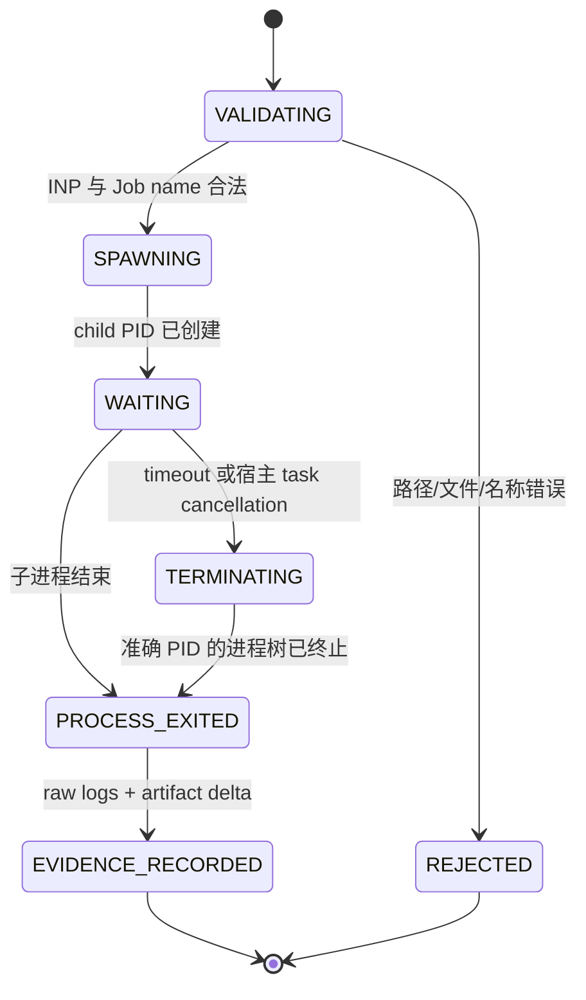

# 当前 Abaqus Solver 生命周期

## 当前实现是什么

首轮没有持久 Job Service 或 Job ledger。`run_solver_job` 是一次有界、同步的本机工具调用：校验工作区内
INP 和 ASCII Job 名，先写 Harness started tool effect 与输入 hash/Job 标识，启动 Abaqus/Standard，等待
进程结束或 timeout，保存日志、完整 execution journal 和 artifact delta，再把证据交给 Coder 与宿主
verifier。



命令形状为：

```text
D:\SIMULIA\Commands\abq2024.bat
job=<ascii-name>
input=<workspace-relative.inp>
interactive
```

runner 使用参数序列而不是拼接用户 shell 字符串；`cwd` 固定为 canonical workspace。

## 分层成功语义

`AbaqusExecutionResult.succeeded` 只表示没有 timeout 且进程 exit code 为 0。它不等于分析成功。真实本机
集成中已观察到 CAE noGUI 脚本报错但进程仍返回 0。普通 CLI 还要求该 invocation 的最后一次 stage check
没有 `Abaqus Error:`、Python traceback 或 Solver error diagnostic；固定 solver/physics eval 才继续检查：

- 本次 execution 确实是 solver invocation；
- 目标 `.odb` 和 native 状态文件是本次生成或修改；
- `.sta` 包含 Abaqus 成功完成标记；
- ODB 能由独立 oracle 打开并包含预期 step、mesh 和结果。

这也是 `CodingRunOutcome` 只能由宿主 verifier 形成的原因。普通 CLI 记录
`verification_scope=execution_evidence`；只有固定 eval 记录 `task_oracle`，两者不能互换。

## Timeout 与 task cancellation

Windows runner 为每次调用创建新的 process group。timeout 或宿主 async task 取消时，对准确的 spawned PID
执行 `taskkill /PID <pid> /T /F`，随后收集能取得的 stdout/stderr。原始 bytes 写入 workspace 外 state；
解码文本仅供诊断，UTF-8 失败时回退 CP936。

这能处理宿主仍存活时的有界调用，但没有以下保证：

- 宿主进程或机器崩溃后重新附着 solver；
- 请求发出和外部进程启动之间的 exactly-once；
- 持久 cancel intent、异步 poll、deadline reconcile；
- `UNKNOWN` 状态和人工接管；
- 多个 licensed worker 的队列、限流或调度。

新进程可以恢复 CodingRun conversation 和已完成 execution evidence；若 Solver tool effect 只有 started 而
没有 completed/failed，`--resume` 在任何模型请求前把 run 标为 `needs_reconcile`。这避免盲目重复提交，
但不会判断外部 Job 实际是否启动或完成。因此当前仍不能把文件 evidence 或 Pydantic history 描述成
durable Job 状态机。

## 何时重新引入 Job Service

只有固定评测复现下列问题时，才为持久 Job Service、SQL ledger 或 DBOS/Temporal/LangGraph 提出新 ADR：

- 求解时长要求 CLI 退出后继续运行；
- 宿主崩溃导致重复提交或无法确认 Job 真相；
- 真实消费者需要查询、取消、恢复或并发队列；
- 多台 solver host 需要外部 handle、幂等键和 reconcile。

届时必须让外部 Abaqus Job 成为独立状态真相；workflow checkpoint 不能替代外部进程对账。ADR-0003 保留
了此前方案的分析，但已由 ADR-0008 替代，不能作为当前已实现能力。

## 相关文档

- [一次 CodingRun](simulation-run.md)
- [当前系统框架](../system-framework.md)
- [ADR-0008：首轮采用 Pydantic AI Harness 单 Coder](../../adr/0008-pydantic-ai-harness-abaqus-coding-run.md)
- [ADR-0020：使用 Harness StepPersistence 续跑中断的 CodingRun](../../adr/0020-resume-coding-runs-with-harness-step-persistence.md)
