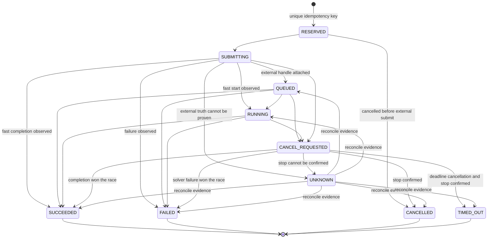

# Abaqus Job 生命周期

## 为什么单独建模

LangGraph checkpoint 可以恢复业务控制流，但无法与 Abaqus 进程组成 exactly-once 事务。Job Service 因此
拥有独立、持久的 ledger，并独占 submit、poll、cancel、timeout 和 reconcile；`SimulationExecutor`
只负责把确定性命令映射到 Mock 或真实 Abaqus。

当前 `JobPhase` 和 Mock 只覆盖基础状态；下面是目标 FSM。

## 状态机



状态语义：

- `RESERVED`：ledger 已用唯一幂等键占位，尚未开始跨越外部边界。
- `SUBMITTING`：处于“数据库已知意图、Abaqus 是否已启动尚可能不确定”的非原子窗口。
- `QUEUED`：已确认 Abaqus 接受 Job，但尚未观察为运行中。
- `CANCEL_REQUESTED`：取消意图已记录；不能提前谎称进程已经停止。
- `TIMED_OUT`：deadline 触发了取消，并且已经确认外部进程停止。
- `UNKNOWN`：是否启动、是否停止或外部状态无法确认；它不是失败终态，禁止自动重提。
- `SUCCEEDED`、`FAILED`、`CANCELLED`、`TIMED_OUT` 是不可回退终态。取消与完成竞争时，以真实观察到的
  solver 终态为准，同时保留取消请求事件。

## 幂等键与提交协议

对以下稳定字段做 canonical JSON 后计算 SHA-256：

```text
run_id
spec_revision
artifact_sha256
executor_profile
solver_configuration_digest
```

键中不包含时间戳、随机数、数据库自增 ID 或外部 job name。数据库对 `jobs.idempotency_key` 建唯一约束；
由该键派生的确定性 Abaqus job name 只用于外部查找与 attach，不代替唯一约束。

`JobService.ensure_submitted()` 固定执行：

1. 验证 approval 仍绑定当前 spec/plan revision、artifact digest、executor profile 和 solver config。
2. 按幂等键 upsert/reserve Job ledger；唯一约束处理并发或节点重放。
3. 已有可信 external handle 时直接返回同一个逻辑 Job。
4. handle 缺失时，先按确定性 job name、隔离 workspace、PID/外部 ID 和状态文件查找已有 Job。
5. 找到则 attach 并补写 handle；只有证据明确表明不存在时才提交。
6. 持久化 handle、attempt 和观察状态，再让父图推进。

这提供的是“图重放不会主动制造重复 Job”，不是理论上的 exactly-once。

## 崩溃窗口

| 崩溃位置 | 恢复行为 |
|---|---|
| reserve 前 | 同一输入正常重做 reserve |
| reserve 后、submit 前 | reconcile 后确认不存在，再以同一 key 提交 |
| Abaqus 已启动、handle 未写回 | 按确定性 job name、workspace、PID 和 `.lck/.sta/.msg/.dat` attach；无法证明则 `UNKNOWN` |
| handle 已写回、graph checkpoint 未完成 | 图节点重放从 ledger 返回同一 Job |
| poll 中 | 恢复后重新读取 ledger 与外部状态，不依赖旧内存值 |
| ODB 已提取、manifest 未写回 | 以稳定提取键和内容寻址写入，重复提取不覆盖已有 generation |

`reconcile` 的证据至少包括 ledger、external job ID/PID、确定性 job name、workspace 和 Abaqus 状态文件。
矛盾或不足时进入 `UNKNOWN` 和人工接管，不能用“可能没启动”作为自动重提依据。

## 取消与超时

API 的取消操作只写持久 `cancel_requested` 命令并唤醒 run。父图读取命令后让 Job Service 按已登记的
external ID/job name 定向取消，再进入 machine interrupt 等待实际停止。不得按模糊进程名批量 kill。

deadline 到达只触发取消请求；只有外部状态证明确认停止后，才根据原因写 `TIMED_OUT` 或 `CANCELLED`。
若 solver 在取消过程中先完成，则写真实 `SUCCEEDED` 或 `FAILED`，并保留“曾请求取消”的事件。

## Workspace 与 Artifact

```text
var/
├── workspaces/<run_id>/<revision>/<job_id>/   # 可变执行目录
└── artifacts/sha256/<prefix>/<full_digest>    # 不可变 CAS
```

workspace 由 Job Service/runner 拥有。完整 `.inp`、`.log`、`.msg`、`.sta`、`.dat`、`.odb`、提取结果和
截图在稳定后通过“临时文件 → 流式 SHA-256 → 原子 rename”进入 CAS；正在追加的日志或未完成 ODB 不能
直接登记成最终不可变 artifact。manifest 和 ledger 都持久化后才能清理 workspace；首版可以不自动清理，
但必须支持显式 retention。

主 Python 3.12 服务与 Abaqus 自带 Python 不共享包运行时。两边通过版本化 JSON command/spec、`.inp`、
JSON/CSV 提取结果和 manifest 交换数据。用户文本不能拼接进 shell 字符串；正常情况使用 argv，Windows
必须调用 `.bat` 时使用固定 wrapper 和 allowlist 参数。

## 相关文档

- [一次仿真 Run 的工作流](simulation-run.md)
- [完整系统框架](../system-framework.md)
- [ADR-0003：分离可恢复控制平面与 Abaqus 执行边界](../../adr/0003-durable-control-plane-and-execution-boundary.md)
