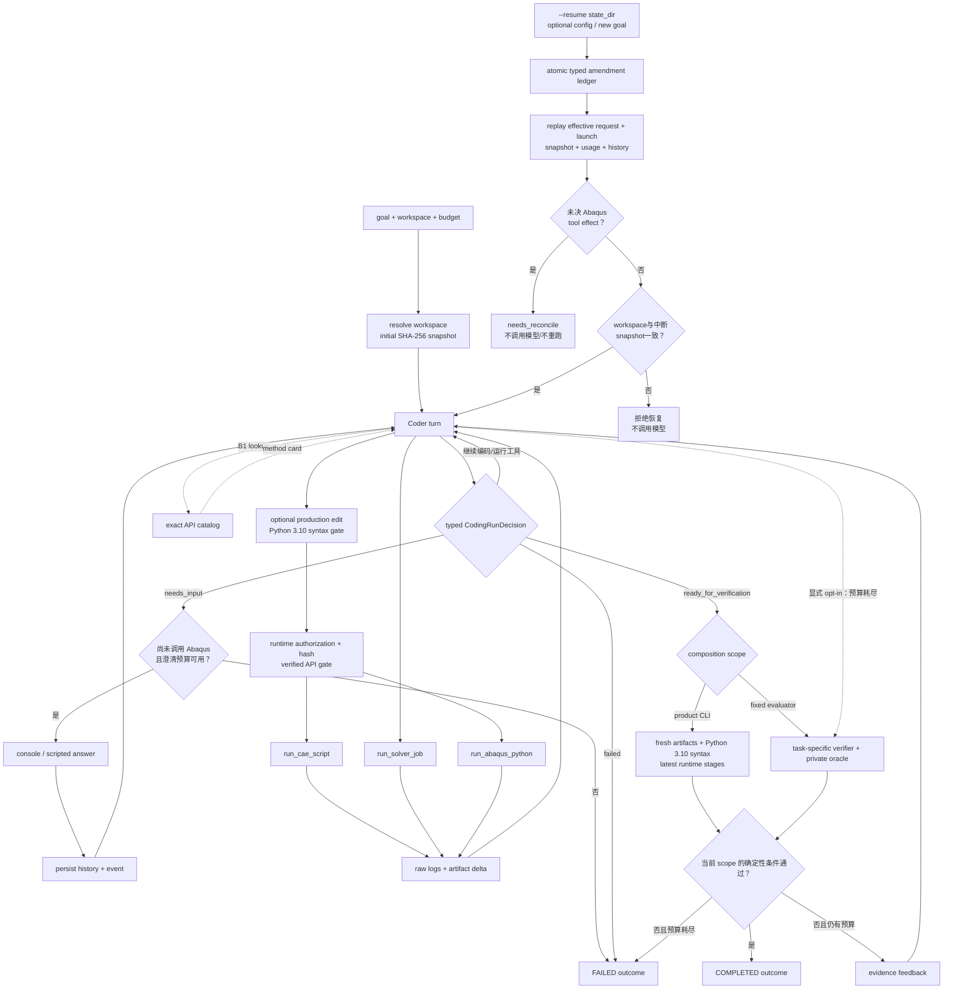

# 一次 CodingRun 的工作流

## 新默认问答交接

新默认CLI先使用ask_user(question)与框架deferred results交接。宿主保存问题、history和waiting_for_user，释放运行锁后取答复；
空输入/EOF/Ctrl+C保留待答。resume在请求模型前重显原问题或提交匹配ID的答案，等待不计active wall。
混合提问与执行的模型响应整体拒绝，答案保存后再让模型决定下一步。已有运行后的答复建立新task revision；
未决runtime reconcile仍优先。参见[ADR-0024](../../adr/0024-host-owned-user-question-waiting.md)。

## 保留的legacy闭环

首轮由 `CodingRunService` 驱动一个 Pydantic AI Harness Coder。Coder 动态决定怎样检查和编辑文件，但
澄清、预算、Abaqus 运行入口、宿主验证和最终 outcome 由确定性宿主代码拥有。这不是 LangGraph，也没有
预定义“改材料、改网格、从零建模”等任务分支。



`ready_for_verification` 只是一项请求，并必须列出typed deliverables；宿主要求路径位于workspace、去重、
存在且相对initial snapshot为fresh。Agent不能用`abaqus.rpy`等vendor临时文件替代用户交付物，也不能自行
把run标为`COMPLETED`。普通CLI的verifier只
形成 `execution_evidence`，不调用 trusted oracle；固定 evaluator 的 `task_oracle` 对模型不可见。默认情况下预算耗尽仍直接失败；verified-seed model-change evaluator 显式启用
终态验收，允许宿主在预算边界对当前 artifact 做一次 verifier finalization。只有 verifier 全部通过才形成
`COMPLETED`，缺少 `results.json` 等终态仍保持原 budget failure。

## 三种 typed decision

| decision | 何时使用 | 宿主动作 |
|---|---|---|
| `needs_input` | 缺少必需物理值、物理意图存在 material ambiguity，或用户显式约束冲突 | 确认回答前 Abaqus 调用数为 0，取得匹配 `field_id` 的回答；把 `kind/question/impact` 与回答写入 event 并继续同一 history |
| `ready_for_verification` | Agent 已生成并检查当前任务所需产物 | 运行模型不可见的 verifier；通过才形成完成 outcome，失败证据回送 Coder |
| `failed` | 当前证据表明任务无法在预算内继续 | 记录 `failure_stage` 和 summary，形成失败 outcome |

首个 Gold 的必要澄清字段是 `plate_thickness`。自动评测只在 Agent 结构化询问该字段时提供 `1 mm`，不会
把 answers JSON 直接放进 prompt。

`physics-materiality-clarification-v1` 还要求问题面向用户掌握的工程事实，不向用户询问 Abaqus API、
repository owner、Set、`findAt` 容器或文件名。若剩余差异只属于当前任务范围内的实现/数值选择，Coder
自行选择并保留显式用户约束。该通用策略已有合同与 Prompt 测试；除 `plate_thickness` 外尚无真实模型
smoke 或 licensed task 收益证据。

## 工作区与状态

交互 CLI 未给 `--workspace` 时使用启动时的绝对 `Path.cwd()`；显式参数覆盖它。from-scratch eval 创建独立
空目录；verified-seed change 先验证 source run 属于对应 frozen Gold、完成验收并匹配六个artifact hash，
再缓存两份脚本 bytes，在空目录中只从缓存写 seed，然后捕获
initial snapshot：

```text
var/runs/<run_id>/
├── state/       # Agent 不可写：request、history、syntax/API traces、raw logs、oracle、outcome
└── workspace/   # Agent 可写：脚本和 Abaqus artifacts
```

交互运行的默认 state 位于 `%LOCALAPPDATA%\abaqus-sim-agent\runs\<run_id>`。`FileSystem`、RepoContext、
Abaqus runner 和 snapshot tracker 都使用同一个 canonical workspace；Product Coder 在注册前移除 Harness
Shell。系统提示词只是说明这些事实，真正路径和执行边界由 capability 配置和 runner 校验形成。

可续跑 state 还包含：

```text
request.json                 # immutable CodingRun 合同
launch.json                  # 无凭据的 CLI composition
amendments.json              # operational overlay 与 task revision；原子替换
initial_snapshot.json        # 首次 freshness 基线
resume_state.json            # turn/revision、累计预算、证据offset和当前workspace snapshot
history.json                 # 最新模型消息副本
step-persistence/            # Harness run/event/snapshot/tool-effect
execution_results.jsonl      # 完整 AbaqusExecutionResult journal
coding_run.lock              # OS独占锁载体；文件存在不等于当前持锁
outcomes/task-*/             # revision/sequence/turn绑定的历史终态
```

`request.run_id` 是 conversation id；每次首次或恢复后的 Agent 调用使用新的 turn run id。API 异常前已完成的
tool exchange 从 settled snapshot 继续；首个模型响应尚未产生时重新发送原 goal。旧 state 缺少上述恢复
合同会明确拒绝，不根据当前 workspace 猜造初始状态。
同一 state 的所有执行从初始化到终态都持有一个不可继承的 OS 文件锁；另一个进程会立即失败，不等待也不
写 `interrupted`。恢复前还会把当前 workspace 与最后一次 resume snapshot 逐文件比较；任何外部修改都
要求先由调用方处理，不能被本 run 当作 fresh artifact。

不带新参数的`--resume`继续同一task revision。预算、provider/model和HTTP retries作为operational amendment
叠加到immutable base，累计usage不重置；带新goal的resume形成新的task revision，捕获当前workspace为
freshness baseline，并只把revision execution offset之后的运行证据交给verifier。旧outcome保留在历史路径，
顶层`outcome.json`只是最新投影。

## 运行与修复

Coder 可以直接编写普通 Abaqus Python，但 Abaqus 只能经三个工具运行：

1. `run_cae_script` 在 CAE kernel 中建模并写 `.cae/.inp`，不 submit；
2. `run_solver_job` 从已存在 `.inp` 同步启动一个 Standard Job；
3. `run_abaqus_python` 通过 standalone Python/`odbAccess` 生成 Agent 的 `results.json`。

任务可在strict request中为三类入口分别声明`RuntimeScriptPolicy`精确相对路径。未声明时保持原工作区
边界；声明后，allowlist外调用在probe状态、预算预留和runner之前返回
`RuntimeScriptPolicyDenied`，不产生vendor副作用也不消耗Abaqus预算。B31 v7用它把运行权限固定到
`build_model.py`、`beam_tension.inp`和`extract_results.py`，同时仍允许这些生产文件按证据反复修复。

显式`enforced_verified`先用Harness ToolGuardrail在`write_file/edit_file`执行前构造完整production候选；
Python 3.10语法无效则旧文件不变，并把行列诊断返回Coder。运行申请先过RuntimeScriptPolicy，再按当前
SHA-256复核语法，随后用固定abqpy wheel/BasedPyright分类API诊断。有licensed/冻结evidence id的blocker
不可由同一hash原样重试解除；未知attribute和少量SWIG consumer mismatch仅warning并继续runtime。enforce
checker不可用/预算耗尽fail closed；旧`advisory`仍可显式选择并保留fail-open兼容。`syntax_checks.jsonl`、
`static_preflight.jsonl`及raw bytes进入state；Solver INP不经过Python门，物理正确性仍由Abaqus/oracle拥有。

每次调用保存命令、exit code、timeout、duration、decoded output、原始 bytes 和 workspace delta。模型根据
这些证据修复最小问题。CAE noGUI 在脚本异常时可能仍返回 0，因此工具返回值、目标 artifact 和 verifier
必须共同判断；工具分别返回 `process_succeeded`、`abaqus_error_detected` 和 `stage_succeeded`，进程 0
只代表 transport 层没有报告非零退出。显式 B1 Catalog 变体允许最多 4 次计费 exact lookup；stderr
traceback 中能提取 method 时，宿主自动附加结果。多义/未命中和重复 card 不计 lookup budget，所有查询
进入 `api_lookups.jsonl`，且都不占 Abaqus budget。

首轮预算是最多 2 次澄清、30 次模型请求、12 次静态预检、9 次 Abaqus 调用（其中最多 3 次 solver）和
45 分钟墙钟。静态预检关闭时该计数始终为0；开启后也不占Abaqus预算。
wall-clock timeout 或 async task cancellation 会终止准确的 Windows 进程树。基础设施异常与 cancellation
把 CodingRun 标为 `interrupted`；再次启动只累计此前和本次活动执行时间，用户等待后再继续的间隔不占
wall budget。该恢复不重新附着外部进程。
model-change suite 默认最多 36 次模型请求、12 次 Abaqus 调用和 3 次 solver；CLI 可以显式覆盖三项并把
实际值写入 metadata，不因 Case 难度静默改变。Catalog 默认 off；显式非 off treatment 另有最多 3 次
API lookup。`48/18/3` 的 load-mode budget-only smoke 仍为 2/3：一条 44-request 成功，一条 48/16/0
失败，因此高预算保留为显式 profile，不替换默认值，也不被当作收敛策略。

显式 typed-probe 模式要求 CAE/Abaqus Python 调用标记 `production|diagnostic`。diagnostic 后，宿主冻结
Case 允许的 production target hashes；下一次 Abaqus runtime、Solver 或 verification 前必须记录 typed
conclusion。validated 只能采用到 allowlisted target，目标 hash 改变并完成 production runtime 前阻断后续
diagnostic 与 Solver。结论可原子附到下一次 runtime，所有 conclusion/adoption 追加到 state JSONL；关闭
模式时旧工具 schema 不变。v2 Product-Agent smoke 与高预算 control 同为 2/3，且没有 validated adoption，
所以当前只把协议当作证据/状态边界，不宣称任务收益。

## 完成不变量

普通 CLI 的 `COMPLETED` 必须有非空typed deliverable manifest且每项fresh；所有 fresh Python 通过3.10
语法检查，且每种已使用 Abaqus invocation 的最后一次执行通过 stage check。该 outcome 标记
`verification_scope=execution_evidence`，不代表自然语言需求或物理模型已经被独立证明。

对二维拉伸 Gold，固定 evaluator 的 `task_oracle` 还必须同时满足：

1. 板厚在首次 Abaqus 调用前得到回答；
2. `build_model.py`、`extract_results.py`、`.cae/.inp/.odb/results.json` 相对初始 snapshot 均 fresh；
3. 记录中存在本次成功的 solver invocation，且 `.sta` 含成功完成标记；
4. private oracle 能独立读取 ODB；
5. ODB 恰有 80 个 `CPS4R`；
6. 平均右边 `U1`、平均 `S11` 和左边总 `RF1` 在 2% 容差内；
7. Agent 的 `results.json` 与 oracle 重新提取的值一致。

该 physics checker 只覆盖这一 Gold，并且不进入普通 CLI。产品通用 checker 只验证执行证据，没有把
“任意 Abaqus 任务正确”伪装成一个通用 validator。

对 L1 suite，source run 必须先通过上述 plate Gold。共享 verifier evidence 证明 source scripts 的实际
diff、当前 CAE/INP/ODB/results 来自正确三阶段；三个 physics verifier 分别验收：中心孔边界环/半径/应力
集中，双材料 40/40 元素属性与共节点界面，traction 的旧位移删除、`DSLOAD/TRVEC`、完整右边 surface 和
右端零反力。中心孔 v2 和载荷模式都要求原 extractor hash 不变，新指标由各自 host-only oracle 验收；
双材料仍要求 extractor 增加两侧材料结果。suite 只有在每个选中 Case 都达到各自 2/3 时通过。当前双材料
为2/3，显式 full Catalog 下 load-mode 早期为2/3、no-Shell/精细 verifier follow-up 为3/3，中心孔 v2
为1/3；没有同一配置下的全套 suite pass。

B31 section change 使用同一稳定顺序，但 source 必须是通过 B31 Gold 的 run，provenance 的 artifact stem
是`beam_tension`。Agent只改build script，extractor必须逐字节保持；host检查20×10新截面、±42 kN响应、
原wire/mesh/orientation/material/step/BC/output，以及三阶段current hashes。当前deterministic为1/1、Product
为3/3；它不加入plate三Case总gate，也不扩展为任意梁修改。

B31 tip-load change 仍从同一类 verified source 开始，但需求同时改变模型与下游结果消费，因此两份脚本都
必须产生patch。host先解析INP中的左端Encastre、右端DOF2=1000 CLOAD、禁用载荷和精确U/RF/SF输出，
再通过同一host-only ODB oracle读取U/RF/RM/SF/SM，核对弯曲响应、results.json和原模型回归。v1 control
虽3/3但三次为8/9/6次Abaqus；当前`declared_odb_contract_v2`公开作者/读取边界和最大SM向量模定义，正式与
严格回放均3/3，三次稳定顺序都是一次CAE、一次Solver、一次production extraction，然后立即交host验证，
没有diagnostic脚本。该顺序是本Case的小样本证据，不是所有模型变更的强制无修复路径。

## 恢复边界与当前没有的语义

`history.json`、Harness snapshot 与 `resume_state.json` 共同支持本地 CodingRun 跨进程续跑；它们不是
外部 Job checkpoint。`run_cae_script`、`run_solver_job` 或 `run_abaqus_python` 若只有 started tool effect，
恢复确定性停在 `needs_reconcile`，不会重复执行。当前没有人工确认后解锁、PID/Job 重新附着、数据库事务、
异步 poll/cancel/reconcile、exactly-once、跨 worker lease 或多 Agent routing。

## 相关文档

- [当前系统框架](../system-framework.md)
- [当前 Solver 生命周期](job-lifecycle.md)
- [ADR-0004：以证据和物理验证定义任务成功](../../adr/0004-evidence-first-physics-verification.md)
- [ADR-0008：首轮采用 Pydantic AI Harness 单 Coder](../../adr/0008-pydantic-ai-harness-abaqus-coding-run.md)
- [ADR-0009：构建精确 Abaqus API Catalog](../../adr/0009-exact-abaqus-api-catalog.md)
- [ADR-0011：以已验证 CodingRun 作为现有模型变更的种子](../../adr/0011-verified-seed-model-change.md)
- [ADR-0012：用逐 Case gate 的正交变更套件扩展 L1](../../adr/0012-per-case-model-change-suite.md)
- [ADR-0013：模型变更新指标由宿主 oracle 验收](../../adr/0013-host-owned-model-change-acceptance.md)
- [ADR-0014：用 typed probe 协议约束诊断结论和 production 收敛](../../adr/0014-typed-probe-convergence-protocol.md)
- [ADR-0015：产品 Coder 不暴露通用 Shell](../../adr/0015-disable-general-shell-for-product-coder.md)
- [ADR-0018：以分级 ACI 强制生产脚本语法和已验证 API 合同](../../adr/0018-enforce-verified-abaqus-aci.md)
- [ADR-0020：使用 Harness StepPersistence 续跑中断的 CodingRun](../../adr/0020-resume-coding-runs-with-harness-step-persistence.md)
