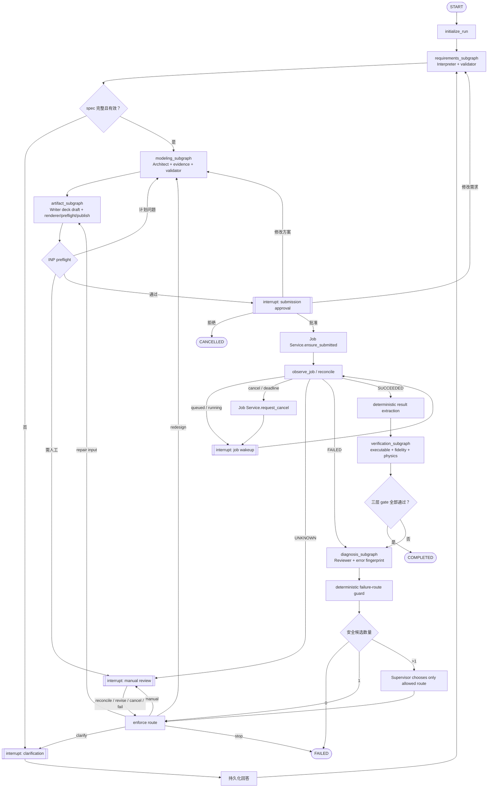

# 一次仿真 Run 的工作流

## 核心规则

父图是确定性的业务状态机；专业 Agent 在受限子图中产生结构化结果；Supervisor 只处理失败后确实存在
多条安全路径的语义分流。所有人工交互和外部 Job 等待都在父图 interrupt，所有 Abaqus 副作用都由
Job Service 独占。

这是一份目标设计。当前仓库还没有实现 LangGraph 父图和子图。

## 父图



Supervisor 不参与幸福路径，也不能：

- 绕过 clarification、preflight 或 approval；
- 直接提交、取消或 reconcile Job；
- 修改全局 phase、artifact 或终态；
- 把未通过三层 gate 的 run 标记为 `COMPLETED`。

父图在调用 Supervisor 之前先按当前 phase、诊断类别、审批状态、artifact 状态和预算计算
`allowed_routes`，再对输出做枚举校验。

## 专业子图

| 子图 | Agent | 子图内确定性节点 | 返回父图的 typed outcome |
|---|---|---|---|
| `requirements_subgraph` | Interpreter | schema、单位/数值基础校验、缺失项分类 | spec draft、问题、校验证据 |
| `modeling_subgraph` | Architect | typed retrieval、支持范围和 plan validator | modeling plan、假设、evidence refs |
| `artifact_subgraph` | Input Writer | typed deck draft、deterministic renderer、INP preflight、SHA-256、immutable publish | artifact generation 与 preflight report |
| `diagnosis_subgraph` | Reviewer | 日志解析、错误指纹、进展比较和预算判定 | diagnosis 与 patch proposal |
| `verification_subgraph` | Verifier | 结果提取后的 executable、fidelity、physics 检查 | 三份 gate report 与证据 |

每次调用使用 `subgraph.compile(checkpointer=None)`，继承父图 checkpointer 并保持 per-invocation 状态。
这让子图内部能够 checkpoint/interrupt，同时避免多次修复调用共享私有消息或产生 namespace 冲突。
首版不使用 `checkpointer=True` 的 per-thread 子图记忆，也不使用 `checkpointer=False` 关闭子图持久化。

父子图 state schema 分开：wrapper 将父图当前 spec、plan 或 artifact 引用映射成子图输入，再把 typed outcome
映射回父状态。子图不使用 `Command.PARENT` 任意跳转。依据见 LangGraph 官方的
[subgraphs](https://docs.langchain.com/oss/python/langgraph/use-subgraphs) 与
[persistence](https://docs.langchain.com/oss/python/langgraph/persistence) 文档。

## Graph State 与 Runtime Context

父图 State 按以下区域组织，并保持 JSON round-trip：

| 分区 | 内容 |
|---|---|
| identity | `schema_version`、`run_id`、`thread_id`、`workflow_version`、配置指纹 |
| request | 原始请求、request revision、带稳定 ID 的 clarification entries |
| requirements | 当前 spec、revision、缺失项和 validation refs |
| modeling | 当前 plan、revision 和 retrieval evidence refs |
| artifact | candidate/approved artifact ID、generation、digest 和 preflight ref |
| approval | pending action 与 decision ref；决定实体在应用 DB 中 |
| execution | Job ledger ref、idempotency key 和最后观察投影；ledger 才是真相 |
| diagnosis | error fingerprint、diagnosis 与 repair history refs |
| verification | executable/fidelity/physics 三份报告与证据引用 |
| control | phase、预算、计数器、last event sequence 和 terminal reason |

模型客户端、Agent registry、Job Service、repository、Artifact Store、Retriever、Validator、Result Extractor、
Clock、ID factory、Trace sink 和 Workflow policy 通过 `context_schema` 的 Runtime Context 注入。checkpointer
是 graph compile-time 基础设施，不在 Context；任何 client、DB session、secret、INP、ODB、完整日志或
原始 CoT 都不能进入 State。会影响结果的 model、prompt、graph、policy、executor 和 solver 配置只把版本或
digest 固化进 run。

LangGraph 官方 [Graph API](https://docs.langchain.com/oss/python/langgraph/graph-api) 将 model、数据库连接等
run dependency 作为 Runtime Context 的用途；本项目按这一边界实现。

## Interrupt

### 人工 interrupt

首版只有三类：

1. `clarification`：缺失字段、问题、spec draft 和 spec revision。
2. `submission_approval`：spec/plan revision、artifact generation、SHA-256、executor profile、solver config
   和资源摘要。任一绑定内容变化，旧审批立即失效。
3. `manual_review`：用于 UNKNOWN、重复故障、预算耗尽、不支持问题或物理结果无法自动判定。人工可以
   选择 reconcile、修改需求、重设计、取消或失败，但不能绕过 gate 直接写 `COMPLETED`。

每个 interrupt 节点只有一个 `interrupt()`；payload 和 resume value 是 JSON 可序列化 typed model；
interrupt 前不写新的 event、approval 或其他非幂等副作用，resume 后在独立节点以稳定业务键持久化。
首版一个 run 同时最多一个 pending action。

LangGraph 官方 [interrupts](https://docs.langchain.com/oss/python/langgraph/interrupts) 说明 resume 会从该节点
开头重新执行，因此审批和提交必须是两个节点，interrupt 前的副作用也必须可重放。

### 机器 interrupt

`job_wakeup` 表示图暂时让出执行权，不是人工审批。payload 包含 `run_id`、`job_record_id`、`not_before`、
`reason` 和 `schema_version`。Coordinator 根据应用 DB 中的非终态 run 和 deadline 轮询/对账，再以 typed
`WakeSignal` 恢复父图。checkpointer 只保存等待点，不负责定时调度；图内不使用长时间 `sleep` 占住 worker。

取消同样通过持久命令唤醒：API 写 `cancel_requested`，Coordinator 恢复图，Job Service 发出定向取消，
父图再次等待并确认外部进程实际停止。

## Phase 与预算

目标 `WorkflowPhase` 需要演进为以下明确阶段；这不是当前枚举已经完成的声明：

```text
RECEIVED → INTERPRETING → AWAITING_CLARIFICATION → DESIGNING → BUILDING
→ PREFLIGHTING → AWAITING_APPROVAL → SUBMITTING → AWAITING_JOB
→ REVIEWING / VERIFYING / AWAITING_INTERVENTION
→ COMPLETED | FAILED | CANCELLED
```

不同失败类型使用不同计数，不用一个通用 `loop_count`：clarification turns、structured-output retries、
preflight repairs、solver attempts、solver repairs、redesign attempts、consecutive same failure 和
reconciliation attempts。初始默认值属于可配置 policy snapshot，并用 Gold cases 调整，不能描述成经验最优。

Reviewer 只诊断，Writer 才修改。每次修改产生新的 immutable generation 和 digest；digest 改变使旧审批
失效，首版所有修复产物都需重新审批。相同 digest 不得作为新的 solver repair attempt 再次提交；相同错误
指纹且 digest 没有有效变化算 no progress，达到预算后转人工或失败。

## 完成不变量

1. 只有父图可以改变全局 phase 和 workflow 终态。
2. 只有 Job Service 可以提交、取消或 reconcile Abaqus。
3. 没有绑定当前 revision、artifact digest 和 executor profile 的有效审批，不得进入 submit。
4. 一个幂等键最多一个逻辑 Job；`UNKNOWN` 禁止自动重提。
5. terminal workflow 不再执行 Agent 或 Job 节点；terminal Job 不回退。
6. 新 artifact generation 不覆盖旧 generation。
7. Job result、ODB 与验证证据必须能追溯到同一 artifact digest 和 external handle。
8. Verifier 不改模型，Reviewer 不改 artifact，Supervisor 不越过 guard。
9. `COMPLETED` 当且仅当 executable、specification fidelity、physics validity 全部通过。
10. deadline 到达不等于 Job 已停止；确认停止后才能写 `TIMED_OUT` 或 `CANCELLED`。
11. State 始终可 JSON round-trip；Runtime client 和大型 artifact 不进入 State。
12. checkpoint 不是应用事务或 Abaqus exactly-once；恢复必须先 reconcile。
13. event、human action、Job transition 和 artifact publication 都有稳定业务键，在节点重放时去重。
14. prompt、model、graph、policy、solver config 与 artifact 都留下版本或 hash。

## 相关文档

- [完整系统框架](../system-framework.md)
- [Agent 与首个完整实现范围](../agent-implementation-scope.md)
- [Abaqus Job 生命周期](job-lifecycle.md)
- [ADR-0002：使用 LangGraph 构建分层多 Agent 系统](../../adr/0002-langgraph-hierarchical-multi-agent.md)
- [ADR-0003：分离可恢复控制平面与 Abaqus 执行边界](../../adr/0003-durable-control-plane-and-execution-boundary.md)
- [ADR-0004：以证据和物理验证定义任务成功](../../adr/0004-evidence-first-physics-verification.md)
