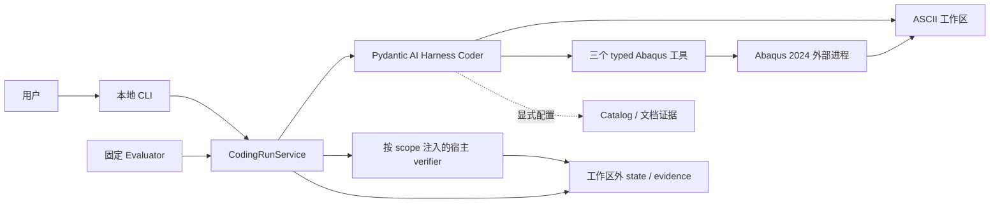

# 项目架构

## 当前系统

Abaqus Sim Agent 是本地 Windows Coding Agent：一个 Pydantic AI Harness Coder 在用户工作区编写普通
Abaqus Python，通过受控工具运行 Abaqus 2024。宿主管理会话、预算、用户问答、执行证据和最终验收。

普通 CLI 的完成表示 `execution_evidence` 通过：交付物存在且 fresh、fresh Python 符合 3.10 语法、
每种已使用 runtime 的最后一次阶段检查通过。它不证明全部自然语言要求或物理正确。固定 evaluator
另行注入模型不可见的 INP/ODB oracle，使用 `task_oracle` 验收指定 Case。

当前已有文件后端的问答、会话续跑和任务修订。FastAPI/Web 已有采纳方案和接线实验，产品实现尚未完成；
外部 Job 对账、数据库控制面、多进程 Coordinator、多 Agent 和 LangGraph 均不在本分支产品调用链。
旧路线与当前路线的关系见 [ADR 索引](../adr/README.md)。

## 核心能力与公开入口

| 能力 / 入口 | 对外含义 | 重要边界 | 实现 |
|---|---|---|---|
| `abaqus-sim-agent` | 在指定或启动目录工作区执行开放 coding goal | 默认不预设板、单元、文件名或物理答案；完成只表示执行证据通过 | [CLI](../../src/abaqus_sim_agent/coding/cli.py) |
| `CodingRunRequest` / `CodingRunOutcome` | strict 请求、预算、产物、验收 scope 和终态 | 模型只申请验收，最终 outcome 归宿主 | [合同](../../src/abaqus_sim_agent/coding/contracts.py) |
| `CodingRunService.run_step` | 执行一个宿主工作段，返回 outcome 或 `WaitingForUser` | 新问答协议用该入口；旧 `run` 保留 settled-result 契约 | [Service](../../src/abaqus_sim_agent/coding/service.py) |
| `ask_user`、`--answer-file`、`--cancel-question` | 持久待答、按问题 ID 回答或取消 | 等待释放锁、不计 active wall；同 ID 同答幂等，冲突答复拒绝覆盖 | [问答](../../src/abaqus_sim_agent/coding/user_questions.py) |
| `--resume`、显式 amendment / task revision | 同一 conversation 继续，或修订配置/任务 | 继承累计预算；新任务换验收基线；未决 runtime 停在 `needs_reconcile` | [恢复](../../src/abaqus_sim_agent/coding/resume.py)、[修订](../../src/abaqus_sim_agent/coding/amendments.py) |
| 三个 typed Abaqus 工具 | CAE 建模、Standard 求解、Abaqus Python 提取 | 工作区路径、后缀、预算、超时与执行记录；不暴露通用 Shell | [工具](../../src/abaqus_sim_agent/coding/runtime_tools.py) |
| 显式 API Catalog 模式 | 精确读卡、错误后提示；`full_with_discovery` 另提供对象方法目录 | discovery 只返回候选，需 exact lookup；lookup/discovery 共用 API 预算并可恢复 | [知识接入](knowledge-access.md) |
| 可选文档、ACI、probe、纯编辑策略 | 按显式 profile 增加证据或约束 | 默认关闭；组合和旧 run 按保存合同处理；接线不代表收益 | [Agent 范围](agent-implementation-scope.md) |
| 固定 evaluator | Gold、verified-seed change、API repair 和检索对照 | 逐 Case 合同与 gate；不等于任意 CAE capability envelope | [验证证据](verification-evidence.md) |

## 组件与状态所有权

| 逻辑组件 | 职责与拥有的状态 | 主要实现 |
|---|---|---|
| Coder 装配 | 模型、文件能力、领域 Skill、工具白名单和单次依赖；不拥有最终验收 | [agent.py](../../src/abaqus_sim_agent/coding/agent.py) |
| CodingRun 宿主 | request/launch、turn/revision、问答、累计 usage、history、恢复和 outcome | [service.py](../../src/abaqus_sim_agent/coding/service.py) |
| Harness 步骤存储 | 模型/工具事件、settled snapshot 和 tool effect；不能恢复外部 Job | [harness_compat.py](../../src/abaqus_sim_agent/coding/harness_compat.py)、[resume.py](../../src/abaqus_sim_agent/coding/resume.py) |
| Abaqus runner | 固定 launcher、输入校验、子进程、raw logs、execution result 与文件变化 | [abaqus2024.py](../../src/abaqus_sim_agent/execution/abaqus2024.py) |
| 产品 verifier | declared deliverables、freshness、语法和 runtime stage 的执行验收 | [execution_verifier.py](../../src/abaqus_sim_agent/coding/execution_verifier.py) |
| 评测与物理 verifier | 固定任务、可信种子、oracle、逐 Case 成败和冻结报告 | [evaluation](../../src/abaqus_sim_agent/evaluation)、[verification](../../src/abaqus_sim_agent/verification) |
| 知识组件 | Catalog 卡片、文档索引及查询证据；不拥有物理事实和任务成功 | [api_catalog](../../src/abaqus_sim_agent/api_catalog)、[retrieval](../../src/abaqus_sim_agent/retrieval) |

包按活动组件组织。产品 `coding` 拥有 verifier port，具体物理 verifier 从外侧实现；普通 CLI 装配产品
执行 verifier，evaluation 装配 Case oracle。当前部分可选文档服务仍复用 `evaluation` 内算法，不能仅凭
目录名断言严格依赖隔离或把它们当无用实验删除。部署与数据边界见 [系统框架](system-framework.md)。

## 运行拓扑

宿主 Python 3.12 与 Abaqus Python 3.10 分开；通过文件和受控命令协作。state 使用 JSON/JSONL 与
Harness 文件存储，同一 state 有 OS 独占锁。文件记录支持本地会话续跑，不提供数据库事务或跨 worker 调度。

## 当前限制

- 模型可能漏问、误选 API 或耗尽预算；Provider 中断也会阻止交付。问答机制只保证已经提出的问题能安全交接。
- 生成脚本是动态 Python。禁用通用 Shell 与路径 allowlist 不构成恶意代码沙箱；CAE 内部提交 Job 的
  静态阻断尚未实施，见 [PLAN-0011](../plans/todo/0011-block-solver-submit-inside-cae-script.md)。
- 恢复要求 workspace 和保存的边界一致；未决 Abaqus effect 不自动重跑，也没有人工 reconcile 后解锁或 PID 重新附着。
- 固定 plate/bar/beam 与模型变更案例只证明各自冻结合同。不同 Prompt、协议或批次的成绩不能合并成当前成功率。
- 知识接线、命中、读卡、任务采纳和物理收益需要分别验证。当前支持结论与历史证据由
  [验证证据入口](verification-evidence.md)集中路由，不在本页维护实验流水账。

## 继续阅读

- [一次 CodingRun](flows/simulation-run.md)：问答、恢复、修订与终态。
- [Solver 生命周期](flows/job-lifecycle.md)：外部进程与崩溃边界。
- [Agent 与权限范围](agent-implementation-scope.md)、[知识接入](knowledge-access.md)。
- [技术栈与讲解点](technology-stack.md)、[ADR 索引](../adr/README.md)。
