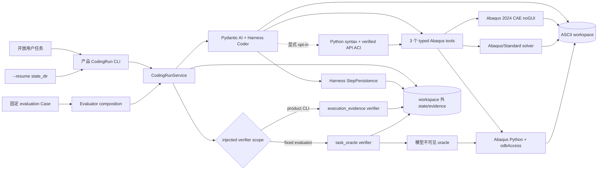

# 项目架构

## 先建立一个印象

Abaqus Sim Agent 当前先做一件可验证的事：让一个 Pydantic AI Harness Coding Agent 在隔离工作区里编写
普通 Abaqus Python，通过三个受控的 Abaqus 2024 运行工具完成建模、求解和 ODB 提取。普通CLI由宿主验证
执行与fresh产物；固定Gold另用独立oracle，新hybrid评测将数值检查与人工工程审查分开。

首轮不是 LangGraph 多 Agent、DeckDraft renderer 或 Web/数据库控制面。旧的 Graph State、角色 Protocol、
`StructuredModelPort` 和 Mock Executor 源码已清理，相关历史决定与实验记录保留。FastAPI、
SQL、DBOS、持久 Job ledger、外部 Job 崩溃对账和多进程 Coordinator 也尚未形成产品能力。普通 CLI 已
实现文件后端的中断会话续跑，但不等于 durable Job runtime。

新建目标Go/V4-Flash run使用宿主strict有效配置：thinking enabled/high、默认10次SDK额外重试、
60秒可配置HTTP超时、Planning开启且不附加低单响应token cap。CLI与新任务候选装配共用配置映射；
launch v3及新默认v4保存有效值，旧v1/v2只构造provider-default兼容视图，不改写原文件或重套新默认。
推理策略run内固定；不兼容provider/model amendment在既有state锁内、任何ledger/终态变更前拒绝。
新run允许先读取用户工作区事实再澄清，不能补造缺失物理参数；旧run和旧Gold指令保持legacy。
Go DeepSeek自2026-09-14恢复框架原生reasoning_content回传，移除历史禁用覆盖；
持久历史中的ThinkingPart继续通过原字段送回。此为工具调用协议修正，不改变enabled/high或补造历史推理，
不改写旧实验与launch；使用新适配器继续旧run不等于复现旧版线上请求。
新默认CLI以ask_user(question)交接用户输入，宿主保存waiting_for_user后释放运行锁，Console答复不消耗active wall；
resume先展示未答问题或按ID提交答案。launch v4/resume v5与问题记录拥有该协议。
新CLI显式API Catalog支持与ask_user组合，full暴露主动查询，automatic模式仍只在错误后送达证据；
旧保存run按原launch恢复，Gold、旧--answers及其他未迁移profile继续legacy。
已有Abaqus执行后的新答复建立task revision，使旧产物不能验收新要求；这不保证模型会主动识别缺参。
实现与边界见[ADR-0024](../adr/0024-host-owned-user-question-waiting.md)。
这只证明离线发送与合同一致，不证明服务端实际执行high或任务成功收益。见
[配置实施记录](../plans/done/0005-align-target-agent-runtime.md)；新任务基线仍是
[未封存候选](../plans/todo/0006-domain-task-evaluation-baseline.md)。

项目继续服务于秋招：当前可以从真实代码讲清 strict Pydantic 合同、Pydantic AI tool loop、Harness 编码
能力、工具白名单、澄清循环、Windows 外部进程、vendor Python 边界、artifact 指纹、独立物理验证与重复
评测及文件后端待答恢复；SQL/API/外部Job持久调度只有以后真实实现并验证后再加入项目主线。

首轮决定见 [ADR-0008](../adr/0008-pydantic-ai-harness-abaqus-coding-run.md)，成功定义继续遵循
[ADR-0004](../adr/0004-evidence-first-physics-verification.md)，中断续跑边界见
[ADR-0020](../adr/0020-resume-coding-runs-with-harness-step-persistence.md)。

可选纯编辑入口 `--edit-scope-file` / `CodingRunRequest.edit_scope` 由调用方冻结一个现有 Python 文件、
初始原文/hash 和一个完整表达式区间；宿主在文件写入前限制范围外文本不变及引用表达式形式，不注册
Abaqus runtime。`edit_scope_state.json` 在 workspace 外保存合同绑定、已提交 hash 和 pending 标记；
resume/amendment 不重绑范围，漂移或未决写入失败关闭。该能力只证明编辑权限边界，不证明引用/API/物理
正确，不是 OS sandbox 或跨进程工作区事务；默认 CodingRun 不受影响。见
[ADR-0023](../adr/0023-constrain-explicit-reference-edits-before-writing.md) 和
[`ReferenceEditScope`](../../src/abaqus_sim_agent/coding/edit_scope.py)。

三个 from-scratch Gold reference/oracle 已在本机 Abaqus 2024 完整版跑通持证集成。二维板得到 80 个 `CPS4R`、右边平均
`U1=0.10000000149 mm`、平均 `S11=210 MPa`、左边总 `RF1=-4200 N`；三维杆得到 80 个 `C3D8R`、
189 个节点、`100/10/10 mm` 三向跨度、`21/3/3` 坐标层、`U1=0.1 mm`、`S11=210 MPa`、
`RF1=-21000 N` 和 Y/Z `-0.003 mm` 泊松收缩；B31 梁得到 20 个单元、21 个节点、`U1=0.1 mm`、
左右 `RF1=-/+21000 N` 和全梁 `SF1=+21000 N`，并核对材料、截面、Step、连通和 INP contract。
它们验证真实 runner 与对应 verifier；
早期 OpenCode Go 的 transport/retry 与 Prompt v2 B0/B1 实验均未通过。Prompt v3 先用官方/reference-backed
Skill和精简 Harness 往返把 B0 no-retrieval 稳定为 3/3，再以同一代码运行 B1 Exact
API Catalog；B1 为 1/3，且唯一通过的 run 没有实际 lookup。当前单 Coder 闭环已通过 smoke gate，但仍
没有在该从零建板题观察到 Catalog 收益。随后新增的多 API repair benchmark 将已有脚本修复与从零建模
分开：无 runtime note 的三个 holdout 交错三轮后，Skill-only 为 8/9、full Catalog 为 9/9；这首次观察
到 Catalog 在修复/调试任务中的增量，但仍只覆盖三个 API 家族。
把 note 投递、本地化指纹和 Planning 浪费修正后，从零建板 Prompt v4 的 Skill/full/automatic 三臂为
2/3、2/3、3/3。当前证据不支持“从零建模不需要 Catalog”，而支持把错误触发 verified note 作为低干扰
候选；是否扩大到其他从零场景仍需新的 Gold。

final8 针对后续暴露的 `Part.BaseSolidBox` 和 `PartInstance.Set` 两种失败增加了确定性修复路由。前者在
`AttributeError` 后返回同 owner 的合法名称，后者返回合法 owner 下的同名方法；两者都不返回 Card、
不使用向量检索且不消耗 lookup/note budget。两个 Product-Agent regression 各运行一次并均通过：前者
实际采用提示后以 8 次模型请求、2 次 CAE 修复，后者在首次 CAE 前自行修正后以 6 次模型请求、1 次 CAE
通过。第三个 BeamSection DEV regression 在 Skill 无直接覆盖、无 runtime note 时由
`automatic_exact_signature` 注入紧凑官方签名并完成最小修复。该 3/3 只证明已知回归路径可工作，
不构成稳定成功率或广泛 API 覆盖。

三维杆随后用于 Concept 工具的真实任务消融。automatic verified-note control 为 2/3，唯一失败是任何
Abaqus 调用前的网关超时；只暴露 Concept tool 的中间组虽为 3/3，但 0/3 发起查询，不能归因于 RAG。
加入 prompt-only `concept-tool-from-scratch-preflight-v1` 后查询采用率为 3/3，闭环仍为 2/3，失败 run 在
40 次模型请求和 12 次 CAE 调用后耗尽预算且未进入 Solver。control 和 preflight 都通过 smoke gate，当前
没有观察到成功收益；[冻结证据](../../benchmarks/coding/bar_tension_3d_concept_evaluation_20260824.json)
仍只代表一个简单三维题、每臂三次。

历史 r2 final8 复跑为 1/3；新的 r3/45m 配置为 2/3，通过当前 3D Gold smoke gate，完成 transport 的
两次均通过 hidden oracle。唯一失败仍是文件或 Abaqus 副作用前的 Go timeout。额外 retry 没有证明挽救
任一成功 run，且所有尝试短于 1800 秒，所以不能把改善归因于 retry=3 或 45 分钟上限。当前只接受该
3D Gold 配置，不接受更广义的 Baseline-v1；没有使用 eval retry 或重复到通过。
[冻结证据](../../benchmarks/coding/bar_tension_3d_final8_baseline_20260824.json)。

B31 首轮 Product-Agent smoke 为 0/3 transport failure；v2 首次完成物理解并暴露 verifier 对 BeamSection
integration 的过约束。接受官方允许的 `BEFORE_ANALYSIS` 与 `DURING_ANALYSIS` 后，v3 为 1/3：一次
完整 oracle 通过、一次 Go HTTP 500、一次在完成 CAE/Solver 后耗尽 Abaqus budget。只把 Catalog 改为
full 的 v4 同样为 1/3；两个进入任务的样本均用满 4 次 lookup，但没有观察到 gate 或聚合调用量收益。
automatic-exact-signature v5 仍为1/3且唯一成功未触发 lookup。当前 full final9/no-Shell v6 首次达到2/3：
一次文件前 timeout，两个 task-started attempt 均通过完整 oracle，分别使用28/10与12/3次模型/Abaqus调用。
v6 没有 `Method.parameter` 查询，因此只确认冻结配置通过 B31 gate，不确认参数级跨模型收益或配置改动因果。
[冻结证据](../../benchmarks/coding/beam_tension_b31_evaluation_20260824.json)。

现有模型变更作为独立 L1 能力加入，不替代从零 plate Gold。suite 只接受一个已完成并通过 private oracle
的 plate CodingRun，核对 request/outcome/verification 与六个 artifact hash 后缓存两份源脚本 bytes；
每个 attempt 从缓存建立 seeded workspace。L1 覆盖三个正交 Case：中心孔几何/网格拓扑、双材料
partition/section/共节点界面、规定位移改均匀 surface traction。共享层只负责 source、Agent runtime、
snapshot/diff 和三阶段 provenance，三个 INP/ODB physics verifier 保持独立。中心孔 v2 保持 source
`extract_results.py` byte-for-byte 不变，孔洞拓扑、孔边离散和应力集中只由 hidden oracle 验收；shared
runtime 的 Catalog 默认 off，但可为已复现 API-binding 缺口显式选择现有 mode/binding。

三个 deterministic reference 均通过真实 Abaqus 2024。双材料正式三重复为 2/3。载荷首批有一个正确完整
解因 ODB surface 名自动大写而被 verifier 误拒；修正后 replay 通过，但 corrected off 三重复仍为 0/3；
冻结其他合同后，full Catalog treatment 为 2/3。中心孔 v2 正式为 1/3：两次 pre-Abaqus Go timeout，唯一
task-complete attempt 在 hidden oracle 发现 partition 造成的边界集合回归后完成修复并通过。suite 必须每个
Case 都通过自己的 2/3；没有运行混合 retrieval 配置的全套批次，中心孔又未过，因此当前仍不能声明整体
通过。[历史证据](../../benchmarks/coding/plate_model_change_suite_evaluation_20260825.json)，
[treatment 证据](../../benchmarks/coding/plate_model_change_treatments_20260825.json)。
load-mode 的 budget-only `48/18/3` follow-up 同样为 2/3；它容纳了一条 44-request 成功轨迹，也产生一条
48-request、16 次 Abaqus、0 Solver 的失败轨迹。预算现为显式 evaluator 参数，默认仍为 `36/12/3`。
显式 typed-probe 协议另把 diagnostic execution、typed conclusion 和 production adoption 分开持久化，并
以 Case-owned target allowlist、hash change 和 runtime gate 约束状态转换。v1 诊断批次 0/3 后修正 target
所有权与记录往返；`typed-probe-convergence-v2` 在 full Catalog `48/18/3` 下为 2/3，与 protocol-off
control 相同。两条通过没有 probe，失败轨迹只有 7 条 inconclusive，因此当前没有任务收益或 validated
adoption 的 Product-Agent 证据。
重复的 Set→Surface gap 随后通过独立 licensed 微回归人工晋升为 final9 的
`Model.SurfaceTraction.region` scoped note。final9 保持 5,481 cards/48 conflicts；
同配置 Product batch 中 note 投递和 `Assembly.Surface` 采用均为 3/3，两条 task-complete 通过，另一条在
独立 directionVector 错误后遇到 tool infrastructure。gate 仍为 2/3，因此只确认 region-binding 行为收益。
随后只扩展 resolver：`Method.parameter` 返回参数签名、官方描述和 scope 匹配 note，不改变 final9 卡片；
fixed benchmark 为 16/16。同配置 Product batch 仍为 2/3，但 directionVector 参数查询和两点向量采用均为
3/3，前批 directionVector API 错误未重现。失败样本遗漏 `follower=OFF` 后误读聚合 verifier 反馈，并通过
Python subprocess 间接调用 Abaqus，最终耗尽模型预算；后续问题已转为反馈精度与执行边界，不再继续增加
SurfaceTraction 专用语义。
follow-up 从 Product Coder schema 移除通用 Shell，并把 traction verification 拆为 count/type/magnitude/
direction/follower/surface 字段。上一批真实失败 artifact replay 只报 `follower_actual=true`；新 Product
三重复为 3/3，三次均为 3 次 Abaqus、1 次 Solver，且 history 无 `run_command`/subprocess。该批证明正常
路径不受影响；没有触发字段级修复，2/3→3/3 也不作因果成功率声明。
后续对162份history、745次typed runtime call复审，使用三个licensed fixture把反复出现的容器与ODB
边界收敛成final13；真实B31触发并经独立licensed probe确认`beamOrientation`后，当前final15仍为
5,480 cards/48 conflicts、16条verified notes，固定benchmark为27/27；
新增规则覆盖跨维度`setElementType`、Surface SIDE1/SIDE2 edge/face、B31 companion fields、ODB ownership和
BeamSection/orientation分离。Product三重复仅对旧Assembly.Set观察到1/3、14次CAE到3/3、6次的强改善；
Surface为mixed positive，setElementType与BeamSection没有调用节省。三条与Skill重复或无treatment证据的
SectionAssignment/BC/load notes已裁剪。API修好后误读final-output `Invalid JSON`造成多余artifact probe的
问题由`decision-output-tool-clarification-v1`修正，两个单次follow-up均2次CAE通过。final13 automatic真实
B31三重复为1/3：两条pre-file timeout，唯一task-started attempt为24/8次模型/Abaqus调用并采用
FieldOutput note通过oracle；同一无效属性只修一处造成额外提取调用，后续以`same-api-occurrence-scan-v1`
要求下次runtime前检查全部同类出现位置。两项都仍不作稳定率或节省声明。
同题final15 treatment为0/3：一条task-started轨迹31次模型/12次Abaqus/0 Solver后耗尽，另两条为文件前
HTTP500/timeout。两条相关note修复局部API后，失败转移到独立实例、mesh ownership、Set和probe/check脚本；
`same-api-occurrence-scan-v1`没有观察到任务收益。该批还暴露CAE`MeshNodeArray`被ODB note越界匹配，当前
router已收窄到精确`OdbMeshNodeArray`。后续v7以strict request显式限制CAE/solver/extraction的runtime文件，
正式2/3：一条31/12/0生产修复耗尽，两个pass为9/3/1和11/4/1次模型/Abaqus/Solver，三条均无诊断
vendor脚本或policy denial。v7成为当前B31 profile；结果证明组合配置和正常路径，不证明allowlist单因果收益。
早期advisory preflight被真实B31模型逐次原样绕过，当前由显式`enforced_verified`分级ACI替代：Harness
ToolGuardrail在生产文件落盘前拒绝无效Python 3.10候选，运行申请按authorization→syntax/hash→verified
API blocker→budget→Abaqus→oracle执行；warning不阻断，同一blocker hash不可由模型override。离线21份
正例0 blocker/16 warning、5份licensed负例5/5 blocker，另4个B31实机失败家族4/4 blocker。首次正式
treatment三条均在文件前Go timeout，0次ACI/Abaqus，故默认仍off且未替代v7。
B31 后续复用同一 verified-seed 原则，但使用独立 beam source loader 和 verifier。source
`beam-1f4ef88fd5dc` 的 request/outcome/verification 与六个 artifact hash 经重新校验后，只复制两份脚本；
Agent 将截面10×10改为20×10，原 extractor 必须逐字节不变。deterministic reference为1/1；off/off/
no-Planning Product batch为3/3，三次均3次Abaqus/1次Solver，20×10、U1≈0.1、RF1/SF1=±42 kN、空
extractor patch和全部回归通过。[冻结证据](../../benchmarks/coding/beam_section_change_evaluation_20260827.json)。
同一 verified source 的正交 bending Case 要求同时修改 build 与 extractor：删除右端U1规定位移，增加 +Y
1000 N CLOAD，并把结果合同改为U2/RF2/RM3/最大SM。deterministic reference为1/1；off/off/no-Planning/
no-Shell v1 batch为3/3但分别使用8/9/6次Abaqus。轨迹审计发现RM/SM读取边界与最大弯矩定义未公开，且
verifier把U/RF/SF实现成子集判断；修正exact contract后，中间read-card treatment严格回放仅1/3。当前
`declared_odb_contract_v2`正式与严格回放均3/3，三次都为1次CAE+1次Solver+1次production extractor、无
diagnostic脚本，总Abaqus调用23→9；Skill和retrieval保持不变。
[基础闭环](../../benchmarks/coding/beam_bending_change_evaluation_20260827.json)；
[收敛与合同证据](../../benchmarks/coding/beam_bending_convergence_evaluation_20260827.json)。
决定见 [ADR-0011](../adr/0011-verified-seed-model-change.md) 与
[ADR-0012](../adr/0012-per-case-model-change-suite.md)、
[ADR-0013](../adr/0013-host-owned-model-change-acceptance.md)、
[ADR-0014](../adr/0014-typed-probe-convergence-protocol.md)、
[ADR-0015](../adr/0015-disable-general-shell-for-product-coder.md)。
[ADR-0018](../adr/0018-enforce-verified-abaqus-aci.md)记录分级ACI及其不可由模型绕过的边界。

## 当前核心能力与入口

| 核心能力或入口 | 对外含义与适用场景 | 关键状态、副作用或失败边界 | 主要实现位置 |
|---|---|---|---|
| `abaqus-sim-agent` CLI | 在显式或启动目录工作区运行一次开放的 Abaqus 2024 coding task；支持文本/JSON goal、控制台或 scripted clarification | 默认不预设 plate、单元、网格、文件名或物理答案；以 `execution_evidence` 完成，只证明 fresh artifact、Python 3.10 语法和最后一次已用 runtime stage | `src/abaqus_sim_agent/coding/cli.py`、`coding/execution_verifier.py` |
| `CodingRunRequest` / `CodingRunOutcome` | 固定 run、runtime、路径、可选runtime-file allowlist、澄清策略版本、预算、澄清、usage、artifact、verification scope 和终态的 strict typed contract | ready decision须声明去重的workspace-relative deliverables；产品要求逐项fresh；allowlist默认null；`execution_evidence`不等于`task_oracle` | `src/abaqus_sim_agent/coding/contracts.py` |
| `abaqus_2024_coder` | 使用 Harness `Coder` 与包内领域 Skill 编写、检查和修复工作区文件 | 只有 `needs_input / ready_for_verification / failed` 三种 typed decision；不能写最终成功 | `src/abaqus_sim_agent/coding/agent.py`、`src/abaqus_sim_agent/skills/abaqus-2024-coding/SKILL.md` |
| 三个 Abaqus 工具 | 分别运行 CAE `noGUI` authoring、solver Job、Abaqus standalone Python/`odbAccess` | 只能使用工作区内受控后缀文件；Solver只摘录显式/非零高信号诊断，忽略普通 `ERROR TOLERANCE` 和零计数状态行；不自动修复；调用次数受预算 | `src/abaqus_sim_agent/coding/runtime_tools.py`、`src/abaqus_sim_agent/execution/abaqus2024.py` |
| `CodingRunService` | 拥有模型 turn、task revision、澄清、history、累计usage/wall clock、恢复、独占执行、验证反馈和 outcome 聚合 | 基础设施异常形成可续`interrupted`；terminal仅在有新amendment时继续；task revision重置当前证据baseline/offset而不篡改旧outcome；未决Abaqus副作用仍形成`needs_reconcile` | `src/abaqus_sim_agent/coding/service.py`、`src/abaqus_sim_agent/coding/resume.py`、`src/abaqus_sim_agent/coding/amendments.py`、`src/abaqus_sim_agent/coding/run_lock.py` |
| 产品执行证据 verifier | 对开放 CLI 检查 fresh workspace 变化、fresh Python 的3.10语法和每种已用 Abaqus invocation 的最后一次确定性 stage 状态 | 不理解自然语言 goal 的完整交付物，不读取隐藏物理真值，不声明模型物理正确 | `src/abaqus_sim_agent/coding/execution_verifier.py` |
| 测评物理 verifier | 由固定 evaluator 显式注入；用模型不可见的 oracle 独立读取 ODB，核对对应 Case 的完成证据、模型合同与结果 | 不进入普通 CLI；trusted oracle 不注册为模型工具；验证失败只反馈证据，不能被 Agent 自评覆盖 | `src/abaqus_sim_agent/verification/`、`src/abaqus_sim_agent/verification/assets/` |
| licensed evaluator | 从空工作区重复运行 plate、3D bar 或 B31 beam Gold，或从冻结故障脚本运行 API repair case，量化终态、usage 和失败阶段 | 历史 plate v4 automatic 为3/3，但早于 strict clarification event；当前 strict 缺板厚批次为1/3。3D r3/45m final8为2/3；B31 current automatic-final15/allowlist v7为2/3；repair holdout Skill/full为8/9、9/9；均为小样本 smoke | `evaluation/plate_tension.py`、`evaluation/clarification_policy.py`、`evaluation/bar_tension_3d.py`、`evaluation/beam_tension.py`、`evaluation/api_repair.py`、`benchmarks/coding/` |
| verified-seed model change | 重新验证已完成 source 与 artifact hashes，只复制源脚本，对变更需求和原行为分别验收 | plate suite 为逐Case gate且尚无全套pass；独立B31 section change与declared-contract tip-load change均为3/3，后者三次均严格三阶段且把总Abaqus调用23→9；均不等于任意模型修改 | `evaluation/verified_*_seed.py`、`evaluation/model_change_runtime.py`、`evaluation/model_change_suite.py`、`evaluation/beam_*_change.py`、case verifiers |
| 本地官方文档检索 | 构建 Abaqus HTML 的 Chroma Dense 与 SQLite BM25 倒排索引，支持精确 symbol metadata 路由、RRF、query-centric/diagnostic/sealed held-out评测、输入面审计、可选 Coder tool和默认关闭的Solver diagnostic advisory | held-out净增仅1题且区间跨零；diagnostic development中RRF对Dense有条件收益但39个need以文档派生压力题为主；RF3 Agent A/B两臂均3/3且Abaqus/Solver调用相同，不支持默认接入 | `src/abaqus_sim_agent/retrieval/`、`evaluation/retrieval_input_inventory.py`、`coding/concept_lookup.py`、`coding/diagnostic_retrieval.py`、`benchmarks/rag/` |
| Exact API Catalog | 将官方 Scripting Reference、abqpy AST 和 Abaqus 2024 runtime note 合并为可追溯的 method cards，支持紧凑 `Method.parameter`；新目录可显式附加 `Owner.member` 静态声明 | 非向量、不可变、位于 workspace/Git 外；推荐 final15 仍为5,480 cards/48 conflicts、16条verified notes、benchmark 27/27；独立 ODB members v1 附加85条声明，不替换 final15；成员不生成 automatic runtime note | `src/abaqus_sim_agent/api_catalog/`、`benchmarks/api_catalog/` |
| 分级Abaqus ACI | 在production edit和vendor runtime前，分别强制Python 3.10语法与有冻结证据的API合同 | 默认off；verified blocker不可由模型override且checker故障fail closed，未知SWIG/type仅warning；离线精度通过，正式批次无task-started样本 | `coding/aci.py`、`coding/static_preflight.py`、`benchmarks/coding/abaqus_aci_enforced_policy_v1_20260829.json` |

## 当前运行拓扑

模型负责提出和修改代码；宿主负责运行边界、预算、澄清、证据留存和最终 outcome。普通 CLI 的完成范围是
`execution_evidence`；只有固定 evaluator 才用自己的脚本重新提取 ODB，并形成 `task_oracle` 结论。

## 逻辑组件、职责与状态所有权

| 逻辑组件 | 负责什么 | 明确不负责什么 | 拥有的数据或状态 | 主要实现位置 |
|---|---|---|---|---|
| Workspace Resolver | 捕获交互工作目录；eval 要求显式空目录；建立初始与终态 SHA-256 snapshot | 不保存模型 history，不判断物理正确 | 已解析 workspace、state_dir、文件指纹与 freshness | `coding/workspace.py` |
| Agent composition | 组装模型、Harness 文件能力、Skill、StepPersistence、deps、三个 Abaqus runtime tools，以及可选 Catalog/Concept 模式；fail-closed 移除 Coder 自带 Shell | 不拥有 turn 循环、最终 outcome 或 trusted oracle；不提供 `run_command`/宿主 Python；文档按需调用由主Agent判断；不复制 Harness FileSystem | 单次 Agent 配置、settled step snapshot/tool effect、`coder-general-shell-disabled-v1`、`decision-output-tool-clarification-v1`、`same-api-occurrence-scan-v1`；运行期 deps 中的调用计数、delivered note ids 与 execution 记录 | `coding/agent.py`、`coding/instructions.py`、`coding/dependencies.py`、`coding/runtime_tools.py`、`coding/api_lookup.py`、`coding/concept_lookup.py`、`coding/harness_compat.py` |
| CodingRun orchestration | 多turn clarification、typed operational amendment、task revision、累计budget、history、provider中断续跑、verification feedback和终态 | 不解释ODB数值；不重新附着外部Job；新task不能复用旧revision的freshness或execution证据 | immutable base request/launch、amendment ledger、revision snapshot/offset、resume state、StepPersistence、execution journal、历史outcome | `coding/amendments.py`、`coding/service.py`、`coding/resume.py`、`coding/verification_port.py` |
| Abaqus runner | 构造固定 launcher 命令、校验路径、运行 Windows 子进程、超时终止树、保存 raw logs 和 artifact delta | 不判断模型意图或物理通过；普通模型工具不能运行工作区外脚本 | 单次 execution result、raw stdout/stderr、前后文件指纹差 | `execution/abaqus2024.py` |
| Product execution verifier | 对开放任务逐项验证declared deliverables为fresh，并检查fresh Python语法与最后一次已用runtime阶段 | 不证明manifest覆盖自然语言goal的全部语义；不检查固定几何/网格/结果，不把执行成功写成物理正确 | `verification_scope=execution_evidence`、manifest、artifact和execution摘要 | `coding/execution_verifier.py` |
| Evaluation oracle verifier | 为固定Case重新读取ODB并执行模型合同、结果一致性和解析值检查；L1另从INP/ODB联合检查新需求与回归 | 不进入普通CLI；不修改Agent代码，不向模型泄漏oracle | `verification_scope=task_oracle`、oracle request/result、verification report、workspace diff | `verification/run.py`、`verification/plate_change*.py`、`verification/bar_run.py`、`verification/beam_run.py` |
| Evaluator | 定义 from-scratch Gold、verified-seed change、repeat/gate、指标与报告 | 不为失败运行做人工代码修复，不把 synthetic unit test 当 licensed result | evaluation report、summary、gate、seed provenance | `evaluation/plate_tension.py`、`evaluation/plate_change.py`、`evaluation/bar_tension_3d.py`、`evaluation/beam_tension.py` |
| Retrieval baseline | 本地文档加载/切块、Chroma Dense、SQLite BM25倒排、RRF、exact metadata优先拼接、AND/OR held-out scorer和可选Concept tool | held-out点估计RRF高1/30但无稳定收益；默认关闭的文档工具按需调用，RRF另用于可选Solver advisory；不补物理输入 | `var/rag` dense/lexical manifest、held-out seal/attempt/consumption、`concept_lookups.jsonl`和retrieval报告 | `retrieval/`、`coding/concept_lookup.py` |
| 独立运行时证据端口 | 单次有界查询、strict结果合同、来源及依赖校验、技术失败分类；不判断充分性 | 显式CLI/Protocol，未接入Coder；Windows Job监督worker只打开state内索引副本，不改原库；不自动重试或降级 | 宿主state中的request、receipt、实际依赖hash、原始日志；临时索引副本在worker退出后清理 | `retrieval/evidence_contracts.py`、`coding/document_search_port.py`、`evaluation/runtime_evidence_service.py` |
| API Catalog | 原子解析官方 callable article、安全 AST 提取 abqpy class graph/overload；按显式 owner 提取注解成员并保留静态 C3 声明来源；精确查询 method、parameter、member；保留 runtime note/source conflict | 不执行 abqpy，不做 embedding，不把 found 当脚本正确；成员未命中不证明 API 不存在；not-found 提示不占 lookup/note budget | `var/api-catalog` immutable catalog、method/parameter/member 返回去重状态、manifest；schema v2 的成员 sidecar hash 同时进入 run/resume binding | `api_catalog/` |

这些活动组件有意保持为同一 Python package 下的扁平 component map：`coding` 是产品能力，`execution` 是
vendor 副作用边界，`verification` 是宿主可信边界，`retrieval` 与 `api_catalog` 是两种知识组件，
`evaluation` 是外层证据系统。它们不属于同一技术分层轴，也不再套 `capabilities/knowledge/runtime`
总括父层。组件内部可以按 contract、service、tool adapter 和实现职责继续拆分，决定见
[ADR-0017](../adr/0017-package-by-component-coding-run.md)。

verifier port 已由消费方 `coding.verification_port` 拥有，concrete `verification` 单向实现；
`coding.service` 不再依赖 concrete verifier package。`coding.cli` 作为 composition root 仍会同时导入
service 与具体 Case verifier，这是允许的最外层装配关系。旧 `verification.base` 已删除；组件根 facade
也不再转发具体 Case、组件局部 evaluator 或 legacy executor。

## 运行状态和证据放在哪里

- **Agent workspace**：模型可读写的脚本和 Abaqus 产物。三个 Gold 都必须新建 `build_model.py`、
  `extract_results.py`、`results.json` 及各自的 `plate_tension.*`、`bar_tension.*` 或 `beam_tension.*` CAE/INP/ODB，并证明
  相对初始 snapshot 是新的或已改变的；失败终态也会重新 snapshot，避免 outcome 留空或引用较早
  verifier 的旧 hash。
- **State directory**：位于 workspace 之外，保存 `request.json`、`launch.json`、首次
  `initial_snapshot.json`、原子`amendments.json`、原子更新的 `resume_state.json`、增量 `history.json`、Harness
  `step-persistence/`、`execution_results.jsonl`、`coding_run.lock`、`events.jsonl`、
  `api_lookups.jsonl`、`concept_lookups.jsonl`、显式模式下的 `probe_results.jsonl`、`outcome.json`、每次运行的 raw stdout/stderr、oracle request/result 和
  `verification.json`。verified-seed change 还保存 source provenance、initial/final snapshot、
  `workspace_diff.json` 和两份源码 patch；这些证据不向 Agent 暴露。
- **续跑状态**：Pydantic AI message snapshot、累计 usage、Abaqus/solver/lookup 计数、澄清和 execution
  results 可由新进程恢复；`--resume <state_dir>` 在同一 conversation 上开始新 turn。若三个 Abaqus 工具
  留下 started 而无 terminal tool effect，宿主先进入 `needs_reconcile`，不会自动重复运行。恢复还要求
  workspace 与最后持久边界的hash完全一致；同一state由OS文件锁保证只有一个活动执行。运行配置修改重放
  为effective config且不清零usage；新goal形成task revision并使用新的snapshot/execution offset重新验收。
- **本地 retrieval 数据**：`var/rag`，与 CodingRun state 分离且不进入 Git。

这些 JSON/JSONL、Harness snapshot 和文件指纹支持本地单进程会话续跑，但不是数据库事务或完整 durable
workflow checkpoint。当前仍没有外部 Job exactly-once、重新附着、cancel/reconcile 或多用户状态投影。

## 当前支持边界

当前有三个受验证的 Gold contract，均为 `E=210000 MPa`、`ν=0.3`、Abaqus/Standard `Static, General`、
`NLGEOM=OFF` 的线弹性单轴拉伸：100 mm × 20 mm 二维平面应力板使用 `CPS4R` 20×4 网格，板厚故意缺失
并必须先澄清为 1 mm；100 mm × 10 mm × 10 mm 三维杆使用 `C3D8R` 20×2×2 网格；100 mm 长、
10×10 mm 截面的 wire 梁使用 20 个 `B31`。三者都规定右端 `U1=0.1 mm`，并分别提取 U/S/RF 或 U/RF/SF。

plate、3D bar 和 B31 都曾在各自 frozen 配置下通过 Coding Agent smoke gate；B31 current v7为2/3。
plate 的历史3/3早于 strict `kind/impact` clarification event；当前 strict 缺板厚批次只有1/3，不能沿用
历史 gate 作为新合同的稳定性结论。
三个固定合同都不等于项目已经支持任意二维/三维、接触、非线性、动力学、
复合材料或通用后处理。plate L1 有三个固定脚本级变更合同；双材料为 2/3，载荷模式的早期显式 full Catalog
为 2/3、移除通用 Shell/精细 verifier follow-up 为 3/3，默认 off control 仍为 0/3；中心孔 v2 为 1/3。
独立B31 section change和declared-contract tip-load change均为3/3；后者三次都达到三阶段最低调用，但
只有同日、同任务三个样本。尚无同一配置下的多模型变更suite，因此不构成任意现有`.cae`修改或稳定通用
变更能力，也不能把这次合同公开外推为通用prompt规律。

## 当前质量目标和限制

- 不猜物理输入或静默消解会改变物理问题的歧义；Prompt要求澄清 gate 早于 capability、Planning、
  workspace、lookup 和 runtime 工具，宿主另行确定性保证回答前没有Abaqus副作用。用户显式约束优先，
  API/文件实现问题不向用户提问。
- 模型看不到 trusted oracle；Product Coder 不注册通用 Shell/宿主 Python，vendor runtime 只能从模型可见
  的三个 typed Abaqus 工具启动。composition 要求并移除恰好一个 Harness Shell，否则 fail-closed。
- 建模、solver 和 ODB 提取严格分阶段；建模脚本不能提交 Job。
- 进程成功、ODB 存在和模型自报结果都不足以单独通过。
- 失败修复只依据 verifier 和 runtime 证据，并受模型请求、Abaqus、solver、澄清和 wall-clock 预算约束；
  当前普通 CodingRun wall budget 为 2700 秒，API repair 显式保持 600 秒。
- 当前工具边界不是恶意代码沙箱；仅用于本地受控用户和受控模型任务。
- 当前 runner 有同步等待和进程树终止，但没有 durable cancel、崩溃重连或 Job 对账。
- Pydantic AI Harness `0.24.0` 的Windows CRLF hash、Shell超时清理调用POSIX `os.killpg`、并行thread
  追加FileStepStore JSONL覆盖记录三个问题由精确版本、幂等补丁缓解：分别规范化`_content_hash`、用
  `taskkill /PID /T /F`终止准确PID树、串行化event/tool-effect写入。并发记录、文件round-trip与Shell
  timeout测试通过；损坏旧ledger因无法排除effect/event之间的runtime窗口而一律fail-closed。final8 Baseline-v1 的三个
  Product-Agent attempt 没有调用通用 Shell，因此只证明未再观察到 `killpg`，不构成该路径的端到端复测。
  当前 Product Coder 已移除 Shell，进程树补丁只保留为直接 Harness Shell 回归/历史配置证据；未复制
  FileSystem、未修改 `.venv`，升级 Harness 时 no-Shell composition 会先 fail-closed 并要求重新验证。
- automatic runtime note 已声明 `applies_to_parameters`。错误代码与中文 traceback 会提取 `faces`、
  `edges`、`regions`、`side1Edges/side2Edges`、`orientation/geometricType` 等参数；作用域过滤早于 Catalog query 与 budget 计数。`faces=` 会拒绝 edge-only
  `Assembly.Set` note，`edges[0]` 的 seed 正向路径保持可用。
- final output validation 与 workspace artifact validation 分离。若模型没有调用三个 typed decision output
  tool，Pydantic retry中的JSON/schema错误只指向上一条模型响应或tool arguments；不能据此重跑Abaqus或
  修改工作区结果文件。
- automatic AttributeError `not_found` 只返回至多三个确定性 owner-aware 合法名称，不返回 Card、不走
  embedding，也不消耗 lookup/note budget。候选名仍只是修复方向，脚本正确性继续由 Abaqus runtime 和
  verifier 判断。

## 独立 Retrieval 基线

本地 Abaqus 2026 HTML 检索已经独立实现并评测。一次全量 Dense 构建读取 1,609 个候选页面、索引
38,913 条记录，约 309 MiB；历史42条benchmark中，11组paired query的Dense Recall@5为`0.727`，
人工提供symbol/product后的exact-augmented结果为`1.000`，但这不是BM25收益。

随后以相同32,466个semantic records构建SQLite BM25倒排，并让31个唯一query分别进入BM25、Dense和
固定RRF。主要21条自然语言query的Recall@5为`0.714 / 0.857 / 0.762`，MRR为
`0.482 / 0.736 / 0.643`；BM25-only命中1条、Dense-only命中4条。RRF没有把互补性转为总体收益，
所以实现保留为研究路径，但没有替换Agent当前检索。

另一个query-first held-out在两次page/family泄漏检查撤回后，以v3封存30条query、40个requirement和
38个新gold页面。首次Complete Hit@5为BM25/Dense/RRF=`23/30 / 24/30 / 25/30`，Requirement
Recall@5为`0.839 / 0.878 / 0.906`。RRF相对Dense为3胜、25平、2负，但paired bootstrap区间跨零且
sign-test `p=1.0`；v3已消费并禁止继续调参。这说明固定RRF在新页面上可能利用互补性，不足以证明一般
优势或触发Agent接入。

首份v3 seal未预绑定HNSW文件，因此该历史限制继续保留。独立`v3-reproduction-r1`随后在排名前绑定当前
五个HNSW文件、七个MiniLM文件、ONNX provider顺序和运行依赖，并在唯一一次运行中逐项复现30×3共90份
Top-5排名及全部非延迟效果字段。这只补充同一已消费数据的可重放证据，不构成新held-out或RRF收益证据。

随后不再只枚举人工设想的query，而是从CodingRun的goal/revision、Concept/API/diagnostic trace、结构化
execution journal、stdout/stderr、solver日志、verifier、基础设施和clarification等输入生成面做只读清点。
更新后的273个可识别evaluator/development run有3次Concept查询、231次API lookup和3次diagnostic advisory；
strict execution journal覆盖10个run，
因此legacy unknown仍只能regex归纳，不能声称完整或代表生产流量。scanner对任意结构化失败都落known owner
或unknown，并明确排除API/local code、缺文件、基础设施和澄清，不把所有失败都包装成RAG需求。

基于该清点建立了39个need/86个query variant的diagnostic development stress：8个need绑定5份历史`.dat`，
31个从官方故障条件构造；全部gold都映射到索引真实的`document_id + section_id + section_title`。
need-group macro Section Hit@4的BM25/Dense/RRF为`0.504 / 0.453 / 0.521`，MRR为
`0.429 / 0.361 / 0.427`。官方condition fragment上BM25 Hit为`0.839`，但8条observed verbatim excerpt上
BM25为`0/8`，Dense为`3/8`：具体solver日志未必逐字出现在解释手册。RRF相对Dense Hit增加`0.068`，
却没有超过BM25的MRR；这支持继续保留并分片研究两路检索，不支持默认Agent接入。

首轮diagnostic报告保留了未预绑定HTML解析依赖的attestation gap。之后的identical replay在排名前绑定
HNSW/encoder、`lxml`、Pydantic、127个逐Case target、首轮报告和固定检索合同，复现86×3共258份有序
排名及全部非延迟字段。它证明当前环境可重放，不把development set变成held-out，也不追溯修复首轮证据。

在此基础上只增加了一个默认关闭的Solver diagnostic advisory，而没有替换Concept tool：结构化warning/error
触发独立预算的固定Top-4 RRF，证据附在同一个Solver tool return中，检索失败不覆盖原运行状态。RF3
development Case先用不含答案的机械query把正确Plane Stress章节排到rank 1，再以相同seed/Prompt/工具/预算/
oracle做3×2 Agent对照。Control与Advisory均3/3，模型请求总数`42/38`，tool/Abaqus/Solver总数分别都是
`50/15/6`；三次treatment都送达rank-1证据，六次都独立选择RF3→RF1。通过差为0且逐对请求差方向不一致，
所以只证明诊断反馈链可运行，不证明RAG必要、模型逐次采用或任务收益。

这些指标只证明当前本地 retrieval development baseline和一个显式诊断profile，不支持加入RRF默认路径、
CrossEncoder、pgvector或服务化。
三维杆真实消融进一步区分了“暴露工具”“实际查询”和“任务通过”：只暴露工具的 3/3 run 均未查询；
prompt-only preflight 让 3/3 run 在 CAE 前查询，但与 2/3 control 相比仍为 2/3，没有观察到闭环成功收益。
文档工具仍默认关闭。当前显式tool模式注册 `search_abaqus_docs`，接收question和可选observed_context，
在原输入中匹配索引已有符号metadata，并复用exact-symbol-augmented Dense。`docs-tool-selective-v1`
允许运行前后按需查询或零查询，取消旧preflight的固定次数/失败阶段提示。返回原文候选及实际版本，不产生
answered或适用性判断。该接口没有扩大当前语料覆盖。新策略另有六场景、每场景一次的真实模型离线行为
测试：本地证据复用和缺输入澄清符合预期，三个知识问题实际发起检索；但成员查询缺口、AT误识别、产品
范围混入和证据适用范围扩大仍存在。共36次模型请求、0次Abaqus，不是完整仿真A/B或收益证据。API
binding失败与Solver advisory继续使用各自的自动增强入口。优先处理已观察到的检索缺陷，而非直接扩充
整套脚本指南。

独立统一检索候选另支持两个显式开关：`question_only`仅以问题字段检索/重排但保留原context trace；
`page_lexical`在Hybrid全局候选中保留一半，再按排名前两页补充未表示的父单元，沿用全语料BM25 IDF、
范围约束与来源检查，本批保持64候选/4单元预算。默认仍为question+context与flat，不接入产品Agent。
四组各10项development对照中，两组原配置完全复现旧排序/分数/证据；页面补充让Riks必要段落入池，
但重排34、仍未送达。仅问题正文未改善Riks，却让warning问法1的机制段重排7→1并送达，问法2保持
送达；三项必要证据检查由1/3变为2/3。它没有证明应普遍省略context、两个开关组合有效或Riks已解决，
没有新held-out或Agent收益。详情见[召回策略对照](../../benchmarks/rag/recall_policy_ablation_v1_20260910.md)。

后续固定上述20个候选列表，仅更改重排query的40次对照精确复现20个原条件；warning问法1在四池中
均由最佳子片段7/9/7/8升至1并送达，说明其局部收益不要求改变召回。Riks在page-hybrid池中34→21，
仍未送达。显式候选新增 `rerank_question_only`，保留问题+context召回、仅以问题重排，并分开记录
两种query和预算；默认不变。完整流程15条自然语言配置的候选池保持原样，排序/证据与固定池实验一致，
连同符号/版本/预算共30/30一致；必要证据仍只有2/3。新问题泛化和Agent收益未验证，见
[固定池重排与完整流程验证](../../benchmarks/rag/fixed_pool_rerank_v1_20260910.md)。

随后最多双问的生成式拆分仅作独立实验：五条原问题各一次Go/Flash调用，模型只见原输入，原样生成9条
子问题后冻结，在同一page-hybrid64池分别重排并按父单元轮流合并。必要证据交付仍2/3；Riks核心题只
生成一条近似改写，边界条件从原21降为30，补充LPF定义也未送达，不能称该题已测试双问融合。
额外使用5次生成（3767/900 input/output tokens）且重排pair由320增加到576，没有观察到预设指标收益。
不接入默认RAG、不补跑至通过、不据此宣称所有拆分无效，见
[问题拆分对照](../../benchmarks/rag/query_decomposition_v1_20260910.md)。

随后独立的七题证据驱动补查实验比较单轮8单元与最多两轮各4单元，累计证据阅读上限相同并计入首轮重读。
首批17次真实Go/Flash请求中，4个gap仅返回文本JSON而被ToolOutput拒绝，另4个最终回答违反状态/claims合同；
三个有效gap均停止，因此没有实际第二轮检索，不能比较方法收益。事后离线回放定位SDK的V4 profile将隐式
强制工具选择降为auto；文本未被重新采用。来源审计同时区分Riks中心关系未建立、history精度页未入库和
热膨胀关键解释被deferred_math排除；两条原始文本gap还存在充分性误判。该实验不改变默认路径，详见
[证据驱动补查首批](../../benchmarks/rag/evidence_followup_v1_20260910.md)。

输出接口另有独立`evidence-reader-json-v2`：使用Pydantic AI PromptedOutput显式请求JSON对象，不注册输出或
函数工具；schema、精确引文、原问题锚点仍由宿主检查，零输出重试且每次阅读最多一次模型请求。
`insufficient`可携带有引用的背景claims，非关键限定放入`limitations`，`answered`与未解决问题并存仍拒绝。
30项新测试及9条历史响应的本地Mock HTTP回放符合预期，旧批次代码/结果hash保持不变；未做新Provider或
检索调用，充分性误判和来源缺口未修，不能称为新协议的真实模型资格或RAG收益。见
[v2接口验证](../../benchmarks/rag/evidence_reader_json_v2_20260911.json)。

随后3个真实Go/Flash JSON资格场景分别通过完整回答、带引用背景的拒答、合法补查决策；独立Top1链路测试
却在遗漏“规定转角单位”时返回sufficient，第二次检索仍未执行。资格gap与链路gap的可见HTTP JSON请求体
完全相同、匿名session不同，返回follow_up/sufficient；前三次响应带reasoning_content，链路响应没有，尽管
请求均声明关闭thinking。只能确认本次4个JSON接口调用有效，不能声称推理配置一致、充分性可靠或多轮收益。
旧批次与默认路径不变，见[真实资格与链路记录](../../benchmarks/rag/evidence_reader_json_v2_live_20260911.md)。

RAG-only独立候选随后补入一页执行指南，并从旧投影失败公式组拆出说明段，保留全部34,307个旧可检索单元
及33,383个片段。原样16用例双臂回放中，history精度规则由缺页变为重排第1并完整交付；热膨胀说明段虽已
被BM25召回，但重排第63、仍未交付。原10项必要证据检查保持6/10，不能称整体无回归或两题均解决；
不调用生成模型/Abaqus，不切换默认路径，见[入库修复与检索回放](../../benchmarks/rag/ingestion_fixes_v2_20260911.md)。

上述配置现已收敛为显式 `rag-evidence-baseline-v1` 组合对象与 CLI，统一强制关联交付及宿主评分；一次16题
回放逐项复现旧候选和实际证据。7个有标签问题的10项必要条件，候选覆盖9/10、重排Top4与最终交付均6/10，
完整覆盖已标注条件为4/7，必要父单元MRR@64为0.635954；五项guard通过。分数与工程验收分开，不合成总分，
不把开发集等价复现当作质量准入。25项新合同测试、全仓970项测试通过；默认产品仍未改变。见
[基线使用与评分](../../benchmarks/rag/rag_evidence_baseline_v1_20260911.md)。

后续只在固定640个问题—片段对上比较MiniLM、原池顺序和BGE v2-m3。先按原问题修订history背景标签并
补入热膨胀初始/参考温度条件，旧10项仍并列计分；新11项三组最终覆盖均7/11，但后两组丢失稳态热传导
条件，完整题数由MiniLM的5/7降为4/7。BGE的必要证据MRR虽为0.8333（MiniLM为0.7584），仍未满足
完整覆盖不退化的预设选择条件，且本机CPU打分403.13秒对18.07秒。两个替代方案均未采用；默认和旧成绩
不变，没有生成式模型、Agent或Abaqus调用。见[固定池重排对照](../../benchmarks/rag/fixed_pool_bge_v1_20260911.md)。

该冻结组合另已封装为显式 `doc-evidence-result-v1` 运行时端口，未替换Coder旧工具。Windows监督worker
只打开state内一次性索引副本；宿主重核receipt、原库依赖、原文、版本/范围、公式关联与预算后交付四种状态。
完整16题与旧正文/来源/排序/关联/原预算等价；新增溯源字段计入4000-token上限，最大2846。
单次35.56–45.61秒，主要成本是冷启动、私有复制和校验，不能称低延迟服务或质量提高。43项专项与常规
1024项测试通过，持证测试27项跳过；无生成模型/Abaqus调用。已完成
[PLAN-0002](../plans/done/0002-rag-runtime-evidence-service.md)，应用回评/补查的产品接线和模型行为验证仍待PLAN-0003完成。

[PLAN-0003](../plans/done/0003-bounded-evidence-use-in-coder.md)另已实现独立 `DocumentPolicy` 宿主组件：
need登记、精确引用回评、一次补查、共享查询计数、版本化ledger/head以及恢复/修订状态。门禁只放行原执行
检查，不形成物理结论；技术故障不能靠换query/need名重试。45项假端口/假validator测试通过，包括真实第二次
fake查询、来源漂移模拟、坏日志、旧快照补齐和Abaqus计数不增加。
第二阶段已按显式bounded_v1装配同一Coder的唯一文档工具与回评工具、三条runtime/ready/预算耗尽门禁、
CLI严格spec和原生resume。新模式持久launch v2/resume v4；旧off路径仍为v1/v3，不能通过resume关闭策略。
13项新增接线测试和全仓1082项测试通过（27持证跳过）。两次FunctionModel实际驱动真实RAG和重验worker，
各1次检索/3次重验/0次Abaqus并通过报告文件的execution_evidence。它证明实际链路，不是生成模型理解或
自主补查收益；默认仍off。详见
[第二阶段记录](../../benchmarks/coding/document_policy_phase2_20260912.json)。

第三阶段已冻结8类真实模型行为场景及官方原文受控回放，并各发出一次Go/Flash请求。全部在生成前被400
`MissingSessionID`拒绝，0个ModelResponse/有效行为样本/查询/Abaqus调用；它暴露的是当时接入缺少稳定
conversation header，不是模型或RAG表现。原批未重跑并作为无效样本保留。
见[第三阶段无效样本记录](../../benchmarks/coding/document_policy_phase3_20260912.json)。

用户授权后，共享Go adapter已通过稳定conversation hash与项目User-Agent修复，并在全仓1092项测试后另开
batch-2。新批3项通过、4项模型行为失败、1项Provider timeout无效，未观察到合格的补查闭环，8场景gate
未通过；0次live ranking和Abaqus。`bounded_v1`未获行为资格，继续默认off，PLAN-0003以负资格结论完成。
见[最终行为记录](../../benchmarks/coding/document_policy_phase3_batch2_20260912.json)。

成员覆盖的第一步已单独落在 Exact Catalog：`--abqpy-member-owner` 只为显式类集合从已核对
METADATA 的 wheel 提取公开注解和源码注释，成员使用独立 `ApiMemberCard`，不伪装成方法签名或
licensed runtime note。静态 C3 继承保留 public receiver 与 declaring class；歧义 owner、未知基类、
不一致 MRO、条件类体拒绝构建，动态属性及未选 owner 不作不存在判断。新目录使用
`members.jsonl` 与 schema v2 digest，旧 schema v1 仍可读取；CLI 和 evaluator 的 run/resume binding
同时绑定两类内容，不能只验证旧 methods hash。显式 full 模式沿用同一 `lookup_abaqus_api`、预算、
去重与 trace；成员声明不触发 automatic 提示。邻近方法/参数返回也显式带 abqpy 来源版本与路径。

独立 `abaqus-2024-odb-members-v1` 保留 final15 methods bytes，附加 `Odb`、`OdbAssembly`、
`OdbInstance`、`OdbSet`、`FieldOutput`、`FieldValue` 六个 owner 的85条2024.10静态成员。14条
development 成员/邻近查询与确定性 Coder 工具送达均通过，旧、新 method benchmark 均27/27。
这不是模型自主选工具、采用证据或物理闭环收益；`search_abaqus_docs` 没有自动路由到此目录，默认
Catalog、默认文档索引、Riks召回和warning排序均未改变。证据与使用方式见
[ODB成员目录验证](../../benchmarks/api_catalog/odb_member_catalog_v1_20260910.md)。

随后独立的真实Go/Flash局部编辑对照中，旧final15与新成员目录各3次，固定相同任务、Skill、full模式、
`12请求/4次found lookup/240秒`预算，三对交错执行且不运行Abaqus。六次均主动查询同一
`OdbAssembly.nodeSets`；旧组not_found后继续搜索并耗尽模型请求，正确修复0/3；新组三次均收到
2024.10成员卡后只替换授权表达式，execution evidence与固定AST检查均通过，正确修复3/3。
模型请求总数36→18，API尝试36→9，但found计数8→9、输出token2198→2890。它支持本题的真实
证据采用和局部收敛改善，不是通用RAG或物理能力结论。旧组三次在查询参数中生成未发生的错误文本；
新组对旧方法重载来源和假设替换的权限解释仍有混淆，不能把正确patch计数等同于完整解释正确率。
没有补跑、人工修补或默认profile变化，见[真实成员采用对照](../../benchmarks/api_catalog/odb_member_adoption_v1_20260910.md)。

## 关键决定

- [ADR-0004：以证据和物理验证定义任务成功](../adr/0004-evidence-first-physics-verification.md)
- [ADR-0005：有来源地吸收与重构 AbaqusAgent](../adr/0005-traceable-upstream-reuse.md)
- [ADR-0008：首轮采用 Pydantic AI Harness 单 Coder 的原生 Abaqus CodingRun](../adr/0008-pydantic-ai-harness-abaqus-coding-run.md)
- [ADR-0009：使用官方文档、abqpy AST 与运行证据构建精确 Abaqus API Catalog](../adr/0009-exact-abaqus-api-catalog.md)
- [ADR-0010：以显式受预算工具接入官方建模概念检索](../adr/0010-budgeted-official-concept-retrieval.md)
- [ADR-0011：以已验证 CodingRun 作为现有模型变更的种子](../adr/0011-verified-seed-model-change.md)
- [ADR-0012：用逐 Case gate 的正交变更套件扩展 L1](../adr/0012-per-case-model-change-suite.md)
- [ADR-0013：模型变更新指标由宿主 oracle 验收](../adr/0013-host-owned-model-change-acceptance.md)
- [ADR-0014：用 typed probe 协议约束诊断结论和 production 收敛](../adr/0014-typed-probe-convergence-protocol.md)
- [ADR-0017：以扁平组件图组织 CodingRun 产品包](../adr/0017-package-by-component-coding-run.md)
- [ADR-0020：使用 Harness StepPersistence 续跑中断的 CodingRun](../adr/0020-resume-coding-runs-with-harness-step-persistence.md)
- [ADR-0021：用 Amendment 和 Task Revision 延续 CodingRun](../adr/0021-use-amendments-and-task-revisions-for-continuation.md)
- [ADR-0022：先独立评测 BM25、Dense 与 RRF，再决定是否接入 Agent](../adr/0022-evaluate-bm25-dense-rrf-before-agent-adoption.md)
- [首轮 Agent 与实现范围](agent-implementation-scope.md)
- [当前系统框架](system-framework.md)
- [技术栈与工程讲解点](technology-stack.md)
