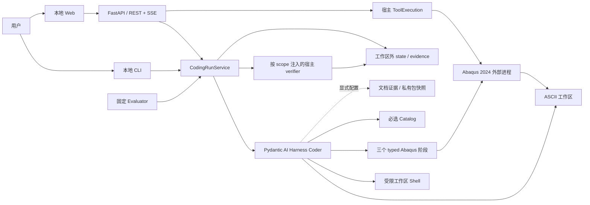

# 项目架构

## 当前系统

配置已采用“程序默认值、本次显式输入、必要会话记录”；偏好读取撤回、内部静态资源准备和固定命令入口已实施，
Catalog 已作为包内资源接入 CLI/Web，原生 provider 与动态模型窗口已接入，见
[ADR-0045](../adr/0045-use-explicit-run-options-without-preference-files.md)及[逐字段修订方案](configuration-reference.md#已确认的修订方案)。

Abaqus Sim Agent 是本地 Windows Coding Agent：一个 Pydantic AI Harness Coder 在用户工作区编写普通
Abaqus Python，通过受控工具运行 Abaqus 2024。CLI 和本地 Web 工作台共用宿主应用入口；宿主管理会话、
预算、用户问答、执行证据和最终验收。

文件或执行请求的完成表示 `execution_evidence` 通过：交付物存在且 fresh、fresh Python 符合 3.10 语法、
每种已使用 runtime 的最后一次阶段检查通过。它不证明全部自然语言要求或物理正确。launch v10 还允许
`ResponseDecision` 直接交付纯文字答复，但不把它描述成文件、执行或物理验收。固定 evaluator 另行注入
模型不可见的 INP/ODB oracle，使用 `task_oracle` 验收指定 Case。

当前已有文件后端的问答、会话续跑、显式任务修订和 Web Thread continuation。FastAPI + React/assistant-ui
工作台、模型预览与宿主拥有的后台 Solver `ToolExecution` 已完成离线工程实现；PLAN-0010 的两条真实
Web 主线仍未执行。外部 Job 对账、数据库控制面、多进程 Coordinator、多 Agent 和 LangGraph 均不在
产品调用链。旧路线与当前路线的关系见 [ADR 索引](../adr/README.md)。

## 核心能力与公开入口

| 能力 / 入口 | 对外含义 | 重要边界 | 实现 |
|---|---|---|---|
| `--phoenix` | CLI/Web 与代表评测入口显式向本机 Phoenix 记录消息、工具和业务 Trace | 默认关闭；服务独立启动和保存数据；不改变 outcome、恢复或本地证据 | [telemetry](../../src/abaqus_sim_agent/telemetry.py)、[ADR-0044](../adr/0044-local-phoenix-observability.md) |
| `abaqus-sim-agent` | 在指定或启动目录工作区执行开放 coding goal | 默认不预设板、单元、文件名或物理答案；完成只表示执行证据通过 | [CLI](../../src/abaqus_sim_agent/coding/cli.py) |
| `abaqus-sim-agent-web` | 从普通回环 URL 创建本地会话；新会话必须先选择已有 ASCII 工作区，之后可发送消息、回答问题并查看执行与产物 | 不自动创建托管空工作区；started 后默认打开浏览器；无感 session + CSRF，仅本机单用户、一个主动模型工作段，REST 写入、SSE 通知重取 | [Web app](../../src/abaqus_sim_agent/web/app.py)、[ADR-0037](../adr/0037-open-loopback-web-with-plain-local-url.md)、[ADR-0041](../adr/0041-require-selected-workspace-for-web-runs.md) |
| `CodingRunRequest` / `CodingRunOutcome` | strict 请求、limits、runtime policy、产物、验收 scope 和终态 | 普通产品 limits unlimited；模型只申请验收，最终 outcome 归宿主 | [合同](../../src/abaqus_sim_agent/coding/contracts.py) |
| `CodingRunService.run_step` | 执行一个宿主工作段，返回 outcome 或 `WaitingForUser` | 新问答协议用该入口；旧 `run` 保留 settled-result 契约 | [Service](../../src/abaqus_sim_agent/coding/service.py) |
| `ResponseDecision` | 对当前问题、讨论或局部请求交付纯文字 | `verification_scope=null`；已有运行或终态工作区变化时不能绕过验收 | [合同](../../src/abaqus_sim_agent/coding/contracts.py) |
| `ask_user`、`--answer-file`、`--cancel-question` | 持久待答、按问题 ID 回答或取消 | 等待释放锁、不计 active wall；同 ID 同答幂等，冲突答复拒绝覆盖 | [问答](../../src/abaqus_sim_agent/coding/user_questions.py) |
| `--resume`、显式 amendment / task revision | 同一 conversation 继续，或修订配置/任务 | 继承累计 usage；runtime policy 可修订，新任务换验收基线；未决 runtime 停在 `needs_reconcile` | [恢复](../../src/abaqus_sim_agent/coding/resume.py)、[修订](../../src/abaqus_sim_agent/coding/amendments.py) |
| Web runtime policy amendment | 在已有会话中修改未来 Abaqus/Solver 提交权限 | 仅空闲且无需对账时可写；待答问题保留，不自动继续或取消执行，累计 usage 不重置 | [Web controller](../../src/abaqus_sim_agent/web/controller.py)、[ADR-0021](../adr/0021-use-amendments-and-task-revisions-for-continuation.md) |
| Web Thread message / continuation | 在同一会话 history 上追加普通消息 | 不推进 task revision；每段独立划定 workspace/execution evidence baseline | [Web storage](../../src/abaqus_sim_agent/web/storage.py)、[ADR-0027](../adr/0027-decouple-web-thread-messages-from-task-revisions.md) |
| Web 停止当前任务 | 中断当前 Agent 工作段及其前台工具，保留已完成工作和累计状态 | 按 operation ID 防止过期停止；后台 Solver 继续运行并单独取消，终态 workspace 精确匹配后再继续 | [取消控制](../../src/abaqus_sim_agent/coding/response_stream.py)、[ADR-0036](../adr/0036-interrupt-web-work-segments-and-manage-background-jobs-separately.md) |
| Web 删除会话 | 确认后结束本宿主受控执行，永久删除会话记录 | 工程文件保留，无回收站；不删除尚无法确认的外部执行记录 | [删除存储](../../src/abaqus_sim_agent/web/deletion.py)、[ADR-0035](../adr/0035-delete-web-conversation-records-and-keep-workspaces.md) |
| Harness 文件与 Shell 工具 | 普通仓库编码、检查、测试和后台命令 | Shell 固定 workspace 并剥离 Provider 凭据；直接 Abaqus launcher 被拒绝；Planning 仅保留历史适配，新运行不启用 | [Agent](../../src/abaqus_sim_agent/coding/agent.py)、[ADR-0032](../adr/0032-restore-restricted-shell-for-product-coder.md) |
| 模型窗口与 context policy | 新普通会话按保存窗口的 90% 触发先清旧 tool result、再按需摘要；旧会话沿原策略 | summary 只改模型 history；typed capability activation 被保留，launch v10 绑定窗口和 Skill digest | [context policy](../../src/abaqus_sim_agent/coding/context_policy.py)、[PLAN-0012](../plans/done/0012-agent-runtime-budget-and-context-policy.md) |
| 三个 typed Abaqus 阶段 | CAE 建模、Solver submit/wait、Abaqus Python 提取 | Abaqus 默认 allow、Solver 默认 deny；可允许有限次数，进程 timeout 默认 unlimited；普通会话的 `solver_job` 分离提交和等待 | [工具](../../src/abaqus_sim_agent/coding/runtime_tools.py)、[ADR-0033](../adr/0033-split-solver-submit-and-wait-actions.md) |
| 执行前语法检查与可选静态反馈 | Python 3.10 解析失败阻止本次脚本执行；BasedPyright 诊断随运行结果返回 | 编辑可保留半成品；静态分析默认 off，无 API 案例阻断或原样重试逃生口 | [ADR-0038](../adr/0038-unify-runtime-syntax-and-static-feedback.md) |
| Web Solver `ToolExecution` | 在宿主后台运行并观察 `solver_job(action=submit)` | submit 立即返回 execution ID；wait 读取同一结果；当前宿主可取消，重启中的活动进程不重附着 | [controller](../../src/abaqus_sim_agent/web/controller.py) |
| 必选 API Catalog 与显式模式 | 默认仅在错误后附 verified note；`full` / `full_with_discovery` 可暴露主动查询 | 新 CLI/Web 自动读取并绑定包内 Catalog，无需配置路径；默认模式不暴露查询工具，discovery 候选仍需 exact lookup | [知识接入](knowledge-access.md)、[ADR-0040](../adr/0040-require-api-catalog-for-product-runs.md) |
| UTF-8/CP936 工作区文本 | Abaqus 生成文本可正确读取、搜索、编辑和 Web 预览 | 编码严格识别；已有文件保持原编码，新文件 UTF-8，hash 绑定原始 bytes | [Agent 范围](agent-implementation-scope.md) |
| 本机私有领域知识包 | 从用户级应用数据目录列出，并由新 CLI/Web 会话显式选择一个或多个包 | 默认 off；launch v10 绑定不可变 state 快照，包只提供参考文本，不增加 instructions、工具、权限或验收语义 | [知识接入](knowledge-access.md)、[ADR-0029](../adr/0029-discover-private-knowledge-from-user-data.md) |
| 可选文档、ACI、probe、纯编辑策略 | 按显式 profile 增加证据或约束 | 默认关闭；冻结评测保留原合同，开发期旧产品 state 不迁移；接线不代表收益 | [Agent 范围](agent-implementation-scope.md) |
| 固定 evaluator | Gold、verified-seed change、API repair 和检索对照 | 逐 Case 合同与 gate；不等于任意 CAE capability envelope | [验证证据](verification-evidence.md) |

普通 CLI/Web 的提供商选择来自无凭据、无 SDK 导入的目录，覆盖框架原生模型提供商及 OpenCode Go/Zen，暂不接入 xAI。选择时才检查依赖；CLI 支持环境凭据与隐藏输入，Web 可设置仅进程内保存的 API Key，并通过框架执行 OpenAI Codex / GitHub Copilot 登录。原生模型装配、会话窗口与认证边界见 [模型配置与兼容](technology-stack.md#模型配置与兼容)。SDK 接线与离线协议测试不等于真实提供商或任务效果已经验证。

## 组件与状态所有权

| 逻辑组件 | 职责与拥有的状态 | 主要实现 |
|---|---|---|
| Coder 装配 | 模型、文件能力、领域 Skill、工具白名单和单次依赖；不拥有最终验收 | [agent.py](../../src/abaqus_sim_agent/coding/agent.py) |
| 共享应用与装配 | 为 CLI/Web 准备新运行、回答、继续和资源生命周期；不拥有 HTTP 或页面状态 | [application.py](../../src/abaqus_sim_agent/coding/application.py)、[composition.py](../../src/abaqus_sim_agent/coding/composition.py) |
| CodingRun 宿主 | request/launch、turn/revision/continuation、问答、累计 usage、history、恢复和 outcome | [service.py](../../src/abaqus_sim_agent/coding/service.py) |
| Harness 步骤存储 | 模型/工具事件、settled snapshot 和 tool effect；不能恢复外部 Job | [harness_compat.py](../../src/abaqus_sim_agent/coding/harness_compat.py)、[resume.py](../../src/abaqus_sim_agent/coding/resume.py) |
| Web 管理层 | Thread、registry、invocation、ToolExecution、命令回执和只读 DTO；不改写产品 outcome | [web](../../src/abaqus_sim_agent/web)、[read_model.py](../../src/abaqus_sim_agent/coding/read_model.py) |
| Abaqus runner | 固定 launcher、输入校验、子进程、raw logs、execution result 与文件变化 | [abaqus2024.py](../../src/abaqus_sim_agent/execution/abaqus2024.py) |
| 产品 verifier | declared deliverables、freshness、语法和 runtime stage 的执行验收 | [execution_verifier.py](../../src/abaqus_sim_agent/coding/execution_verifier.py) |
| 评测与物理 verifier | 固定任务、可信种子、oracle、逐 Case 成败和冻结报告 | [evaluation](../../src/abaqus_sim_agent/evaluation)、[verification](../../src/abaqus_sim_agent/verification) |
| 知识组件 | Catalog 卡片、文档索引、私有领域知识包及查询证据；私有包源归本机用户、run 快照归 state，均不拥有物理事实和任务成功 | [api_catalog](../../src/abaqus_sim_agent/api_catalog)、[retrieval](../../src/abaqus_sim_agent/retrieval)、[domain_knowledge.py](../../src/abaqus_sim_agent/coding/domain_knowledge.py) |

包按活动组件组织。产品 `coding` 拥有 verifier port，具体物理 verifier 从外侧实现；普通 CLI 装配产品
执行 verifier，evaluation 装配 Case oracle。当前部分可选文档服务仍复用 `evaluation` 内算法，不能仅凭
目录名断言严格依赖隔离或把它们当无用实验删除。部署与数据边界见 [系统框架](system-framework.md)。

## 运行拓扑

宿主 Python 3.12 与 Abaqus Python 3.10 分开；通过文件和受控命令协作。state 使用 JSON/JSONL 与
Harness 文件存储，同一 state 有 OS 独占锁。文件记录支持本地会话续跑，不提供数据库事务或跨 worker 调度。

## 当前限制

- 模型可能漏问、误选 API 或耗尽预算；Provider 中断也会阻止交付。问答机制只保证已经提出的问题能安全交接。
- 生成脚本是动态 Python。Shell launcher denylist 与路径 allowlist 不构成恶意代码沙箱；CAE runtime 前只对
  AST 中直接出现的 `.submit(...)` / `.waitForCompletion(...)` fail-closed，动态调用绕行不在覆盖范围内。
- 恢复要求 workspace 和保存的边界一致；未决 Abaqus effect 不自动重跑，也没有人工 reconcile 后解锁或 PID 重新附着。
- Web Solver 只在当前宿主仍持有进程控制句柄时支持取消；服务重启不重新附着活动 Solver。Web registry、
  Thread 与 CodingRun state 分属不同文件域，不具有数据库事务语义。
- Web 主停止只能取消仍绑定当前 `AgentRun` 的工作段；已后台化的 Solver 保留独立生命周期。停止不是暂停，
  也不保证终止脱离宿主管理的外部进程。
- 工作台工程接线和浏览器确定性场景通过，不代表 PLAN-0010 的真实 Provider/Abaqus 主线已经验收。
- 固定 plate/bar/beam 与模型变更案例只证明各自冻结合同。不同 Prompt、协议或批次的成绩不能合并成当前成功率。
- 知识接线、命中、读卡、任务采纳和物理收益需要分别验证。当前支持结论与历史证据由
  [验证证据入口](verification-evidence.md)集中路由，不在本页维护实验流水账。

## 继续阅读

- [一次 CodingRun](flows/simulation-run.md)：问答、恢复、修订与终态。
- [配置输入与恢复记录](system-framework.md#配置输入运行合同与恢复记录)：默认值、request/launch、修订与 checkpoint 的所有权。
- [配置逐字段合同](configuration-reference.md)：每个字段的来源、默认、校验、保存位置和修改边界。
- [Solver 生命周期](flows/job-lifecycle.md)：外部进程与崩溃边界。
- [Agent 与权限范围](agent-implementation-scope.md)、[知识接入](knowledge-access.md)。
- [技术栈与讲解点](technology-stack.md)、[ADR 索引](../adr/README.md)。
