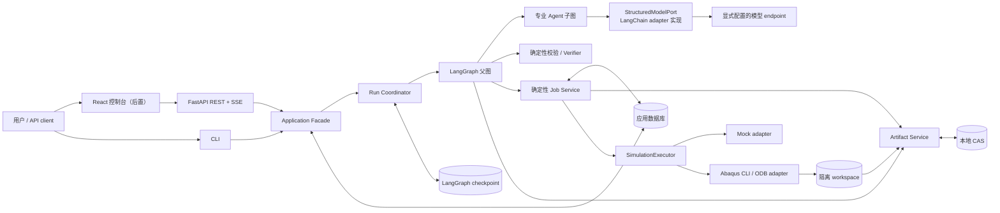

# 完整系统框架

## 结论

Abaqus Sim Agent 确定采用：**模块化单体控制面 + LangGraph 可恢复业务状态机 + 受控 Abaqus
执行边界 + 不可变证据链**。

一个 Python distribution 内实现 API、应用用例、工作流、专业 Agent、Job Service、持久化和验证；
模块之间通过领域契约与端口协作。首版不拆微服务，不引入 Redis、Celery 或消息队列，也不把每个
Agent 部署成独立服务。Abaqus Job 是长时间运行的外部副作用，只有无 LLM 的 Job Service 可以操作。

这是目标框架，不是完成声明。截至 2026-08-19，仓库已有领域契约、Agent/Executor 协议、面向
checkpoint 的 State 骨架、内存 Mock Executor，以及 `StructuredModelPort`、scripted fake 和 LangChain
adapter 骨架；专业 Agent、API、父图、持久 Job ledger、Artifact Store、真实 Abaqus adapter 和物理验证
仍待实现；真实模型 endpoint 尚未接入并完成合同验证。

## 系统拓扑



可以用四层讲清整个项目：

1. **交互层**：FastAPI、REST/OpenAPI、SSE、CLI 和后续 React 控制台。
2. **控制层**：Application Facade、Run Coordinator、LangGraph、专业 Agent、HITL 和预算守卫。
3. **执行层**：确定性 Job Service、Job ledger、Mock/Abaqus adapter、取消、超时与 reconcile。
4. **证据层**：checkpoint、应用数据库、Artifact Store、三层验证、结构化事件和离线 benchmark。

## 运行形态

| 形态 | 进程与存储 | 用途与边界 |
|---|---|---|
| 本地开发 / 首版 | 单个 Python 进程内运行 FastAPI 与 Coordinator；`app.sqlite3`、`checkpoints.sqlite3`、本地 CAS、Mock 或本机 Abaqus | SQLite 阶段不让 API 与 worker 两个进程并发写；启动时扫描非终态 run 并 reconcile |
| Mock 演示 | React/Nginx、同一 Python 镜像的 API 与 Coordinator 启动命令、PostgreSQL、共享 artifact volume、Mock | 进入双进程前先迁移 PostgreSQL；不需要 Redis/MQ |
| 真实 Abaqus | Coordinator/runner 首先部署在有许可证的宿主机，使用 headless CLI 与 ODB 提取；API 可同机 | Docker 只证明 Web/Mock/数据库交付，不宣称 Abaqus 已容器化 |
| 远程 runner（条件触发） | 认证的 runner 协议、PostgreSQL、S3-compatible Artifact Store | 只有跨主机持证执行成为真实需求后，才选择 SSH、gRPC、MCP 或其他协议 |

即使 PostgreSQL 阶段把 API 和 Coordinator 分成两个进程，它们仍来自同一仓库、同一 Python 包和同一
业务模型，是模块化单体的两个运行入口，不是两套微服务。

## 逻辑组件和责任

| 组件 | 负责 | 明确不负责 | 状态或数据所有权 |
|---|---|---|---|
| API / CLI adapter | 校验请求、调用应用用例、返回资源和事件 | 不直接调用 Agent、Graph、SQLAlchemy model 或 Executor | 不持久化业务真相 |
| Application Facade | `create_run`、`clarify`、`approve`、`cancel`、`query` 等用例与事务边界 | 不包含 LangGraph 节点细节或 Abaqus 命令 | 命令语义和用例事务 |
| Run Coordinator | 启动/恢复父图、投递人工响应、唤醒等待 Job 的 run、启动恢复扫描 | 不用内存 task 充当 durable queue，不在 HTTP 请求中等待 Abaqus | run 的调度投影；图游标仍由 checkpointer 拥有 |
| LangGraph 父图 | 全局 phase、确定性路由、checkpoint、interrupt、预算和终止条件 | 不直接操作 SQL 表、任意路径或 Abaqus | 可序列化 Graph State |
| 专业 Agent 子图 | Interpreter、Architect、Input Writer、Reviewer、Verifier 的受限领域判断 | 不改变全局终态，不提交 Job，不持有 DB session | typed outcome 与证据引用，不拥有全局状态 |
| Model Port / provider adapter | Port 提供一次 typed structured invocation 并归一化 Profile、usage、响应身份和失败；adapter 封装 LangChain/provider client | 不编排、不自动 fallback、不拥有业务重试、不执行 Agent 工具或 Abaqus 副作用 | client 生命周期在 Runtime Context；不拥有 Graph State |
| Supervisor | 只在失败后从 guard 生成的安全候选中选择修复、重设计、澄清、人工或停止 | 不负责幸福路径；不能绕过校验/审批、提交 Job或宣告成功 | 单次结构化路由建议 |
| Job Service | 唯一负责 reserve、submit、poll、cancel、timeout 和 reconcile | 不做 LLM 推理，不判断物理正确性 | Job/attempt ledger |
| SimulationExecutor | 将确定性命令映射到 Mock 或 Abaqus CLI/ODB | 不决定是否提交、重试或批准 | 外部进程句柄与原始观察事实 |
| Artifact Service / Store | workspace 隔离、SHA-256、不可变 generation、manifest 和读取 | 不把大文件塞入 Graph State，不覆盖已有 generation | Store 拥有字节，应用 DB 拥有 metadata |
| Verification | INP preflight、需求忠实度和物理有效性三层检查 | 不静默修改模型，不以单一 LLM Judge 代替数值证据 | Verification report 与 evidence |
| Event / Trace | append-only 产品事件、SSE 回放、节点/角色/Job/artifact 指纹 | 不充当图或 Job 的主事实来源；不保存原始 CoT | 应用数据库中的事件序列 |
| Evaluation | Gold cases、故障注入、重复运行、消融、scorer 和 badcase | 生产 runtime 不反向依赖 benchmark 隐藏答案 | 版本化评测数据与实验结果 |
| Composition Root | 加载配置并组装 Graph、Agent、模型 Profile/Port/client、数据库、Store、Executor 和 API | 不包含领域逻辑，不根据偶然存在的凭据隐式选择 provider | 运行时对象生命周期 |

## 依赖规则

```text
api / cli
    ↓
application services + workflow
    ↓
domain models + ports + agent contracts
    ↑
persistence / artifacts / model provider / Abaqus adapters

bootstrap → 组装所有具体实现
evaluation → 可以依赖产品核心；产品 runtime 不得反向依赖 evaluation
```

硬性规则：

- `domain` 不导入 LangGraph、LangChain、FastAPI、SQLAlchemy 或 Abaqus adapter。
- `application` 只依赖领域模型和 Protocol，不依赖具体数据库、模型 provider 或文件存储。
- API 只调用 Application Facade，不直接查询 ORM model、恢复 Graph 或提交 Job。
- Agent 不持有数据库 session，不写任意路径；工具按角色显式注入。
- Agent 只依赖 `StructuredModelPort`，不得直接导入 `ChatOpenAI`、provider SDK 或第二套 Agent runtime。
- LangGraph node 通过 Runtime Context 使用 Agent、Job Service、Store、Retriever 和 Validator。
- 只有 Composition Root 可以集中依赖具体 adapter；不使用 import-time client 或全局 service locator。
- checkpoint schema 与应用 schema 分开所有权；Alembic 不迁移 LangGraph 内部表。

## 目标包布局

目录只在进入真实调用路径时创建，不预先生成空包：

```text
src/abaqus_sim_agent/
├── domain/                 # 纯领域模型、FSM、错误和 policy
├── application/            # 用例、端口、Runtime Context、Coordinator
├── orchestration/          # 父图、子图 wrapper、节点和路由 guard
├── agents/                 # 角色实现、prompts 和最小权限工具
├── inference/              # StructuredModelPort、scripted fake 与 LangChain/provider adapter
├── execution/
│   ├── base.py             # Executor 协议
│   ├── service.py          # Job Service
│   ├── mock.py
│   └── abaqus/             # CLI、状态识别和 ODB adapter
├── artifacts/              # Store 接口与本地 CAS
├── verification/           # preflight、fidelity、physics
├── persistence/            # ORM、repository、unit of work、checkpoint wiring
├── observability/          # 事件、日志和可选 exporter
├── api/                    # FastAPI、schema、routes、SSE
├── evaluation/             # 评测 runner/scorer；不含生产秘密答案
└── bootstrap.py            # Composition Root

migrations/
web/
benchmarks/
tests/
├── unit/
├── integration/
├── contract/
├── e2e/
├── licensed/
└── evaluation/
```

现有 `application/state.py` 暂时保留；开始实现 Graph 时再把它迁入 `orchestration/state.py`，不为了目录
外观提前移动代码。

## 状态与数据真相

| 数据 | 唯一权威 | 说明 |
|---|---|---|
| 图游标、interrupt、详细业务 State | LangGraph checkpointer | 首版使用独立 `var/checkpoints.sqlite3`；`thread_id` 与业务 `run_id` 一一映射但概念分开 |
| run 列表 phase | `runs` 投影 | 只服务 API 查询，可从 checkpoint reconcile；不能用它单独恢复图 |
| 外部 Job 状态 | Job ledger + 最新外部观察 | Graph State 只保留引用和投影；恢复必须重新观察 |
| artifact 字节 | content-addressed Artifact Store | 不可变；应用 DB 保存 digest、URI、lineage 和 metadata |
| 人工决定 | `human_actions` | 绑定 `interrupt_id`、revision、artifact digest 与执行配置；过期决定返回冲突 |
| 产品事件 | `run_events` | append-only、每 run 单调 sequence、稳定 event key 去重；供 SSE 与审计式追踪 |
| UI 状态 | 无 | GET 获取权威快照，SSE 到达后刷新；浏览器断线不影响工作流或 Job |

首版应用数据只需要 `runs`、`human_actions`、`jobs`、`job_attempts`、`artifacts` 和 `run_events` 六类表。
SQLAlchemy 2 使用 typed model、`AsyncSession` 和小型 unit of work；repository 按聚合建立，不机械地一表
一个 repository。关键约束包括：

- `jobs.idempotency_key` 唯一；
- `human_actions.interrupt_id` 唯一；
- `job_attempts(job_id, attempt_no)` 唯一；
- `run_events(run_id, seq)` 和稳定 `event_key` 唯一；
- Job 转换通过“期望旧状态 + 行版本”的条件更新完成，不使用不安全的“先查后写”。

首版使用两个 SQLite 文件：`var/app.sqlite3` 由 Alembic 管理，`var/checkpoints.sqlite3` 由 LangGraph
管理。迁移 PostgreSQL 后仍使用独立 schema，不能假装 checkpoint、应用事务和 Abaqus 进程组成一个
分布式事务。

## API 与控制台

API 统一位于 `/api/v1`，公开 run 资源，不公开低层 `submit-job` 或 `execute-tool`：

| 接口 | 语义 |
|---|---|
| `POST /runs` | 创建 run，返回 `202 Accepted` 与 `Location`；支持 `Idempotency-Key` |
| `GET /runs`、`GET /runs/{run_id}` | 查询 phase、spec/plan revision、pending action、当前 Job 和 verification 摘要 |
| `POST /runs/{run_id}/human-actions` | 回答澄清、批准或拒绝；必须绑定当前 interrupt 与 revision/hash |
| `POST /runs/{run_id}/cancellations` | 只持久记录取消意图并唤醒 Coordinator，返回 `202` |
| `GET /runs/{run_id}/jobs` | 查询 Job/attempt，不提供直接提交入口 |
| `GET /runs/{run_id}/artifacts` | 查询 artifact metadata 与 lineage |
| `GET /artifacts/{artifact_id}/content` | 按 ID 下载，绝不接受任意本地路径 |
| `GET /runs/{run_id}/events` | SSE 事件流，支持 `Last-Event-ID` |
| `GET /health/live`、`GET /health/ready` | 区分进程存活与依赖就绪 |

SSE 从持久 `run_events` 读取，使用每个 run 单调递增的 `seq` 作为事件 ID，交付语义是 at-least-once；
前端按 ID 去重。完整 solver 日志进入 artifact，事件只携带摘要与 artifact ID。错误响应使用
`application/problem+json`，包含稳定 `code` 和 `trace_id`；同一幂等键对应不同 payload、过期审批或
过期 revision 返回 `409 Conflict`。

React 首版只做 `/runs/new`、`/runs` 和 `/runs/:id` 三个页面。详情页展示 Spec/Plan、待处理 HITL、
Job、Verification、Timeline 和 Artifacts；它不是泛聊天页面，也不在浏览器中复制业务状态机。ODB 首版
只提供 metadata 与下载，不提前实现复杂三维查看器。

## 非功能底线

### 测试

- 单元：领域校验、FSM、幂等键、manifest/hash、路径安全、预算和事件序列化。
- 集成：真实 SQLite 文件、Alembic 空库升级、checkpoint resume、本地 CAS、FastAPI/SSE 和 fake subprocess。
- 合同：同一 `SimulationExecutor` contract 参数化验证 Mock 与真实 Abaqus adapter。
- E2E Mock：创建 run、澄清、审批、提交、等待、验证、SSE 与 artifact 全链路。
- 故障注入：重复 POST、提交后写 ledger 前崩溃、Coordinator 重启、cancel/poll 竞争、timeout、SSE 重连、
  artifact 半写入。
- licensed integration：只在固定 Abaqus 版本和许可证宿主机运行少量解析案例，不作为普通 PR 必需检查。
- benchmark/eval：Gold cases、隐藏答案、重复运行、消融和确定性 scorer，与 pytest 功能回归分开。

第一条关键 E2E 验收是：相同幂等键经历进程重启后仍只对应一个外部 Job。

### 可观测与安全

- 结构化日志统一携带 `trace_id/run_id/thread_id/job_id/agent_role/node/attempt`；不记录密钥或原始 CoT。
- 记录模型延迟、token、structured-output 错误、Job 状态变化和三层 gate，但只把稳定业务事件用于 SSE。
- 默认只监听 loopback；无认证时不作为公网服务，不使用 `CORS *`。
- 用户文本不能直接进入 shell；job name、文件名和执行参数使用 allowlist 与 argv。
- API 只按 artifact ID 访问文件；workspace 与 Store 路径必须验证在配置根目录内。
- approval 必须绑定 revision、artifact digest 和 executor profile；输入变化后自动失效。
- 文件大小、修复次数、运行时长和并发数都有预算；`UNKNOWN` 必须显式呈现，不能伪装为失败或成功。

## 首版验收边界

首版只支持 [Agent 与首个完整实现范围](agent-implementation-scope.md)定义的 5 个专业 Agent、1 个条件
Supervisor，以及 Abaqus/Standard 线弹性小变形 `STATIC_GENERAL` 的 2D 矩形板和 3D 矩形梁模型族；同时
保持单 run 单 active Job、SQLite、本地 CAS、Mock 与一个 headless Abaqus adapter。它必须跑通 durable
checkpoint、澄清/审批/人工接管、幂等提交、异步等待、取消、超时、UNKNOWN、三层 verification 和有限
修复。PostgreSQL、多 worker、RAG、MCP、S3、broker、多模态和多 solver 都是条件触发，不属于首版框架
的完成条件。

## 相关文档

- [一次仿真 Run 的工作流](flows/simulation-run.md)
- [Agent 与首个完整实现范围](agent-implementation-scope.md)
- [Abaqus Job 生命周期](flows/job-lifecycle.md)
- [技术栈与工程讲解点](technology-stack.md)
- [ADR-0006：使用模块化单体和端口适配器组织控制平面](../adr/0006-modular-monolith-control-plane.md)
- [ADR-0007：通过 StructuredModelPort 隔离模型提供方](../adr/0007-structured-model-port.md)
