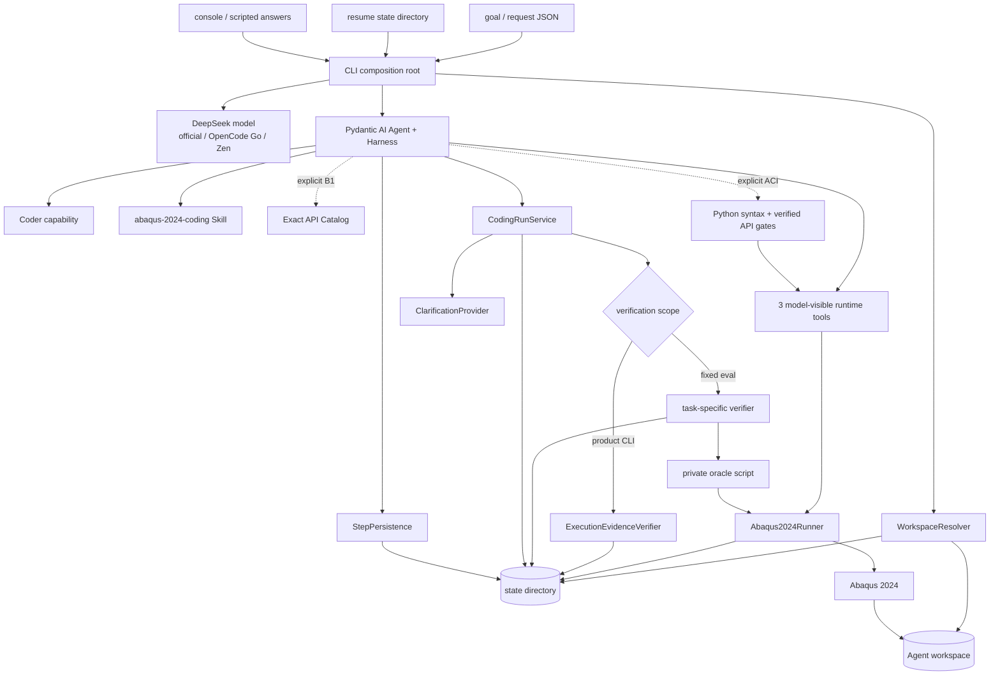

# 当前系统框架

## 结论

当前系统是一个本地 CLI 驱动的 Pydantic AI CodingRun：宿主 Python 3.12 负责 Agent、预算、证据和
验证，Abaqus 2024 vendor runtime 负责建模、solver 与 ODB 读取。二者通过工作区文件、子进程输出和
JSON 交换，不要求共享 Python 包或解释器。

首轮框架不包含 LangGraph、多 Agent、DBOS、FastAPI、SQL 数据层或 durable Job Service。旧路线的相关源码
已清理，历史 ADR 保留此前取舍，不能作为当前调用链。将来是否引入持久控制面，应从当前 smoke 的失败、运行
时长、消费者或并发证据重新决策，而不是继续按旧蓝图补齐组件。

## 两个 Python 边界

| 运行边界 | 版本与职责 | 允许的数据交换 | 不能假设 |
|---|---|---|---|
| 宿主应用 | Python 3.12；Pydantic AI/Harness、CLI、预算、workspace、runner、verifier、evaluator | 命令参数、普通文件、JSON/JSONL、stdout/stderr bytes、SHA-256 | 能直接 import `abaqus`、能理解任意动态脚本语义、exit code 等于物理成功 |
| Abaqus 2024 | vendor CPython 3.10.5；CAE kernel、Standard solver、`odbAccess` | `.py/.cae/.inp/.odb/.sta/.msg/.dat/.log` 与 JSON 结果 | 能 import 宿主 Pydantic/Pydantic AI 包、使用宿主 `uv` 环境、UTF-8 是唯一输出编码 |

显式 launcher 是 `D:\SIMULIA\Commands\abq2024.bat`。宿主 runner 优先按 UTF-8 解码 stdout/stderr，失败
后以 CP936 replacement decode，同时永久保存原始 bytes，避免诊断证据因终端编码丢失。

## 当前拓扑



CLI 负责产品 composition：从环境读取模型凭据，显式创建模型/client、workspace、runtime profile、runner、
Agent、step store、clarification provider 和 `ExecutionEvidenceVerifier`，并在结束时关闭 client；首次运行
把无凭据 composition 写入 `launch.json`，续跑从中重建。固定 evaluator 复用
产品组件，但显式替换 task instructions 与 verifier；模型凭据和 trusted oracle 不进入 request、workspace、
history 或模型 tool schema。

## 一次 CodingRun 的稳定顺序

1. 新运行时 CLI 解析 goal、workspace、state、answers、run ID、launcher、Skill 和可选 API Catalog；续跑时
   `--resume <state_dir>` 读取immutable base request/launch并重放typed amendment。预算、模型和HTTP retry
   修改保持同task revision；新goal显式建立下一task revision。workspace/state/run identity仍不被覆盖。
2. `WorkspaceResolver` 固定 ASCII workspace；交互模式可使用 CLI 启动目录，eval 必须显式传入空目录；
   state 必须在 workspace 之外，并在运行前建立初始 snapshot。
3. Service 先对 state 目录取得 OS 非阻塞独占锁；新运行在确认无 launch/request/amendment/initial/resume/step
   marker后才写immutable base、首次snapshot与resume state。续跑恢复累计usage、调用计数、澄清和history；
   task revision另使用提交时snapshot和execution offset划定当前验收证据。墙钟只累计活动执行时间。
4. Coder 只通过 Harness 文件能力读取/编辑 workspace；composition 已移除通用 Shell，然后返回 typed
   decision。
5. 新默认普通CLI允许先读取用户文件，缺少必要事实时单独调用ask_user；宿主保存waiting_for_user并释放锁后
   取答复，等待不计active wall。答复按ID持久化后以deferred结果继续；晚到工程答复经task revision隔离旧验收。
   旧run/显式profile仍使用needs_input与原来的前置规则。两种协议都不能保证模型识别缺参，见ADR-0024。
6. Coder 通过三个工具依次运行 CAE authoring、solver 和 ODB extraction。每次 runner 都在执行前后 snapshot
   workspace，保存 raw logs，并返回 created/modified/deleted artifact delta；运行前的 Harness tool effect
   带输入 hash/Job 标识，完成结果立即追加到执行 journal。
   显式`enforced_verified`模式先用ToolGuardrail检查生产文件候选的Python 3.10语法；运行时授权通过后再
   复核当前hash，并把有冻结证据的API诊断hard block。warning可继续runtime，同一blocker hash不可原样绕过。
   显式 B1 变体还可按需调用 qualified exact API lookup；CAE traceback 能提取方法名时，宿主自动附加
   lookup 结果。同名方法保持多义而不猜测 receiver；显式 full 模式还可用 `Method.parameter` 只取一个
   参数的签名/官方描述与 scope 匹配 note。query、完整 card 和 `(card_id, parameter)` 分层去重，普通
   CodingRun 最多 4 次计费查询，全部写入 `api_lookups.jsonl`。
7. Coder 返回 `ready_for_verification` 后，普通 CLI 检查 fresh artifact、Python 3.10 语法与最后一次已用
   runtime stage；固定 evaluator 才调用 private oracle 和 Case checker。
8. verifier 通过时，宿主形成带 `verification_scope` 的 `COMPLETED` outcome；拒绝时，把完整 feedback 放回同一 Coder history，让它
   在剩余预算内修复最小问题。
9. Agent `failed`、legacy无澄清回答、预算耗尽或 wall-clock timeout 形成业务失败；新协议无答复保留待答。
   返回前重新 snapshot 当前
   workspace，使失败 outcome 也携带最终 fresh artifact/hash。模型/provider/文件系统等未被建模的异常
   记录为 infrastructure event、把 resume state 标为 `interrupted`，并以 `CodingRunInfrastructureError`
   暴露。

当前 service 仍在一个进程内同步等待每个活动阶段，但 state 可在新进程中恢复会话与已完成步骤。
`history.json` 原子更新，Harness `StepPersistence` 另存 settled snapshot、step events 与 tool-effect ledger；
`resume_state.json` 保存宿主预算和 evidence 引用。未决普通文件工具要求模型先检查 workspace；未决三个
Abaqus runtime 工具在任何新模型请求前改为 `needs_reconcile`。系统仍不会从文件重新附着正在运行的 solver。
每次 resume state 还绑定当时的 workspace SHA-256 snapshot；新进程发现文件新增、删除或内容改变时，
在恢复历史和调用模型前拒绝。锁覆盖 state 读取、Agent/tool loop、verifier 与终态写入，进程退出时由 OS
释放，固定锁文件的存在本身不表示任务仍在运行。

## 执行与副作用边界

### 模型可见的三个入口

| 入口 | 实际命令形状 | 输入约束 | 主要副作用 |
|---|---|---|---|
| CAE authoring | `abq2024.bat cae noGUI=<relative.py>` | workspace 内已存在 `.py` | 创建/修改 `.cae/.inp` 和 CAE 日志；不得 submit |
| Solver | `abq2024.bat job=<name> input=<relative.inp> interactive` | workspace 内已存在 `.inp`；Job 名匹配受限 ASCII pattern | 启动 Abaqus/Standard，生成 ODB 和 solver 状态文件 |
| ODB extraction | `abq2024.bat python <relative.py> ...` | workspace 内已存在 `.py` | 读取 ODB，生成 Agent 可见 `results.json` |

工具不是通用命令转发器：路径必须 resolve 后仍在 workspace 内，后缀必须匹配；Job 名必须以 ASCII 字母
开头，最多 80 字符，只含字母、数字、下划线或连字符。模型工具使用相对路径，降低命令行编码和工作目录
漂移。

产品 Coder 不注册 Harness `Shell` 或 `run_command`。composition 要求构造时恰好存在一个 Shell 并在 Agent
注册前移除，依赖形状改变则 fail-closed；这关闭已复现的宿主 Python subprocess 绕行，但不把 Agent 生成的
动态 Abaqus Python 描述成不可信代码沙箱。

### 宿主私有 oracle 入口

`run_trusted_abaqus_python` 可以运行 workspace 外的应用自有 `.py`，但脚本必须是绝对、已存在、ASCII
路径，并显式声明要读取的 workspace artifacts。它没有注册为 Agent tool，输出写到 state directory，避免
Agent 读取或覆盖 hidden oracle。

### 超时和取消边界

runner 在 Windows 创建新的 process group 和隐藏窗口。超时或宿主 task 取消时，它用准确 PID
`taskkill /T /F` 终止进程树，再收集能够取得的输出。`timed_out` 与 `exit_code` 分开记录。

这只保证当前宿主进程仍在时的 bounded execution，不等于跨进程 cancel、外部 Job reconcile 或 durable
timeout。机器断电、宿主崩溃和 Abaqus 子进程脱离的恢复尚未解决。

## 状态所有权

| 数据或状态 | 当前所有者 | 持久位置 | 语义边界 |
|---|---|---|---|
| base goal、runtime、路径和预算 | `CodingRunRequest` | `state/request.json` | immutable base；不存 API key |
| base composition | 产品 CLI | `state/launch.json` | immutable无凭据base；保存模型/Skill/Catalog/Concept/diagnostic retrieval/静态源路径和模式 |
| 运行配置与任务修订 | amendment owner + CLI | `state/amendments.json` | strict typed、逻辑append-only、整文件原子替换；budget/model/retry为overlay，新goal递增task revision |
| freshness 基线 | `CodingRunService` | `state/initial_snapshot.json` | 只在首次运行捕获；续跑不得用当前 workspace 重建 |
| 恢复与revision证据边界 | `CodingRunService` | `state/resume_state.json` | v3记录当前文件hash、amendment sequence、task revision、revision snapshot与execution offset |
| run 独占权 | OS file lock | `state/coding_run.lock` | 同一state目录一次只允许一个执行；文件永久保留，handle关闭/进程退出才代表释放 |
| 模型 messages 与步骤 | Pydantic AI + Harness `StepPersistence` | `state/history.json`、`state/step-persistence/` | history 是最新审查副本；snapshot只在可续边界形成，tool effect区分started/completed/failed |
| clarification | `CodingRunService` | `events.jsonl` 和 outcome | 记录 field/question/answer/source，以及回答前 Abaqus 调用数 |
| 模型/Abaqus usage 与续跑状态 | Pydantic AI usage + deps counters + service | `resume_state.json`、outcome/eval metrics | turn、model/token/tool、Abaqus、solver、active wall time与去重集合跨进程累计 |
| API lookup trace | Agent deps + exact Catalog | `state/api_lookups.jsonl` | source、query、status、card ids、是否计预算和 payload bytes；不是模型记忆 |
| 主动文档查询trace | Agent deps + exact-symbol-augmented Dense检索 | `state/concept_lookups.jsonl` | 新工具 `search_abaqus_docs` 保存question、Agent提供的observed_context、实际query、metadata推导的symbols/products、版本化策略、索引绑定和有序章节；question/context/revision去重，resume合并journal计数；旧trace保留历史语义 |
| Diagnostic advisory trace | Solver runtime + BM25/Dense/RRF | `state/diagnostic_retrievals.jsonl` | 只由非超时结构化Solver warning/error触发；保存机械query、诊断hash、索引绑定、有序section命中、turn/revision/execution与payload；独立预算和resume去重，默认off，异常不覆盖原Solver结果 |
| Syntax gate trace | production ToolGuardrail + runtime recheck | `state/syntax_checks.jsonl` | candidate/runtime、Python 3.10、script hash、cache hit和denial；invalid edit从未落盘 |
| Static preflight trace | preflight runtime + deps | `state/static_preflight.jsonl`与`state/static_preflight/<n>/*.bin` | engine/source/policy版本、script hash、actionable/filtered诊断、override与raw bytes；不是runtime成功证据 |
| workspace 文件 | Agent 与 Abaqus runtime | workspace | 模型可改；用初始/当前 hash 判 freshness |
| raw stdout/stderr | `Abaqus2024Runner` | `state/executions/<invocation-id>/*.bin` | 永久保留 bytes；decoded tail 和Solver高信号诊断用于工具反馈 |
| execution evidence | runner + deps | `execution_results.jsonl`，摘要进入 events/outcome | 完整结果在工具完成时追加，续跑恢复 verifier provenance；命令、exit、timeout、duration、encoding、artifact delta、Solver diagnostics保留 |
| product verification | `ExecutionEvidenceVerifier` | verification event/outcome | `execution_evidence`；验证工作区、语法和运行阶段，不声明物理正确 |
| evaluation oracle | task-specific host verifier | state JSON | `task_oracle`；模型不可写，只由固定 evaluator 注入 |
| retrieval index/evaluation | retrieval subsystem | `var/rag` Dense/BM25索引；`benchmarks/rag` query/label/family/diagnostic seal、attempt、input inventory与报告 | Chroma Dense与自建BM25语料hash互校；输入面scanner把strict execution失败分到known/unknown；Concept tool仍走历史exact-symbol-augmented Dense，固定RRF另用于评测和显式diagnostic advisory，后者RF3 A/B未观察到成功率收益 |
| API catalog | API catalog builder/loader | `var/api-catalog` | immutable cards + manifest；request/eval 只固化 digest/count，模型只读 |

新建文档索引的 `abaqus-document-context-v2` 保存完整h1–h3章节路径，`products`仍为页级列表，
`products_source`区分官方Products栏、文档ID推断和未知。`section_product_mentions`及其对应标题仅是
章节文字线索，不是适用性裁决，也不覆盖页级标签。主动查询和自动advisory都返回这两层上下文；旧索引
没有来源字段时标为unrecorded。独立完整索引 `var/rag-context-v2` 已构建Dense与BM25；5条真实查询的
离线版本比较未支持整体改善，原 `var/rag` 仍是默认旧版，未新增硬过滤。
[比较证据](../../benchmarks/rag/abaqus_2026_document_context_v2_replay_20260905.json)。

当前没有数据库或 durable workflow engine。Harness snapshot 与宿主原子 state 是本地会话续跑真相，但
不能事务地覆盖外部 solver 副作用，因此不能从“可继续”推导 exactly-once 或 Job 恢复保证。

## 完成和失败语义

`AbaqusExecutionResult.succeeded` 只表示未超时且 exit code 为 0；`stage_succeeded` 还排除 CAE/Abaqus Python
traceback、`Abaqus Error:` 和 Solver error diagnostics。普通 CLI 的 `COMPLETED` 表示：

- ready decision声明非空deliverable manifest，且每项存在并相对initial snapshot为fresh；
- 所有 fresh Python 脚本通过 3.10 语法检查；
- 每种已使用 invocation 的最后一次 execution 通过 stage check；
- outcome 标记 `verification_scope=execution_evidence`，不声明自然语言 goal 或物理模型正确。

固定 plate Gold 的 `task_oracle` 另要求：

- 六个要求 artifact 存在且 fresh；
- 本次记录中有成功 solver invocation；
- `.sta` 包含 Abaqus 成功完成标记；
- trusted oracle 能读取 ODB；
- ODB element type/count 正确；
- U1、S11、RF1 通过解析参考值容差；
- Agent `results.json` 与 oracle 一致。

这使 launcher、authoring、solver、extraction、artifact、oracle 和 physics 失败能够分别定位。产品通用
checker 只拥有执行证据；各 Gold checker 只属于 evaluation。当前不存在通用 specification fidelity 或
任意 Abaqus 物理 verifier。

## 当前代码组织

```text
src/abaqus_sim_agent/
├── coding/          # contract、Agent composition、instructions、typed tools、deps、service、workspace、verifier port
├── execution/       # Abaqus2024Runner：vendor 进程执行、日志与 artifact delta
├── verification/    # Gold/verified-change 的 host oracle 协调与数值 checker
├── evaluation/      # pydantic-evals licensed smoke、verified seed 和 change runtime
├── retrieval/       # Abaqus文档Dense、BM25倒排、RRF、exact metadata与独立评测
├── api_catalog/     # 官方+abqpy AST+runtime note 的非向量 exact catalog
└── skills/          # 随安装包发布的 abaqus-2024-coding 领域 Skill
```

目录存在不等于产品采用。当前入口由 `pyproject.toml` 的 `abaqus-sim-agent` script 指向
`coding.cli:main`，它是判断真实调用链的依据。

当前活动代码按 `coding/execution/verification/retrieval/api_catalog/evaluation/skills` 七个同级组件
组织，而不是全局 `agents/tools/models/services` 技术分桶。任务评分器不进入默认产品调用链；显式有界文档
profile目前复用`evaluation`目录内的运行时证据服务和共享算法，不能按目录名将其一律当作历史实验删除。
`retrieval` 与 `api_catalog` 不依赖 `coding`，由 `coding` 内的 Agent-facing adapter
消费；`execution.abaqus2024` 不依赖 Agent 或 verifier。

verifier port 已迁入消费方 `coding.verification_port`，concrete `verification` 单向实现；
`coding.service` 不再依赖 concrete verifier package。`CodingAgentDependencies` 也已从 `coding.agent`
迁入 `coding.dependencies`，避免 service 为取得 run-scoped state 类型而依赖 Agent composition。
`coding.agent` 现在只负责 Coder/Skill/output/toolset composition；instructions、三个 runtime tools、Exact
API lookup/automatic hint 和 Concept tool 分别由 `coding.instructions`、`coding.runtime_tools`、
`coding.api_lookup`、`coding.concept_lookup` 拥有。`coding.cli` 只依赖 coding 内的通用执行 verifier；
evaluation composition 才依赖 concrete physics verifier。旧 `verification.base` 与 `coding.agent` symbols
已移除，组件 facade 不提供兼容转发。

## 当前部署、测试和演进边界

- 部署形态是本地 Windows CLI；宿主必须能访问显式 Abaqus 2024 launcher 和许可证。
- 普通 CI 可以验证 typed contract、模型 factory、workspace、命令构造、CP936 fallback、artifact delta、
  process-tree timeout、verifier math 和 evaluator gate，不调用真实 Abaqus。
- opt-in `abaqus` 集成测试已在本机 Abaqus 2024 用项目参考脚本再次通过，验证真实 solver 和任意单步名称
  oracle；它不调用 DeepSeek。最新 OpenCode Go Prompt v3 smoke 中，B0 no-retrieval 为 3/3 并通过 gate；
  同代码旧 B1 为 1/3，唯一通过项没有 lookup。随后多 API repair holdout 中，Skill-only/full Catalog
  为 8/9、9/9；修正 note 投递和 Planning 后，从零建板 Prompt v4 的 Skill/full/automatic 为
  2/3、2/3、3/3。两者仍分别只有三个 API 家族或一个建板题。
- Concept工具合同已经接入但默认off，真实任务收益尚未评测；Exact API Catalog支持显式full、
  `Method.parameter` 与 automatic-verified-only。当前final15为5,480 cards/48 conflicts、16条verified
  notes、benchmark 27/27；automatic是reactive fallback，不能阻止错误前的主动probe。任何默认模式变化
  都需要新的同题对照。
- `decision-output-tool-clarification-v1`明确Pydantic final-output JSON/schema retry不等于workspace artifact
  损坏；两个已复现API修复follow-up均以2次CAE结束，但只构成回归证据。
- `same-api-occurrence-scan-v1`要求在已证实attribute缺失或keyword非法后，下一次runtime前检查目标脚本中
  同一owner/attribute或callable/keyword的全部出现位置；来源是B31成功轨迹遗漏第二处FieldOutput.position，
  final15 B31 treatment为0/3且唯一task-started样本失败于不同ownership/probe循环，因此没有收益证据。
- ODB behavior route只允许精确`OdbMeshNodeArray`类型。final15 B31批次启动时的旧代码曾把CAE
  `MeshNodeArray.findAt`误投`openOdb` note；当前定向回归已拒绝该匹配，尚无post-fix Product批。
- strict `RuntimeScriptPolicy`可按任务分别限制CAE脚本、Abaqus Python脚本和Solver INP；null保持原
  workspace边界，显式tuple执行大小写不敏感的精确相对路径匹配。拒绝发生在probe状态、预算预留和runner
  之前，返回`RuntimeScriptPolicyDenied`与`budget_consumed=false`。B31 v7 allowlist正常路径2/3且无拒绝；
  拒绝语义由确定性测试覆盖。
- 分级ACI默认off。`enforced_verified`离线21份正例0 blocker/16 warning、5份licensed负例5/5 blocker，
  B31另4个真实失败家族4/4 blocker；权限先于syntax/API，硬门与checker不可用均不消耗Abaqus预算。
  首次正式B31三条均pre-file网关超时、0次ACI/Abaqus，因此只接受接口和离线精度，不宣称Product收益。
- load-mode no-Shell/字段级 verifier follow-up 为3/3；三条正常路径均只用3次Abaqus和1次Solver，未触发
  verifier修复。旧失败artifact replay能精确报告`follower_actual=true`，但尚无Product-Agent采纳该反馈的
  轨迹，3/3也不作因果成功率声明。
- B31 verified-seed section change复用共享seed Protocol和可配置artifact stem；deterministic为1/1、Product
  为3/3，三次均保持extractor bytes、只用3次Abaqus/1次Solver并通过20×10、±42 kN和原合同回归。Catalog、
  Concept、Planning均off；该结果只覆盖一个轴向截面变更。
- B31 tip-load change复用相同source loader，但按影响范围要求build/extractor两份patch。host独立验收唯一
  +Y 1000 N CLOAD、精确U/RF/SF、U2/RF2/RM3/SM、结果JSON和轴向/模型回归。v1 Product为3/3但使用
  8/9/6次Abaqus；轨迹审计修正隐藏结果合同与subset verifier后，`declared_odb_contract_v2`正式和严格回放
  均3/3，三次都为3次Abaqus/1次Solver、首次extractor成功且无diagnostic脚本。该结果仍限于一个固定Case。
- API/SQL/DBOS/LangGraph、多 Agent、异步 Job Service和 remote runner 都不是默认下一层。本地中断续跑已
  解决模型/API恢复；只有出现真实consumer、跨worker、外部Job重新附着、并发/查询/审批或单Coder稳定
  失败模式时，分别形成新决定和验收。

`docs/architecture/flows/simulation-run.md` 与 `flows/job-lifecycle.md` 分别记录当前单 Coder 的稳定顺序和
同步 Solver 生命周期；它们只承诺本地 CodingRun 会话续跑，不承诺 LangGraph、durable Job ledger 或
外部 Solver 跨进程恢复。

## 相关决定

- [ADR-0004：以证据和物理验证定义任务成功](../adr/0004-evidence-first-physics-verification.md)
- [ADR-0008：首轮采用 Pydantic AI Harness 单 Coder 的原生 Abaqus CodingRun](../adr/0008-pydantic-ai-harness-abaqus-coding-run.md)
- [ADR-0018：以分级 ACI 强制生产脚本语法和已验证 API 合同](../adr/0018-enforce-verified-abaqus-aci.md)
- [ADR-0017：以扁平组件图组织 CodingRun 产品包](../adr/0017-package-by-component-coding-run.md)
- [ADR-0020：使用 Harness StepPersistence 续跑中断的 CodingRun](../adr/0020-resume-coding-runs-with-harness-step-persistence.md)
- [项目架构](overview.md)
- [首轮 Agent 与实现范围](agent-implementation-scope.md)
- [技术栈与工程讲解点](technology-stack.md)
