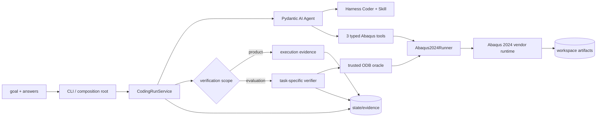

# 技术栈与工程讲解点

## 结论

当前技术栈围绕一条真实 Abaqus 2024 CodingRun 选择，而不是围绕未来系统图堆框架：Pydantic 定义 run
合同，Pydantic AI 负责 typed Agent loop，Pydantic AI Harness 提供 workspace coding 与 Skill，窄
runner 管理 vendor subprocess，宿主 verifier 和 pydantic-evals 定义成功。

LangGraph、多 Agent、DBOS、FastAPI、SQLAlchemy、Alembic、PostgreSQL、Redis/Celery 和前端都不在当前
产品调用链，也没有被当前 ADR 预先选定。它们可以作为秋招知识准备方向，但不能作为项目已实现能力或默认
下一步宣传。

## 秋招岗位定位与能力映射

项目主目标是 AI Agent / LLM 应用工程，其次是 Python AI 后端 / AI 平台。当前调用链已经提供可追问的
Agent 工程问题：

| 常见项目问题 | 本项目中的真实对应 | 当前能展示的证据 |
|---|---|---|
| Coding Agent 怎样限制工具和目录 | Harness `Coder` 固定 workspace、无 subagent，并 fail-closed 移除自带 Shell；Abaqus 只暴露三个 typed tools | tool schema 断言无 `run_command`；typed tool 有路径逃逸、非 ASCII workspace、非法 Job 名和命令构造测试；no-Shell Product follow-up 3/3，仍不是 OS 沙箱 |
| Agent 如何处理信息不足 | `physics-materiality-clarification-v1` 的 typed `needs_input` 区分缺失物理值、物理意图歧义和显式约束冲突；console/scripted provider消费回答 | strict schema、Prompt/事件持久化测试；Gold 厚度仍是当前唯一任务级实证，四个新plate请求仅冻结预期行为 |
| 外部工具副作用怎样隔离 | CAE authoring、solver、ODB extraction 分阶段；runner 保存 raw logs、artifact delta 并限制调用预算 | fake process 与 Windows process-tree timeout 测试 |
| 如何防止 Agent 自评正确 | trusted oracle 不注册为 tool；宿主重新读取 ODB，交叉比较 Agent JSON | verifier 数值、freshness、错误网格和伪造结果测试 |
| 如何评估非确定性 Agent | 同一 Gold 顺序重复 3 次，至少 2 次完整通过；token/tool/runtime/failure 分开记录 | pydantic-evals dataset、synthetic gate 测试、licensed runner 入口 |
| 检索是否真的有用 | resolver/retrieval 先独立 benchmark，再做任务消融；工具暴露、实际查询和闭环通过分开 | repair holdout Skill/full为8/9、9/9；建板 Skill/full/automatic为2/3、2/3、3/3；3D Concept control/preflight均为2/3 |

电商 Agent 的支付/库存副作用、旅游 Agent 的缺失偏好和预订审批、Text2SQL 的只读执行与 execution-guided
repair，都可用于解释相同工程原则，但仓库不拼接这些业务模块。SQL、REST/SSE、事务与持久恢复仍需单独
学习；在进入本项目真实路径前，不能用技术名替代实现证据。

## 当前运行技术栈

| 层次 | 当前选择 | 状态 | 在 CodingRun 中负责什么 | 证据边界 |
|---|---|---|---|---|
| 宿主运行时 | Python `3.12.*` + uv + 项目内 `.venv` | 已实现 | CLI、Agent、runner、verifier、evaluation | `pyproject.toml`、`.python-version`、`uv.lock` |
| 运行合同 | Pydantic `2.13.4` | 已实现 | frozen/strict request、budget、decision、outcome、artifact、verification | `coding/contracts.py`、`verification/plate_tension.py` 及合同测试 |
| Agent runtime | `pydantic-ai-slim[openai] 2.33.0` | 已实现 | typed output、tool loop、deps、增量 history、usage、output retries | `coding/agent.py`、`coding/dependencies.py`、`coding/service.py`；预算中断保留已完成 tool exchange |
| Coding capability | `pydantic-ai-harness[skills] 0.24.0` | 已实现 | workspace file coding、包内Skill加载；产品组合移除Shell；Windows精确补丁统一CRLF hash并串行化并行JSONL追加 | tool schema无`run_command`；直接Shell timeout仍验证`taskkill /PID /T /F`；损坏tool-effect ledger一律fail-closed；未复制FileSystem或修改`.venv` |
| 首个模型 | DeepSeek `deepseek-v4-flash` + OpenAI Python SDK `3.3.0` | 官方 DeepSeek、OpenCode Go/Zen gateway factory 已实现；Go typed smoke 已通过 | OpenAI-compatible Chat model；显式 gateway/model/key env；SDK `max_retries` 默认3、可配置并进入 metadata；无隐藏 gateway fallback | OpenCode Go 真实返回 `needs_input/plate_thickness`；Go profile只禁用历史reasoning replay，当前响应仍保留thinking；r3仍有一次终端timeout |
| Abaqus runtime | Abaqus Established Products 2024；显式 `abq2024.bat` | runner 已实现；二维板、三维杆和B31梁 reference integration 已在本机通过 | CAE `noGUI`、Standard solver、standalone Python/`odbAccess`；当前Job诊断摘录排除零计数与普通 `ERROR TOLERANCE` 状态行 | `execution/abaqus2024.py`、runner tests、opt-in Abaqus integration |
| 宿主编排 | `CodingRunService` + asyncio | 已实现 | clarification turn、history、累计usage/wall budget、typed config amendment、task revision、verifier feedback、历史outcome与`--resume`；默认wall budget为2700秒 | 活动执行仍为本地单进程；API repair显式保持600秒；不是durable scheduler |
| 会话续跑 | Harness `StepPersistence` + `FileStepStore` + typed host resume state + OS file lock | 已实现并有provider/Abaqus故障注入回归 | conversation/turn、settled message snapshot、tool-effect ledger、累计预算/execution恢复、workspace一致性和同state独占 | 未决Abaqus工具只进入`needs_reconcile`；不重新附着Job、不恢复in-flight stream/typed probe；锁不隔离不同run共享workspace |
| 运行证据 | workspace SHA-256 snapshot、JSON/JSONL、raw stdout/stderr bytes | 已实现 | freshness、artifact delta、事件、增量 history、完整execution journal、API lookup trace、oracle 和 outcome | state directory 在 workspace 外；失败终态重新 snapshot；没有事务或数据库 |
| 独立验证 | Pydantic deterministic checker + trusted Abaqus Python oracle | plate、3D bar 与 B31 beam 三个 Gold reference，以及固定plate/beam变更合同已实现并持证验证 | solver/`.sta`、fresh artifacts、单元/节点/拓扑/模型合同、U/S/RF/SF/RM/SM、Agent JSON 对照 | 只覆盖三个简单拉伸Gold和若干固定变更，不是通用 CAE verifier |
| Agent 评测 | `pydantic-evals 2.33.0` | plate、3D bar、B31 beam、verified-seed change、API repair和Solver diagnostic advisory runner已实现；transport/retry、Catalog与retrieval消融均已运行 | repeat、closed-loop/repair gate、clarification/artifact/physics/diff/provenance、usage、note/query-id；双臂smoke与收益delta分开 | plate v4 automatic为3/3；3D为2/3；B31 from-scratch为2/3、section与declared-contract tip-load change均为3/3；RF3 control/advisory均3/3且Abaqus/Solver均15/6；repair holdout Skill/full为8/9、9/9 |
| 官方文档检索 | LangChain splitters + Chroma `1.5.9` + 本地 `all-MiniLM-L6-v2` + stdlib SQLite倒排 | Dense、固定Okapi BM25、RRF、exact-symbol路由、输入面审计、development/diagnostic/sealed held-out evaluator、显式Concept tool和默认关闭的diagnostic advisory已实现 | 32,466个semantic records；BM25 `k1=1.2/b=.75`、16,690 terms/1,298,647 postings；held-out r1复现90/90，diagnostic r1复现258/258；RF3三次advisory均rank1送达 | held-out区间跨零；diagnostic优势随query form反转；RF3两臂均3/3且运行调用无差，不支持默认采用；2026语料不能充当2024 API兼容证据 |
| Exact API Catalog | 官方 Scripting XHTML + abqpy 2024.10 wheel AST + runtime notes | 构建、method/parameter lookup、deterministic evaluation、full/automatic Coder 模式已实现 | qualified/public alias、`Method.parameter` 紧凑合同、构造器/继承、overload、官方 Access/参数语义、参数级 runtime note、owner-aware AttributeError miss；不使用 embedding | final15为5,480 cards、48 conflicts、16条verified notes、27/27；BeamSection note含real-task+licensed的beamOrientation边界；automatic本身不是B31收益保证，v7组合allowlist后2/3 |
| 分级Abaqus ACI | Harness ToolGuardrail + Python 3.10 AST + BasedPyright 1.39.10 + 固定abqpy 2024.10 | `enforced_verified`已实现、默认off；Product待验证 | production candidate落盘前语法hard gate；授权后按当前hash复核并把有evidence id的API诊断hard block，未知SWIG/type只warning，checker故障fail closed | 21正例0 blocker/16 warning、5 licensed负例5/5 blocker、B31另4家族4/4；正式3/3 pre-file timeout，0次ACI/Abaqus |

旧 `domain/`、`agents/`、`application/`、`inference/`、`SimulationExecutor` 和 Mock 源码及其专属
测试已清理；历史 ADR 与评测记录保留。上表只描述当前实际调用链。

## 当前运行结构

宿主 Python 和 vendor Python 不共享依赖。Abaqus 脚本是普通 `.py`；Agent 写脚本，runner 负责选择正确
解释器。产品 CLI 只验执行证据；固定 evaluation 的 host verifier 才读取 trusted ODB oracle。

## 工程与验证工具链

| 用途 | 当前选择 | 当前边界 |
|---|---|---|
| 环境、依赖和构建 | uv、项目内 `.venv`、提交 `uv.lock`、`uv_build` | 宿主 Python 3.12；不能验证 Abaqus vendor Python 兼容性 |
| 测试 | pytest 9 + pytest-asyncio | 默认覆盖 typed contract、clarification、workspace、model factory、runner、verifier、evaluator 和 retrieval；opt-in `abaqus` marker 覆盖真实 reference model/solver/oracle |
| Lint 与格式 | Ruff | 检查宿主源码；不能解析或执行 Agent 动态生成的 Abaqus 脚本 |
| 类型检查 | BasedPyright | 常规开发检查宿主 Python 3.12 `src`；显式ACI还读取固定abqpy source。只有项目verified registry可把诊断提升为blocker，其余warning/ignore；不替代licensed runtime或oracle |
| 自动化 | GitHub Actions | 普通 CI 无 Abaqus 许可证；不应运行 licensed smoke |
| 仓库维护 | Prek、Commitizen、git-cliff、Copier、Renovate | 维护基础设施，不是 Agent 产品能力 |

## 独立 Retrieval 基线

检索模块直接读取本机 Abaqus 2026 HTML 文档。一次全量构建读取 1,609 个候选页面、索引 38,913 条
记录，耗时约 20 分钟，索引约 309 MiB。42 条 retrieval benchmark 上，11 组 paired query 的 dense
Recall@5 为 `0.727`，增加显式 Abaqus symbol 和 product 过滤后为 `1.000`；MRR 从 `0.655` 提升到
`1.000`。增强路径多一次受 metadata 约束的向量查询，常见延迟约从 315 ms 增至 520 ms。

原始文档、downloaded embedding model 和 `var/rag` 索引不进入 Git。以上样本较小，只证明 Concept
retrieval 基线，也不支持现在加入 CrossEncoder、pgvector 或独立向量服务。三维杆任务进一步运行了
automatic control 与 Concept tool 消融：control 为 2/3，唯一失败是 Abaqus 前网关超时；只暴露工具的
中间组为 3/3 但 0/3 查询；prompt-only preflight 让 3/3 run 查询，闭环仍为 2/3，失败 run 在 40 次模型
请求、12 次 CAE 调用、0 次 Solver 后耗尽预算。control 与 preflight 都通过 smoke gate，没有观察到成功
收益；[冻结证据](../../benchmarks/coding/bar_tension_3d_concept_evaluation_20260824.json)仍只有一个题、
每臂三次。

新增输入面审计不是错误关键字白名单：它从strict execution journal确定性枚举失败并把未分类项放入unknown，
同时扫描历史raw stream作为降级证据。更新后273个可识别run中10个有strict journal，因此报告显式限定legacy
unknown不完整。diagnostic development set包含39个need/86个variant；Section Hit@4的BM25/Dense/RRF为
`0.504 / 0.453 / 0.521`。官方condition fragment更偏BM25（`0.839`），observed log全变体更偏Dense
（`0.583`，BM25为`0.083`），说明检索路由要由实际输入形态和持续trace覆盖驱动，不能预设Hybrid或BM25恒优。

默认关闭的diagnostic advisory把结构化Solver诊断与任务上下文机械组query，以固定Top-4 RRF在同一tool return
追加有界证据。RF3 development A/B中两臂均3/3，Advisory三次rank1命中，但Abaqus/Solver调用与Control
相同；模型请求总数`38 vs 42`且逐对方向不一致。因此产品路径和resume/trace合同已经实现，默认采用与任务
收益仍未成立。

## 当前没有采用的技术

| 技术或方向 | 当前状态 | 只有出现什么证据才重新评估 |
|---|---|---|
| LangGraph / 分层多 Agent | ADR-0002 已被替代；当前只有一个 Coder | 单 Coder 在固定题集出现可稳定归因、需要独立上下文/权限/并行判断的失败，并证明新增角色净收益 |
| `DeckDraft/ChangeSet` renderer | 首轮已取消；Agent 直接写普通 Abaqus Python | 动态脚本导致无法控制的安全、兼容或回归失败，且受限 IR 能覆盖目标场景并通过对照评测 |
| `StructuredModelPort` / LangChain model adapter | 旧实现已清理；当前使用 Pydantic AI model adapter | 出现多个 provider 或非 Agent structured call 的真实复用需求，并能减少而非复制 Pydantic AI 语义 |
| DBOS / durable LangGraph / Temporal | 未采用；当前只有本地会话/步骤续跑 | 出现跨worker调度、服务端租约或外部Job附着需求，并证明文件后端与`needs_reconcile`不足 |
| FastAPI / REST / SSE | 未采用 | 出现 CLI 之外的真实消费者，并先冻结 run、clarification、cancel、artifact 和 event 契约 |
| SQLAlchemy / Alembic / SQLite / PostgreSQL | 未采用 | 文件 state 无法满足查询、并发、唯一约束或审计需求，并有可验证 schema/事务用例 |
| Redis/Celery/MQ | 未采用 | 出现多 worker、队列背压或跨主机调度的容量证据 |
| React / Docker 控制面 | 未采用 | API 和事件合同已稳定，且 UI/部署能验证真实交付边界；真实 Abaqus 容器化另行确认许可与平台支持 |
| 默认或自动 Concept RAG | 未采用；显式Concept tool和Solver diagnostic advisory均为opt-in | 新的多场景消融稳定观察到任务收益，并确认payload成本和物理输入边界；当前3D和RF3题均未观察到成功率收益 |
| MCP/CAE GUI、remote runner、S3、多 solver | 未采用 | 有明确外部消费者、跨主机或存储边界和独立 Gold |

这些条目不是路线图承诺。它们只是防止未来把“可能有用”误写成“项目已经选择”的触发条件。

## 可以讲清楚的工程问题

| 工程问题 | 核心机制 | 当前证据与诚实边界 |
|---|---|---|
| 为什么通用 Coding Agent 仍需要领域工具边界 | Coder 负责文件，三种解释器语义不同的 typed tools 负责预算与证据；通用 Shell 不属于产品能力 | 真实轨迹反证 `python` 命令名 allowlist 后，composition 移除 Shell 并 fail-closed；新批3/3 history无`run_command`/subprocess。它关闭应用工具路径，不是恶意租户沙箱 |
| 为什么先澄清再运行 | 板厚等缺失值、不同物理理想化或冲突约束可能让脚本正常求解另一个问题；API/文件细节则应由Coder处理 | strict request要求`kind/question/impact`，service持久化并检查回答前调用数；当前仍只对`plate_thickness`有任务级证据 |
| 为什么 authoring、solver、extraction 分开 | 防止建模脚本隐藏提交副作用，允许按阶段只重跑必要部分，并让每次 invocation 单独计数和留证 | 三个工具和 required artifacts 已实现；还没有异步 poll/cancel/reconcile |
| Windows 超时怎样处理 | 对准确的 spawned PID 终止整个进程树，保留 partial raw output；timeout 与 exit code 分开 | fake Windows strategy 测试存在；机器断电和宿主崩溃不恢复 |
| Windows Harness 兼容问题如何隔离 | Harness`0.24.0`的FileSystem有CRLF hash差异、Shell cleanup使用POSIX `os.killpg`、FileStepStore并行thread追加JSONL会覆盖记录；精确版本补丁分别规范hash、终止Windows树和串行追加 | Product Coder已移除Shell；JSONL补丁有40-record并发压力测试和真实Provider复现。升级时补丁自动失效并重新验证；未复制FileSystem或修改`.venv` |
| 为什么 ODB 存在仍不能成功 | 还要有本次 solver invocation、`.sta` 完成、fresh hash、正确网格/模型合同、解析值和 Agent JSON 对照 | plate/bar/beam verifier 已实现；通用 specification fidelity 仍无 |
| verifier 怎样避免“知道失败却修错方向” | load traction gate 返回 count/type/magnitude/raw+normalized direction/follower/surface 的实际值和逐字段 pass | 上一批真实失败 artifact replay 后只报 `follower_actual=true` 并提示 `follower=OFF`；新批未触发失败，只证明正常路径不退化 |
| 为什么 oracle 不能成为 Agent 工具 | 若模型能读写 evaluator，就能针对答案而非任务求解；trusted runner 只由宿主调用 | oracle 作为 package asset、输出在 state；本地用户仍能读源码，hidden 指模型 tool boundary 而非保密系统 |
| 怎样量化 Agent 闭环 | 同题三次、至少两次 pass；clarification/artifact/physics/failure/usage 分开 | 分别报告 transport、retry、Catalog与Concept treatment；不删除失败 case，也不启用 eval task retry；三次只是 smoke |
| Exact API lookup 为什么仍不对所有任务使用full | identifier 命中、证据返回、模型采纳和任务通过是不同层级；Card 也会增加历史上下文 | repair holdout full/Skill为9/9、8/9；建板automatic/full为3/3、2/3。记录query/card/note-id/payload并按任务路由 |
| verified runtime note 怎样避免跨参数误投 | note 声明 `applies_to_parameters`，错误代码与中文 traceback/AST call提取`faces/edges/regions/side1Edges/side2Edges/orientation/geometricType`，交集过滤发生在查询和预算前 | `faces=`拒绝edge-only Assembly.Set note；Surface和BeamSection scoped路由有单测与licensed evidence；没有自动写回错误→修复知识库 |
| 一个 optional 参数不确定时怎样避免重复整张 Card | `Method.parameter` 只返回该参数的签名变体、官方描述与 scope 匹配 note；方法卡和参数合同分别去重 | final13 benchmark 27/27；历史directionVector查询/两点向量采用3/3且不投递region note，Product gate仍为2/3 |
| 为什么API修好后仍会耗尽调用 | 模型曾把Pydantic final-output `Invalid JSON` retry误读为workspace result JSON错误，继续检查BOM/换行/原子写入 | output tool description与系统指令现在明确错误对象是最终decision；两个单次follow-up均2次CAE通过，尚无稳定率结论 |
| 已有脚本需求变更怎样避免“重新生成答案” | source loader重验request/outcome/verification与六个artifact hash，只复制两份脚本；host按影响范围检查一份或两份patch、三阶段provenance与新/旧物理合同 | B31 10×10→20×10与U1→+Y tip load均为deterministic 1/1、Product 3/3；后者公开作者/读取合同并把output verifier从subset修为exact，三次均三阶段最低调用，Catalog off |
| 虚构方法和错误 owner 怎样得到低成本反馈 | automatic AttributeError miss 从 Catalog 元数据返回至多三个 owner-aware 名称，不返回 Card、不走向量检索、不占 lookup/note budget | `BaseSolidBox` 候选为 Extrude/Revolve/Sweep；`PartInstance.Set` 候选为 Assembly.Set/Part.Set；2个已知回归各跑一次并通过，不能外推稳定成功率 |
| abqpy误报存在时怎样实现不可绕过ACI | syntax gate只判断Python 3.10 grammar；API detector与执行裁决分离，只有带licensed/冻结证据的rule hard block，未知attribute与SWIG container为warning，`Job.writeInput`等使用host override | 21正例134条raw诊断最终为0 blocker/16 warning；5负例和4个B31家族均block。模型不能原样解除blocker，enforce checker故障fail closed；正式Product仍无task-started样本 |
| 文档工具为什么默认关闭 | 独立召回与工具采用都不等于任务成功；历史preflight虽3/3查询但闭环仍与control同为2/3 | 当前 `docs-tool-selective-v1` 已有真实六场景离线行为测试：能零查询、澄清与主动查询，但API成员覆盖、AT误识别和证据使用仍有缺口；0次Abaqus，不代表任务收益 |
| 为什么本地续跑不等于 SQL/API/恢复框架 | StepPersistence与宿主文件状态解决模型网关中断；外部Solver仍需要独立ledger/reconciler，二者不能混称 | `--resume`、累计预算与未决runtime fail-closed有测试；没有数据库事务、多worker或Job重新附着 |

## 讲解主线

1. 用户给出一项 Abaqus 任务；strict request 固定 workspace、runtime 和预算。
2. 单 Coder 在 workspace 写普通 Abaqus Python；物理输入不足时先返回 typed clarification。
3. Product Coder 不注册通用 Shell；三个 typed tools 分别执行 CAE authoring、solver 和 ODB extraction，
   保存命令、raw log 和 artifact delta。
4. Coder 只能请求验证；宿主 oracle 重新读取 ODB，检查完成、freshness、网格和解析结果。
5. verifier 失败证据进入同一 Coder 的有限修复循环；预算耗尽或无进展后明确失败。
6. provider中断时，Harness snapshot与宿主resume state在同一conversation上启动新turn；未决Abaqus
   runtime先停在`needs_reconcile`。
7. pydantic-evals 在空工作区顺序重复 Gold，分别报告澄清、artifact、physics、usage 和 failure stage。
8. Concept文档工具与Exact Catalog均保持显式模式：建模语义查Concept，Python API查Catalog，已知
   runtime差异使用automatic notes；文档工具采用按需查询policy，是否扩大默认范围继续
   由多场景消融决定。

现在可以准确地说“已实现首轮单 Coder 的 typed 调用链、Abaqus 2024 三工具 runner、宿主 verifier、
增量失败 trace 和 smoke evaluator，并用二维板、三维杆和B31梁参考脚本在真实 Abaqus 2024 验证过
runner/solver/oracle；最新 repair holdout 中 full Catalog/Skill-only 为9/9、8/9；修正后从零建板
automatic/full/Skill为3/3、2/3、2/3；3D Concept control/preflight均为2/3；final8 的两个已知
Product-Agent regression 各运行一次并通过；r3/45m final8 为2/3，通过当前3D Gold gate，transport内为
2/2；B31 current frozen v7为2/3，三个attempt均task-started，两个pass仅3/4次Abaqus，但仍有一条12次
生产修复耗尽；历史v6同为2/3且含一条10次Abaqus高成本成功。两批都只是smoke，不能单因果归于某一
策略。其verified-seed 20×10 section change在Catalog off下为3/3，原extractor三次均未改；
正交tip-load control为3/3但使用8/9/6次Abaqus，公开隐藏消费合同并修正exact verifier后的v2仍为3/3，
三次均3次Abaqus且无diagnostic脚本。该对照只覆盖一个任务、每臂三个样本。
额外retry和45分钟上限都没有因果收益证据，更广义Baseline-v1仍未接受。当前观察支持“repair用full、
从零优先automatic、Concept保持显式”的任务路由，但每组都只有三个API家族或一个简单题、每臂三次”。
这些都是smoke，不宣传为统计稳定成功率；
系统可以声称本地 CodingRun 会话续跑和未决 runtime fail-closed；不能把它描述成 LangGraph 多 Agent、
DBOS/FastAPI/SQL、外部 Job reconcile 或完整 durable recovery。

## 相关文档

- [项目架构](overview.md)
- [当前系统框架](system-framework.md)
- [首轮 Agent 与实现范围](agent-implementation-scope.md)
- [ADR-0004：以证据和物理验证定义任务成功](../adr/0004-evidence-first-physics-verification.md)
- [ADR-0008：首轮采用 Pydantic AI Harness 单 Coder 的原生 Abaqus CodingRun](../adr/0008-pydantic-ai-harness-abaqus-coding-run.md)
- [ADR-0018：以分级 ACI 强制生产脚本语法和已验证 API 合同](../adr/0018-enforce-verified-abaqus-aci.md)
- [ADR-0020：使用 Harness StepPersistence 续跑中断的 CodingRun](../adr/0020-resume-coding-runs-with-harness-step-persistence.md)
