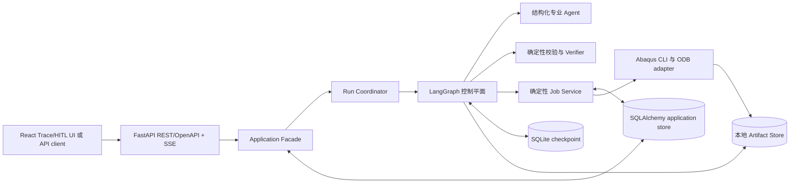

# 技术栈与工程讲解点

## 先说结论

Abaqus Sim Agent 的目标形态是：**用 LangGraph 管理可恢复的多角色控制流，用无 LLM 的 Job Service
幂等地操作 Abaqus，再由独立 Verifier 对需求忠实度和物理正确性验收。**

项目主投 AI Agent / LLM 应用工程岗位，兼顾 Python AI 后端 / AI 平台岗位，并以 Abaqus/有限元作为
AI for Science 的领域落点。技术选型既要完成这条纵向链路，也要让 SQL、API、状态机、权限、测试和
交付等秋招常见能力进入真实调用路径；不为了凑齐技术名词增加服务。本文把状态明确分为四类：

| 状态 | 含义 |
|---|---|
| 已实现 | 代码进入实际调用路径，并有本地测试或检查证据 |
| 骨架已实现 | 契约或依赖已经存在，但还没有形成对应的运行能力 |
| 已确定、待实现 | 已由架构决定确定边界，当前还没有依赖或代码 |
| 条件触发 | 只有出现明确容量、部署、数据或消费者需求后才选型 |

截至 2026-08-19，仓库真正可运行的产品代码是 Python/Pydantic 领域契约、Agent 与执行器协议、单进程
内存 Mock，以及 `StructuredModelPort`、scripted fake 和 LangChain adapter 骨架。LangGraph 编排、专业
Agent、持久化、真实模型 endpoint 接入、真实 Abaqus 执行和物理验证都还不能描述为已实现。

## 秋招岗位定位与能力映射

本项目不与 Java 商城竞争业务完整度，也不增加旅行规划或 Text2SQL 页面。三类常见项目提供的是已经被
反复验证的工程问题，可以自然映射到 Abaqus 主线：

| 常见求职项目 | 经常被追问的核心问题 | 本项目中的真实对应物 | 计划形成的代码与验证证据 |
|---|---|---|---|
| 电商、外卖、秒杀 | SQL、事务、订单状态机、防重复下单、支付/MQ 外部副作用、超时取消、对账、缓存与可观测 | Job/attempt/artifact/event 关系模型；幂等提交；Abaqus 进程与数据库状态对账；timeout/cancel | 唯一约束、合法状态转换、故障注入、crash/replay 后重复 Job 数为 0；没有容量证据前不加 Redis/MQ |
| 旅游规划 Agent | 需求澄清、多个专业角色、并行工具、实时信息、预算/时间/偏好约束、预订前人工确认 | `SimulationSpec` 澄清；专业 Agent 合同；只读检索和独立校验可并行；submit 前 HITL | typed 输入输出、工具白名单、interrupt/resume、约束测试；不把实时 Job 状态放进 RAG |
| Text2SQL / 数据 Agent | schema grounding、结构化生成、AST/权限检查、只读执行、execution-guided repair、执行正确率与效率 | CAE ontology 与 model plan；INP preflight；最小权限 Runner；基于 `.sta/.msg/.dat` 的有限修复；物理验收 | parser/规则检查、错误分类、repair success、资源预算、reference/invariant scorer；不靠 INP 文本相似度或单一 LLM Judge |

这个映射让项目能覆盖 Python、SQL、HTTP、异步长任务、事务与副作用、Agent 工具调用、安全和评测，
同时保留一条可讲透的业务链。数据结构与算法、操作系统、网络和数据库基础仍需单独准备，不能拿项目依赖
清单代替基础知识。

## 目标运行架构

下面是已经确定的目标边界，不代表图中组件都已完成：

Graph State 只保存可序列化业务状态和引用；模型、Agent、执行器、数据库与存储客户端通过 Runtime
Context 注入；`.inp`、`.odb`、日志和结果文件进入 Artifact Store。Job Service 是唯一允许提交、查询、
取消和对账真实 Abaqus Job 的组件。SQLite 首版让 FastAPI 与 Coordinator 在同一 Python 进程运行；
迁移 PostgreSQL 后才允许用同一代码包的两个启动命令拆分进程。完整边界见[系统框架](system-framework.md)。

## 已明确的产品技术栈

| 层次 | 选择 | 当前状态 | 在本项目中负责什么 | 当前证据或首个实现 |
|---|---|---|---|---|
| 主运行时 | Python `3.12.*` | 已实现 | 业务服务、异步协议、状态机节点和确定性校验 | [pyproject.toml](../../pyproject.toml)、[.python-version](../../.python-version) |
| 领域契约 | Pydantic 2；当前 lock 为 `2.13.4` | 已实现 | 严格、冻结的需求、方案、产物、诊断和验证模型 | [domain/models.py](../../src/abaqus_sim_agent/domain/models.py)、[领域模型测试](../../tests/test_domain_models.py) |
| Agent 编排 | LangGraph 1.x；当前 lock 为 `1.2.11` | 骨架已实现 | 父图/子图、条件路由、循环预算、checkpoint、interrupt/resume | 依赖和 [SimulationState](../../src/abaqus_sim_agent/application/state.py) 已有；图尚未实现 |
| 模型端口与适配 | 项目 `StructuredModelPort` + LangChain Core 1.x；当前 lock 为 `1.5.6` | 骨架已实现 | 一次 provider-neutral structured invocation、typed output、Profile、usage/response identity 和失败归一化；不承担第二套编排、自动重试或工具副作用 | [模型端口与 fake](../../src/abaqus_sim_agent/inference/base.py)、[LangChain adapter](../../src/abaqus_sim_agent/inference/langchain.py)、[离线测试](../../tests/test_langchain_inference.py)；尚未进入专业 Agent 调用链 |
| 首个模型 provider | `langchain-openai` `1.5.2` 的 `ChatOpenAI` | 骨架已实现 | 显式 OpenAI Chat Completions、显式 endpoint/model、关闭首个 factory 的 SDK 隐藏重试；CI 只使用 scripted fake | 依赖与 factory 已加入；真实 endpoint 尚未接入/验证，也没有真实 Agent 调用、tool calling 或付费请求。其他 provider 只有在实际兼容性或评测需要出现后才增加 adapter |
| Agent 合同 | Python `Protocol` + Pydantic 输入输出 | 骨架已实现 | 区分 Interpreter、Architect、Input Writer、Reviewer、Verifier 和 Supervisor 的职责 | [agents/contracts.py](../../src/abaqus_sim_agent/agents/contracts.py)；尚无角色 prompt、模型调用路径和工具权限实现 |
| 本地恢复 | SQLite + `langgraph-checkpoint-sqlite` | 已确定、待实现 | LangGraph durable checkpoint | 当前只有为序列化设计的 State；SQLite checkpointer 包尚未加入依赖 |
| 应用数据层 | SQLAlchemy 2 + Alembic；SQLite 开发/CI，PostgreSQL 服务化部署 | 已确定、待实现 | Job、attempt、artifact metadata、approval、event/audit 的关系模型、事务、唯一约束、索引和迁移 | 首版实现小型 repository 与显式 unit-of-work；LangGraph checkpoint 表不由 Alembic 管理，并与应用表保持独立所有权 |
| 仿真产物 | 本地 content-addressed Artifact Store | 已确定、待实现 | 运行目录隔离、SHA-256、revision、manifest 和来源 | [ArtifactManifest](../../src/abaqus_sim_agent/domain/models.py) 只有契约，尚未计算或校验真实文件 |
| 求解器边界 | `SimulationExecutor` + headless Abaqus CLI/ODB adapter | Mock 已实现；真实 adapter 待实现 | 异步提交、查询、取消、日志、结果提取和 metadata | [执行器协议](../../src/abaqus_sim_agent/execution/base.py)、[Mock](../../src/abaqus_sim_agent/execution/mock.py) |
| 结果验收 | 确定性 Python validator + 独立 Verifier | 骨架已实现 | 分开判断 executable、specification fidelity 和 physics validity | [VerificationReport](../../src/abaqus_sim_agent/domain/models.py) 与协议已有；检查器、参考解和容差尚无 |
| API | FastAPI + REST/OpenAPI + SSE | 已确定、待实现 | 通过 Application Facade 提交、查询、取消、恢复/审批；从持久事件投影 SSE，API 不直接恢复 Graph 或操作 Executor | SQLite 首版与 Coordinator 同进程；首个 Mock durable vertical slice 后冻结资源模型和错误语义，再做 UI |
| 演示前端 | React + TypeScript + Vite | 已确定、待实现 | 只做 run 列表/详情、审批、事件时间线和 artifact 查看，体现状态与证据而非通用聊天 | API 与事件合同稳定后实现；不引入 SSR、复杂组件平台或第二套业务状态 |
| 运行证据 | 结构化事件、JSON/JSONL Trace、版本与 artifact 指纹 | 已确定、待实现 | 记录节点、角色、工具、Job、检索证据、配置和评测结果 | State 只有通用 `events` 字段，尚无稳定事件模型和 Trace Store |
| 交付 | Docker image + Docker Compose | 已确定、待实现 | 可复现运行 API、Mock demo 和可选 PostgreSQL profile | 真实 Abaqus runner 默认留在持证宿主机；没有验证官方支持前不宣称求解器可容器化 |

具体模型名称不属于架构常量。首版由 Composition Root 明确选择一个默认 `ModelProfile`，通过 Runtime
Context 注入绑定该 Profile 的 `StructuredModelPort`；Profile 只记录非秘密身份、连接/设置 revision 和
structured-output 策略，URL、client 与凭据单独注入。系统不根据环境中碰巧存在的 key 选择 provider，
不做隐式 fallback；首个 `ChatOpenAI` factory 关闭 SDK transport retry，其他 adapter 也必须显式配置并通过
合同测试。结构修正和业务重试分别由专业 Agent 子图与父图拥有。

首个 factory 固定使用 Chat Completions 并要求传入已解析的 `base_url`，避免 `ChatOpenAI` 从环境隐式改变
endpoint。声称兼容 OpenAI API 的第三方服务仍需逐项验证 structured output、实际使用到的 tool calling、
usage/response identity、超时和错误分类。固定 benchmark 决定默认模型是否合格；首版各角色共用一个
Profile，CI 使用 scripted fake，不同时安装多家模型 SDK。

## 工程与验证工具链

这部分支撑开发和交付，不应和产品运行能力混为一谈。

| 用途 | 当前选择 | 当前证据边界 |
|---|---|---|
| 环境、依赖和构建 | uv、项目内 `.venv`、提交 `uv.lock`、`uv_build` | 本地命令可用；CI 固定 uv `0.11.29` |
| 测试 | pytest `9.1.1`、pytest-asyncio `1.4.0` | 当前测试覆盖领域契约、包导入、内存 Mock、模型 fake、结构化 adapter 与 client factory；没有真实模型、Abaqus 或恢复测试 |
| Lint 与格式 | Ruff `0.16.3` | 本地配置和 GitHub Actions workflow 已有 |
| 类型检查 | BasedPyright `1.39.10` | 检查 Python 3.12 的 `src`；不能替代运行时状态校验 |
| 自动化 | GitHub Actions | CI/release workflow 已配置且本地基线提交已建立；远端执行结果以 GitHub Actions 为准，本地检查不能替代远端证据 |
| 仓库维护 | Prek、Commitizen、git-cliff、Copier、Renovate 配置 | 这些来自项目模板，属于维护基础设施，不是 Abaqus Agent 的产品能力 |

普通 CI 始终使用 Mock，不依赖 Abaqus 许可证。真实集成测试在安装了目标 Abaqus 版本并能取得许可证的
主机运行；主 Python 3.12 进程与 Abaqus 自带 Python 通过命令、JSON/CSV 和 artifact manifest 交换数据，
不假设两边能直接导入同一套包。目标 Abaqus 版本、内置 Python 版本和支持平台要在真实 adapter 开发前
用实际环境固定。

## 条件触发的技术，不属于当前核心栈

| 技术或方向 | 什么时候才引入 | 当前决定 |
|---|---|---|
| PostgreSQL | 多进程 worker、多用户或 SQLite 写并发成为实测问题 | 同时迁移 checkpointer 与 Job ledger，但维持各自状态所有权 |
| S3-compatible 存储 | 多 worker、远程运行或单机文件系统不能共享 artifact | 通过 Artifact Store 接口替换，不把 MinIO 当默认依赖 |
| Redis、Celery 或其他 broker | 出现独立队列、背压或跨主机调度需求，并有容量数据 | 当前不引入 |
| OIDC/JWT 与用户 RBAC | API 对外提供多用户服务，并明确身份提供方、租户和角色模型 | 本地单用户阶段不先搭认证系统；用户身份权限也不能替代 Agent 工具能力边界和 submit 审批 |
| RAG | 固定案例集能衡量检索召回、引用和任务收益，并且语料来源与再分发权清楚 | 先把当前 `Sequence[str]` 升级为带来源、版本、分数和 hash 的 typed evidence；先做 lexical/hybrid baseline，后续可按实测选择 PostgreSQL FTS + pgvector；当前没有向量库 |
| MCP/CAE 插件 | 确有 Claude、Codex 或 CAE GUI 等外部消费者需要协议接入 | 作为 adapter，不替代 Job Service 和权限边界 |
| OpenTelemetry、LangSmith 或其他观测后端 | 自有结构化事件稳定，且出现跨服务关联或外部平台需求 | 作为导出层，不成为工作流真相 |
| LoRA、多模态、多 solver | 已有数据、固定 baseline 和明确问题证明它们必要 | 当前不进入路线 |

## 可以讲清楚的工程问题

这里的“可讲点”不是功能宣传清单，而是应当能从触发条件、状态变化、失败结果、代码证据和验证方法完整
解释的工程问题。尚未完成验证的内容只能作为设计与实现目标来讲。

| 工程问题 | 要讲清楚的核心机制 | 当前证据与诚实边界 |
|---|---|---|
| 为什么 checkpoint 不等于 Abaqus Job 的 exactly-once | 图节点可能重放；真实 Job 已启动而 checkpoint 尚未写入时会留下重复提交窗口，所以提交前要用稳定幂等键写 ledger，恢复先 reconcile | Mock 已证明同一 key 在单进程内返回同一 handle；持久唯一约束、崩溃恢复和外部对账尚未实现 |
| 为什么 checkpoint 数据与应用数据分开管理 | LangGraph 拥有图快照格式；应用层拥有 Job/attempt/artifact/approval/event 关系模型。Alembic 只能迁移应用表，业务事务不能假装同时提交了外部 Abaqus 进程 | 当前只有 State 和领域契约；SQLAlchemy repository、迁移和唯一约束尚未实现 |
| SQL、事务和索引在 Agent 项目里解决什么 | 幂等键依赖唯一约束而不是“先查再写”；合法状态转换需要带旧状态条件的更新；`run_id/job_id/status/created_at` 等访问路径决定组合索引；event/audit 与当前状态各有用途 | 数据模型尚未落地；实现后用并发提交、终态保护、迁移升级和 query plan 测试验证，不宣称不存在的高并发 |
| 为什么 Runner 不应是有任意工具权限的 LLM Agent | LLM 可以提出运行意图，但 submit/poll/cancel/timeout 由确定性 Job Service 独占，审批 interrupt 必须发生在副作用节点之前 | `SimulationExecutor` 已定义边界；权限 enforcement、审批节点和真实 Job Service 尚未实现 |
| 用户 RBAC、Agent 工具权限和 HITL 为什么不是一回事 | 用户 RBAC 决定谁能请求或批准操作；Agent capability 决定某个角色能调用什么；HITL 决定本次高风险副作用是否获批。三者要分别校验并写审计事件 | 当前只有角色 Protocol 和 executor 边界，尚无身份、capability middleware 或 approval persistence |
| 多 Agent 如何避免只是给函数改名 | 每个角色需要不同目标、typed 输入输出、工具集合和成功/失败条件；全局阶段由父图拥有，角色只返回自己的产物 | Agent Protocol、领域模型与通用模型端口已经建立；专业 Agent 实现、子图、局部上下文和工具白名单尚无，`next_role` 也尚未受枚举和路由守卫约束，不能称为多 Agent 已运行 |
| 为什么不把 PydanticAI Agent 或 ChatOpenAI 直接嵌进角色 | LangGraph 必须独占持久编排与全局预算；专业 Agent 只看窄模型端口，provider adapter 只做一次调用。这样 fake、fallback、格式修正和业务重试的所有者都可见 | `StructuredModelPort`、scripted fake、LangChain adapter 与错误/usage 测试已实现；尚未接入专业 Agent 子图或真实 endpoint，因此当前只能证明边界和离线行为 |
| 为什么分离 State、Runtime Context 和 Artifact | checkpoint 只保存可序列化业务事实；客户端与连接由运行上下文注入；大型文件只在 State 中留 URI/hash/metadata | State 和 manifest 形状已有；尚无 JSON round-trip、Runtime Context 或 Artifact Store 运行证据 |
| 为什么 solver 成功不代表任务成功 | 要分别验证可执行、与用户规范一致、物理结果有效；Verifier 读取证据并判定，不能静默改模型 | VerificationReport 和 [ADR-0004](../adr/0004-evidence-first-physics-verification.md) 已定义合同；物理检查、参考解和 Gold cases 未实现 |
| 失败修复怎样避免无限循环和同模型互相附和 | Reviewer 依据原始日志、结构化错误和可追溯知识给出 patch；相同错误或无进展达到预算后重新设计或交给人 | DiagnosisReport 与 Reviewer 协议已有；错误签名、进展判断、循环预算和修复实验未实现 |
| 没有 Abaqus 许可证时怎么持续测试 | Mock 与真实 adapter 遵守同一协议；CI 验证状态和生命周期，licensed host 验证命令、文件与数值结果 | Mock 的提交、状态、取消和结果测试已通过；当前所谓“resume”只是内存状态变化，不是进程恢复 |
| 怎样借鉴 AbaqusAgent 又不继承其问题 | 保留业务规则、角色分工和 ODB 经验；用本项目的 typed contract、持久化和副作用边界重构；代码、提示词和数据按复用层级记录来源与许可证 | [ADR-0005](../adr/0005-traceable-upstream-reuse.md) 和[源码分析](../scratch/abaqusagent-source-design-analysis.md) 已完成；当前尚未复制上游实现 |
| 怎样证明增加 Reviewer、Verifier 或 RAG 确实有用 | 固定 Gold cases、隐藏 evaluator、重复运行、版本指纹和消融；可执行率、规范忠实度、物理通过率和成本分开报告 | 评测方法已确定，但 benchmark、scorer、Trace 和消融 runner 尚未实现 |
| API 为什么选 REST + SSE，而不是把工作流放进 WebSocket 连接 | REST 表达提交、查询、审批、取消等资源操作；SSE 单向投影可重连的结构化事件。断线不取消 Job，客户端按事件 ID 续读，数据库和图才是事实来源 | FastAPI 和事件存储尚未实现；首版 vertical slice 后再冻结接口，不把内存 background task 描述为 durable |
| 前端和 Docker 在项目中证明什么 | 窄范围控制台验证 API、HITL、状态投影与 artifact lineage；Compose 复现 API/Mock/PostgreSQL 边界。真实 Abaqus 是否容器化受平台和许可证约束 | 已完成选型，尚无前端或镜像；实现前不把“React/Docker”列为已有能力 |
| 为什么当前不用更多数据库、队列和框架 | 单机 SQLite、本地 artifact 和一个编排 runtime 足以验证核心问题；只有实测容量或外部需求触发升级 | 触发条件已经写入架构；这是一项范围控制决定，不是已实现功能 |

## 讲解主线

按下面顺序介绍，能把项目从领域问题讲到实现边界，而不是从依赖名开始：

1. 用户需求先进入 `SimulationSpec`；信息不足时返回明确问题，不直接猜完整模型。
2. LangGraph 负责阶段、角色协作、人工暂停和恢复，专业 Agent 只产出结构化结果。
3. 输入产物按 revision 和 hash 保存；人工批准后，确定性 Job Service 幂等提交 Abaqus。
4. 求解结束后分别检查是否可执行、是否符合原需求、是否通过物理规则或参考解。
5. 失败进入有预算的诊断与修复；没有新进展时停止自动循环并交回人工判断。
6. FastAPI 将上述资源和事件投影为 REST/SSE；React 控制台不另建一套状态，断线后可以从持久事件恢复显示。
7. 用 Mock 故障注入、真实 licensed runner、Gold cases 和消融分别验证工程可靠性与 Agent 收益。

现在可以准确地说“已经完成类型契约、状态与执行边界、可测试的内存 Mock，以及结构化模型端口、离线
fake 和 LangChain adapter 骨架”；在专业 Agent、父图、SQLite 持久化、专业 Agent 的真实模型调用链、
真实 Abaqus adapter 和 validator 完成以前，不说“已经实现可恢复多 Agent Abaqus 系统”。

## 相关决定

- [项目架构](overview.md)
- [Agent 与首个完整实现范围](agent-implementation-scope.md)
- [ADR-0002：使用 LangGraph 构建分层多 Agent 系统](../adr/0002-langgraph-hierarchical-multi-agent.md)
- [ADR-0003：分离可恢复控制平面与 Abaqus 执行边界](../adr/0003-durable-control-plane-and-execution-boundary.md)
- [ADR-0004：以证据和物理验证定义任务成功](../adr/0004-evidence-first-physics-verification.md)
- [ADR-0005：有来源地吸收与重构 AbaqusAgent](../adr/0005-traceable-upstream-reuse.md)
- [ADR-0006：使用模块化单体和端口适配器组织控制平面](../adr/0006-modular-monolith-control-plane.md)
- [ADR-0007：通过 StructuredModelPort 隔离模型提供方](../adr/0007-structured-model-port.md)
- [完整系统框架](system-framework.md)
- [一次仿真 Run 的工作流](flows/simulation-run.md)
- [Abaqus Job 生命周期](flows/job-lifecycle.md)
