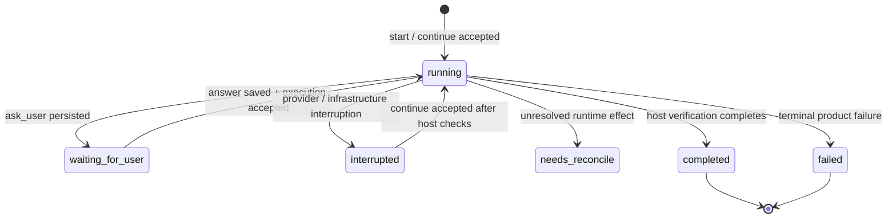

# PI UI/UX 交互模型复用与 Abaqus Agent 工作台实施指南

日期：2026-09-14
用途：供后续实施 LLM 在开发本项目 CLI / Web 工作台交互时直接阅读。本文从用户可见体验逐层下钻到状态所有权、命令合同、事件投影、失败恢复和实施顺序。
范围：整理 PI Coding Agent 的可复用交互思想，并映射到本项目已经采纳的 CodingRun / Web Workbench 架构。本文不是新的产品计划，不替代 ADR 或 PLAN；出现冲突时，以已采纳 ADR、当前源码和对应 PLAN 为准。

---

## 0. 阅读规则：先分清“已有、已采纳目标、建议扩展”

实施前先识别本文中的四类标记：

| 标记 | 含义 | 实施要求 |
| --- | --- | --- |
| **CURRENT** | 当前产品已经存在的宿主语义或代码合同 | 必须保留，不得由 UI 重新定义 |
| **ACCEPTED TARGET** | 已由 ADR / PLAN 采纳，但产品代码尚未实施 | 可按对应计划实施；不能在实现前描述成已有能力 |
| **PROPOSED** | 从 PI 借鉴后建议的后续扩展 | 只有当前任务明确要求时才实施；不能顺手加入首版 |
| **OUT OF SCOPE** | 首版明确不做 | UI 不应出现假按钮、占位动作或暗中实现 |

实施 LLM 必须遵守以下总原则：

1. **宿主状态是真值，UI 是投影。** 浏览器、TUI、组件库、SSE 和本地缓存都不能成为 CodingRun 的权威状态源。
2. **模型文本不等于宿主结论。** 模型说“完成”不能覆盖 verifier、artifact freshness、resume state 或 execution evidence。
3. **execution evidence 不等于物理正确性。** 普通产品任务只能展示其实际 verification scope；固定 evaluator 的 host-only oracle 不能暴露给产品 Agent 或前端。
4. **UI 不增加模型工具权限。** 当前产品 Coder 的运行边界仍是三个 typed Abaqus 工具；浏览器端工具只做展示。
5. **不能用界面假装不存在的运行语义。** 没有真正的取消、暂停、steer、follow-up、外部 Job 重附着或 reconcile 解锁，就不要显示这些操作。
6. **每个建议都要服从现有 CodingRun 生命周期。** 不为追求类似 PI 的体验而创建第二套 Agent loop、第二套会话状态或第二套恢复机制。

---

## 1. 一眼理解最终产品：它不是聊天页，而是“仿真任务工作台”

PI 的强项不只是终端界面好看，而是把 Agent 的关键交互都组织在一个持续任务上下文中：消息、工具调用、用户输入、模型设置、队列、会话和恢复都有明确位置。

本项目可以复用这个交互思路，但产品中心不是“聊天会话”，而是一个 **CodingRun 仿真任务**：

```text
用户目标
  ↓
CodingRun 宿主创建 / 恢复任务
  ↓
abaqus_2024_coder 工作段
  ├─ 读写 workspace
  ├─ ask_user(question)
  ├─ run_cae_script
  ├─ run_solver_job
  └─ run_abaqus_python
  ↓
宿主保存状态、证据、产物、预算与问题
  ↓
独立 verifier 形成产品 verification / outcome
  ↓
CLI / Web 只读取并呈现这些事实
```

因此，界面的核心心智模型应是：

> **一个任务，有持续的对话记录、当前需要用户做的动作、真实运行过程、产物和宿主验收结果。**

聊天只是任务工作台的一个区域。

---

## 2. 从 PI 复用什么：复用交互模型，不复制 TypeScript TUI

PI 当前官方仓库位于 `earendil-works/pi`。其文档没有一份单独名为“UX 设计规范”的文件，但 usage、extensions、TUI、keybindings 和 RPC 文档共同形成了一套相当完整的交互模型。

### 2.1 PI 最值得复用的七类设计

| PI 交互 | PI 中的意义 | 本项目的复用方式 |
| --- | --- | --- |
| Header / transcript / editor / footer | 把身份、历史、输入、状态稳定分区 | Web 中转化为任务列表 + 主时间线 + 操作区 + 状态/结果区 |
| 工具调用内联显示 | Agent 行为不藏在日志里 | CAE / Solver / Abaqus Python 形成专门运行卡片 |
| select / confirm / input / editor | 用户输入是结构化交互，不只是自由文本 | 当前 `ask_user(question)` 先使用文本；未来可扩展结构化 question kind |
| steer / follow-up | 区分“当前任务中途追加”和“本轮结束后的消息” | 作为未来宿主命令语义参考；首版不实现 |
| abort + clear_queue | 取消与消息队列恢复有清晰语义 | 只有宿主真正支持安全取消后才引入；首版不显示 |
| session / resume / fork / compact | Agent 会话有明确生命周期 | 映射到 CodingRun 的 run / resume / revision；不能机械照搬 fork/compact |
| RPC 命令与事件分离 | UI 可作为独立客户端 | 本项目继续采用“命令写入 + 只读状态投影”的架构 |

PI 的核心价值是让“消息、工具、用户动作、会话状态”之间的关系清楚。实现时应借鉴这些语义，而不是把 PI 的 TUI 源码、状态对象或快捷键系统直接移植进 Python 项目。

### 2.2 官方 PI 资料

- [PI usage](https://github.com/earendil-works/pi/blob/main/packages/coding-agent/docs/usage.md)：交互布局、编辑器、命令、消息队列、session。
- [PI extensions](https://github.com/earendil-works/pi/blob/main/packages/coding-agent/docs/extensions.md)：`select`、`confirm`、`input`、`editor`、`notify`、`setStatus`、`setWidget`、custom UI。
- [PI TUI](https://github.com/earendil-works/pi/blob/main/packages/coding-agent/docs/tui.md)：组件模型与 TUI 构造方式。
- [PI keybindings](https://github.com/earendil-works/pi/blob/main/packages/coding-agent/docs/keybindings.md)：快捷键和命令入口。
- [PI RPC](https://github.com/earendil-works/pi/blob/main/packages/coding-agent/docs/rpc.md)：`prompt`、`steer`、`follow_up`、`abort`、`clear_queue`、`get_state`、`get_messages`、model/thinking/compact 等命令及事件化接入。
- [PI moved to Earendil Works](https://pi.dev/news/2026/5/7/pi-has-a-new-home)：仓库迁移说明。

---

## 3. 本项目必须保留的 CURRENT 宿主合同

这一节是 UI 实施的硬边界。任何前端便利设计都不能绕开这些合同。

### 3.1 单 Agent 与工具边界

**CURRENT**：首轮产品调用链只有一个 `abaqus_2024_coder`，由 Pydantic AI Harness 的 Coder 驱动。

模型可调用的 Abaqus 运行工具只有：

```text
run_cae_script
run_solver_job
run_abaqus_python
```

产品 Coder 不暴露通用 shell。显式 profile 可能额外提供只读 API Catalog / Concept retrieval，但它们不是运行工具，首版 Web 也不自动启用这些实验 profile。

UI 层禁止：

- 在浏览器注册新的模型工具；
- 为 assistant-ui / AG-UI 打开前端 `execute` 后让浏览器执行 Abaqus；
- 把“工具卡片按钮”映射为任意 shell 或未授权宿主调用；
- 因为 UI 需要预览就偷偷运行额外 CAE。

### 3.2 `ask_user` 与 `waiting_for_user`

**CURRENT**：新默认协议使用 `ask_user(question)` + Pydantic AI 原生 DeferredToolRequests。

关键语义：

1. Agent 只能提出一个真实问题字符串，不需要自己填写 `field_id/kind/summary`。
2. 宿主拥有问题 ID、落盘、历史、幂等答复和 `waiting_for_user`。
3. 待答期间释放运行锁，用户等待时间不计 active wall。
4. 同问题同答案幂等；不同答案不能覆盖。
5. 如果此前当前 revision 已经发生 Abaqus 执行，晚到答案可能形成新的 task revision 和新的验收基线。
6. 未决 runtime effect 仍优先进入 `needs_reconcile`，不能用答复绕过。
7. 问题和其他工具/最终输出混发会由宿主拒绝，UI 不能自己挑一个保留。

UI 因此必须显示“宿主记录的问题”，不能从模型文本中猜一句问号当作表单。

### 3.3 最终结果所有权

**CURRENT**：模型最终只能给 strict `ready_for_verification` 或 `failed` 决策；最终 `CodingRunOutcome` 由宿主 `CodingRunService` 和独立 verifier 形成。

UI 必须分别呈现：

```text
模型最后说了什么
宿主当前 resume / execution 状态是什么
verifier 实际检查了什么 scope
artifact freshness 是否满足
最终 outcome 是什么
```

不要把这五项合并成一个绿色“成功”。

### 3.4 Resume / amendment / task revision

**CURRENT**：`request.json` 与无凭据 `launch.json` 是 immutable base；后续修改通过 typed amendment 和 task revision 管理，usage / budget 在同一 run resume 时累计。

需要区分：

- **resume**：同一任务、同一有效目标继续执行；
- **late answer revision**：问题答复改变了已执行后的验收基线；
- **task revision**：新 goal / 修改形成新验收边界；
- **new run**：首版 Web 完成后要做新目标时创建新任务。

浏览器缓存和 assistant-ui thread 不能替代这些宿主概念。

### 3.5 证据与物理验收

**CURRENT**：普通 CLI / 产品任务使用 `execution_evidence`，它检查本次 workspace、Python 3.10 语法和实际 runtime stage 等产品证据，不是固定 Case 的物理 oracle。

因此 UI 文案应根据 `verification scope` 呈现，例如：

```text
执行证据：通过
物理正确性：未由普通产品 verifier 自动验收
```

不能写成：

```text
仿真正确 ✓
物理验证通过 ✓
```

除非当前真实 verification scope 确实包含并通过对应检查。

---

## 4. ACCEPTED TARGET：首版本地 Web 工作台的产品形态

ADR-0025 已采纳的首版方向为：

```text
FastAPI
  + React / TypeScript / Vite
  + assistant-ui ExternalStoreRuntime
  + REST 写操作和快照读取
  + 轻量 SSE sync / run.changed
```

当前产品尚未实施该 Web 工作台；PLAN-0009 和 PLAN-0010 负责后端 API 与完整页面落地。

### 4.1 页面信息架构

采用三栏任务工作台：

```text
┌────────────────┬──────────────────────────────────┬────────────────────────┐
│ 任务列表        │ 当前任务主区域                   │ 结果 / 产物 / 验证       │
│                │                                  │                        │
│ + 新建任务      │ 任务目标                         │ 当前状态                │
│                │ 消息 transcript                  │ verification scope     │
│ run A          │ ask_user 问题卡                  │ artifacts              │
│ run B          │ CAE / Solver / Python 工具卡     │ 图片预览                │
│ run C          │ 模型文本                         │ 日志摘要                │
│                │                                  │                        │
│                │ 当前允许的用户操作               │ 配置 / budget 只读      │
└────────────────┴──────────────────────────────────┴────────────────────────┘
```

这相当于把 PI 的 header / transcript / editor / footer 扩展成适合 CAE 的工作台：

- PI header → 当前任务、模型、运行状态、revision；
- PI transcript → 模型消息 + 工具执行 + 用户问题 + 宿主阶段；
- PI editor → 当前允许的用户操作；
- PI footer/status → budget、连接状态、verification scope、artifact 状态。

### 4.2 “输入框”不是一直可用

首版操作区根据宿主状态切换：

| 状态 | 主操作 |
| --- | --- |
| 新任务 | 输入 goal，开始建模 |
| running | 普通输入禁用，仅展示执行 |
| waiting_for_user | 显示宿主问题表单，提交 answer |
| interrupted | 显示后端复核后的“继续”操作 |
| needs_reconcile | 解释需要人工处理，不显示虚假继续 |
| completed / failed | 只读查看结果；新目标创建新任务 |

这一点与 PI 的通用可持续输入不同，是本项目外部副作用和宿主合同带来的必要约束。

---

## 5. 状态模型：不要把所有状态压成一个枚举

PI UI 很强调当前运行状态，但本项目状态比普通聊天 Agent 更复杂。实现时至少分三层。

### 5.1 产品权威状态：`resume_status`

**CURRENT** 的核心状态包括：

```text
running
waiting_for_user
interrupted
needs_reconcile
completed
failed
```

这是产品恢复语义，不能由 UI 自己改名后重新推导业务行为。

### 5.2 Web 管理状态：registration / execution activity

**ACCEPTED TARGET**：Web 需要自己的管理信息，但不能冒充产品状态。

例如：

```text
registration_state:
  registered
  dispatch_pending
  ...

execution_activity:
  idle
  active
  unknown
```

典型场景：服务崩溃后文件中可能仍是 `running`，但 Web 进程并不知道真实外部活动，此时展示应类似：

```text
产品状态：running
当前活动：unknown
操作：经宿主恢复检查后才允许继续
```

绝不能直接显示“正在运行”。

### 5.3 UI 展示阶段：transient progress phase

**ACCEPTED TARGET / PROPOSED typed shape**：为了用户理解，可以显示细阶段，但它只是观察投影：

```text
model_turn
cae
solver
abaqus_python
verification
publishing_artifacts
```

这些阶段不能成为新的恢复状态机，也不能覆盖 `resume_status`。

### 5.4 推荐状态关系图



注意：`verification` 是运行阶段，不应额外塞成一个权威 `resume_status`，除非未来宿主正式定义该状态。

---

## 6. 消息语义：区分 prompt、answer、continue 与未来 steer / follow-up

PI RPC 对不同用户输入做了很有价值的语义区分。本项目可以借此避免未来把“所有文字”都当成同一种 chat message。

### 6.1 首版已经有明确语义的输入

| 用户动作 | 本项目语义 | 是否首版支持 |
| --- | --- | --- |
| 新建 goal | 创建新的 CodingRun | **ACCEPTED TARGET** |
| 回答问题 | 对确定 `question_id` 保存 answer，并尝试继续 | **CURRENT + ACCEPTED TARGET Web 入口** |
| continue | 对 interrupted / 已答未调度任务显式恢复 | **CURRENT backend / ACCEPTED TARGET Web 入口** |
| 新目标 | 首版创建新 run | **ACCEPTED TARGET** |

### 6.2 PI 的 `steer`

PI 的 `steer` 适合表示：Agent 还在工作，用户追加一句会在当前 assistant turn / tool calls 之后尽快送达。

**PROPOSED，不属于首版。**

如果未来要支持，先在宿主定义：

- 什么状态允许 steer；
- steer 如何进入 Harness history；
- 是否形成 task revision；
- 当前 Abaqus runtime 已经执行时如何重新设验收基线；
- 预算如何累计；
- steer 是否允许改变物理模型必需输入。

在这些语义存在前，前端不要提供“运行中继续打字”的假输入框。

### 6.3 PI 的 `follow_up`

PI 的 follow-up 只在 Agent idle 后进入下一轮，适合普通 coding chat。

**PROPOSED，不属于首版。**

本项目 terminal task 完成后首版要求新目标创建新 run。未来若允许对 completed run 追加新目标，应优先映射到本项目的 task revision / amendment，而不是照搬 PI 的 follow-up queue。

### 6.4 PI 的 `abort` 与 `clear_queue`

PI 可以清空排队消息、abort 当前生成，并将文字恢复到编辑器。

本项目首版没有可靠的外部 Job cancel / process reconcile / queued user message 合同，因此：

- **OUT OF SCOPE**：取消正在运行的 Abaqus 工作段；
- **OUT OF SCOPE**：清空消息队列；
- **OUT OF SCOPE**：abort 后自动恢复编辑器文字；
- 不要把 `Future.cancel()` 当作 Abaqus 取消成功。

未来只有在宿主能终止准确进程树、记录 runtime effect、明确 resume/reconcile 后果时，才设计真正的 cancel UX。

---

## 7. `ask_user` 的 UI：当前简单，接口要为结构化输入留余地

### 7.1 CURRENT 首版合同

当前工具是：

```python
ask_user(question: str)
```

UI 卡片至少需要：

```text
question_id
question text
task_revision
status: waiting / answered / cancelled / stale
answer if already persisted
```

提交时必须携带问题身份，不能只 POST 一段文本。

### 7.2 首版展示建议

问题卡应和普通模型消息明显区分：

```text
需要你的输入

板的厚度是多少？

[              ] mm
[提交答案]

这个问题来自当前 CodingRun，回答后任务会继续。
```

不要：

- 预填“常见值”；
- 从 RAG / 模板推断物理参数；
- 把模型普通问句误判为宿主问题；
- 在答案 POST 成功前本地先标记 Answered；
- 答案保存成功但执行调度失败时显示“答案丢失”。

### 7.3 PROPOSED 结构化 question 类型

PI 的 `select / confirm / input / editor` 提醒我们：用户输入不必永远是纯文本。

未来可以把宿主 question contract 扩展成：

```text
free_text
select_one
select_many
confirm
structured_form
```

但扩展必须从宿主开始，而不是前端看到一句自然语言后自行决定控件。

建议未来形态：

```json
{
  "question_id": "...",
  "kind": "select_one",
  "prompt": "选择分析步类型",
  "options": [
    {"value": "static_general", "label": "Static, General"},
    {"value": "dynamic_explicit", "label": "Dynamic, Explicit"}
  ],
  "required": true
}
```

这只是 **PROPOSED**。当前实现 LLM 不应为此修改 `ask_user_v1`，除非任务明确要求升级协议并补兼容/恢复测试。

---

## 8. 工具调用与仿真执行：像 PI 一样“可见”，但必须比普通 Agent 更严谨

PI 把 tool calls 直接放进 transcript，这是本项目非常值得复用的部分。

### 8.1 三类 Abaqus 工具卡片

建议分别呈现：

#### CAE 建模

```text
Abaqus/CAE 建模
状态：完成
脚本：build_model.py
输出：beam_tension.cae, beam_tension.inp
耗时：...
[查看摘要] [查看日志]
```

#### Solver

```text
Abaqus/Standard Solver
Job：beam_tension
状态：失败
高信号错误：...
已有日志：.sta / .dat / .msg / .log
[查看日志详情]
```

#### Abaqus Python 后处理

```text
Abaqus Python / odbAccess
状态：完成
脚本：extract_results.py
输出：results.json
```

### 8.2 工具卡片的事实来源

工具状态必须来自宿主结构化记录：

```text
invocation id
tool kind
started / finished / failed
input artifact identity
exit / structured runtime result
published artifacts
evidence / log references
```

不要从 stdout 文本中正则推导“成功”，也不要把进程 exit code 单独当作 Abaqus 成功。

### 8.3 不显示伪百分比

如果宿主没有可靠 solver 进度合同：

```text
Solver 正在运行
```

比

```text
Solver 63%
```

更正确。

只有确定存在可解释、可恢复的进度字段时才显示百分比。

---

## 9. Verification UX：一定把“谁说成功”展示清楚

本项目最容易被通用 Agent UI 误伤的地方，就是把 assistant message、tool finished 和 host verification 混成同一种 success。

推荐右栏固定有一个“验收”区域：

```text
宿主验收

Outcome: completed
Scope: execution_evidence

✓ 当前 workspace 产物存在且 fresh
✓ Python 3.10 语法检查
✓ 最后实际 runtime stage 有对应证据

物理正确性：未由普通产品 verifier 自动验收
```

如果 verifier 失败：

```text
宿主验收失败

模型已声明 ready_for_verification，
但宿主发现 results.json 缺失 / stale。
```

视觉层级上，宿主结论应高于模型自述。

---

## 10. Session / Resume / Revision：借 PI 的生命周期思想，但使用本项目自己的词

### 10.1 用户在 UI 中应该看到什么

侧栏任务列表每一项代表一个 `run_id`，不是浏览器 thread。

任务详情应能显示：

```text
run_id
当前 task_revision
当前 resume_status
创建时间 / 最近更新时间
goal 摘要
provider / model / thinking 配置（只读）
累计 budget / usage
当前问题（如有）
最终 verification / outcome（如有）
```

### 10.2 Resume 按钮的真实含义

“继续”只能表示：

> 请求宿主按照既有 resume 合同重新检查并继续同一 CodingRun。

它不表示：

- 重新发送最后一条用户消息；
- 新建一个 Agent；
- 清除错误；
- 重跑未决 Abaqus effect；
- 强行把 `needs_reconcile` 变回 running。

### 10.3 Revision 切换

当 late answer 或正式 task revision 改变 `task_revision`：

1. 前端清除当前 revision 的结果缓存；
2. 重新 GET snapshot / timeline / artifacts；
3. 旧 revision 的绿色状态不能沿用；
4. 旧 artifact 只有在仍有对应 bytes / hash 证据时才可查看，并明确标识历史版本。

---

## 11. Artifact UX：CAE 项目和普通聊天 Agent 最大的差异之一

### 11.1 首版要展示的产物

优先支持：

```text
.py
.inp
.json
有限日志文本
真实存在的 .png
其他可下载但不在线解析的 artifact
```

`.cae`、`.odb` 可以列出和受控下载，不需要首版浏览器内解析。

### 11.2 Artifact 身份

**ACCEPTED TARGET**：内容访问绑定至少：

```text
run_id
task_revision
relative_path
sha256
```

前端不要接收或提交任意宿主绝对路径。

### 11.3 预览规则

- 文本：只读、长度有界、按纯文本/代码安全渲染；
- PNG：验证实际格式、大小和像素上限；
- HTML / SVG / script：不作为同源活动内容执行；
- 没有 PNG：显示“尚无模型预览”；
- 不用示意图冒充 Abaqus 真实模型截图；
- 不因为用户打开预览就触发新的 Abaqus 调用。

### 11.4 Freshness 必须可见

推荐给 artifact 显示：

```text
当前 revision 产物
历史 revision 产物
stale / changed
hash verified
```

而不是只显示一个文件名列表。

---

## 12. Model / Thinking / Budget / Status：借 PI 的 footer 思想，先只读

PI 会把 model、thinking level、session / pending messages 等运行信息放在状态区域。

本项目首版可复用这种“环境透明度”，但配置先只读：

```text
Provider: ...
Model: ...
Thinking: enabled / high
Model requests used: ...
Abaqus calls used: ...
Solver calls used: ...
Wall budget: used / limit
Current revision: ...
Connection: connected / reconnecting
```

注意：框架 `usage.requests` 只表示框架已经计数的请求，不能宣称覆盖最后失败的全部 HTTP / 逻辑请求。

**OUT OF SCOPE 首版**：网页模型切换、thinking 修改、预算 amendment 编辑器。

未来如果开放这些操作，必须走已有 typed amendment / execution config 规则，不能直接改浏览器 local state 后继续。

---

## 13. CLI / TUI / Web 应共享一个领域合同

PI 本身同时提供 interactive UI 和 RPC，这个思想值得保留：交互界面可以不同，Agent 任务语义只有一套。

推荐分层：

```text
┌─────────────────────────────────────────┐
│        UI renderers / clients           │
│ CLI   TUI（未来）   Web / assistant-ui   │
└───────────────────┬─────────────────────┘
                    │ commands + read model
┌───────────────────▼─────────────────────┐
│       CodingRun application boundary    │
│ create / execute / answer / continue    │
└───────────────────┬─────────────────────┘
                    │
┌───────────────────▼─────────────────────┐
│ CodingRunService / Harness / verifier   │
└─────────────────────────────────────────┘
```

CLI 与 Web 都不能各自复制：

- provider/model 默认值；
- ask_user 恢复规则；
- verifier 规则；
- runtime tool schema；
- resume / revision 逻辑；
- budget 统计。

UI 的差别只应在：

```text
如何渲染
如何收集用户输入
如何展示只读状态
如何发送已经定义好的命令
```

---

## 14. ACCEPTED TARGET：Web API 命令边界

ADR-0025 / PLAN-0009 已定义首版目标 API。它们目前尚未实施，实施 LLM 不应重新发明一套不同 REST 模型。

| API | 语义 |
| --- | --- |
| `POST /api/v1/runs` | 注册新任务；同创建幂等键同内容返回原任务 |
| `POST /api/v1/runs/{id}/start` | 显式启动已注册任务；202 只表示命令已接受 |
| `GET /api/v1/runs` | 只读任务列表 |
| `GET /api/v1/runs/{id}` | 只读任务快照 |
| `GET /api/v1/runs/{id}/timeline` | 分页消息 / 工具 / 宿主记录投影 |
| `GET /api/v1/runs/{id}/events` | SSE 失效通知 |
| `POST /api/v1/runs/{id}/answers` | 保存指定 question 的答案，并尝试继续 |
| `POST /api/v1/runs/{id}/continue` | 显式恢复同一任务 |
| `GET /api/v1/runs/{id}/artifacts` | 列出可见 artifact |
| `GET /api/v1/runs/{id}/artifacts/{artifact_id}` | 读取受控 artifact |

实现时继续遵守：

- create 与 start 可以由页面一个按钮顺序调用，但后端语义保持分开；
- `answer_saved` 与 `execution_accepted` 分开返回；
- command ID / idempotency key 防止双击、刷新、多标签页导致重复副作用；
- GET 不能调用会修改 resume/question state 的函数；
- Web 不接受完整 `CodingRunRequest` 让浏览器任意指定 launcher / path / tool profile。

---

## 15. SSE 与内部事件：外部通知保持简单，内部观察可以结构化

### 15.1 PUBLIC：首版 SSE 只有两种通知

**ACCEPTED TARGET**：

```text
sync
run.changed
```

payload 只告诉客户端“这个 run 的显示数据失效，需要重新 GET”。

SSE 不承担：

- 产品恢复日志；
- token stream；
- 用户答案；
- 命令确认；
- verifier 真值；
- exactly-once 事件回放。

通知允许重复、合并或丢失；浏览器重新连接后重新 GET 宿主快照。

### 15.2 INTERNAL：建议增加 typed progress，而不是解析日志

PLAN-0009 已计划增加 `coding/progress.py` 的结构化观察。实现时可以采用类似下面的内部形态；字段名是 **PROPOSED implementation shape**，不应未经需要变成公开协议：

```python
class ProgressEvent:
    run_id: str
    task_revision: int
    kind: str
    occurred_at: datetime
    invocation_id: str | None
    summary: str | None
```

`kind` 可以覆盖：

```text
model.turn.started
model.turn.completed
user_question.required
runtime.cae.started
runtime.cae.completed
runtime.solver.started
runtime.solver.completed
runtime.python.started
runtime.python.completed
verification.started
verification.completed
artifact.published
budget.updated
```

关键规则：

1. 事件在确切生命周期点产生；
2. 观察失败不能改变运行结果；
3. 事件不是恢复账本；
4. UI 可以丢掉瞬时事件后通过 read model 重建 settled 事实；
5. 不从 stdout 正则反推出这些事件。

---

## 16. Timeline 设计：把四种内容并列，而不是把一切伪装成聊天消息

推荐 timeline item 至少有四类：

```text
assistant_message
user_message / answer
tool_execution
host_event
```

其中 `host_event` 可用于：

```text
等待用户输入
答案已保存
开始宿主 verification
verification 失败
Provider 中断
revision 发生变化
```

这样可以避免把宿主事实伪造成 assistant role 消息。

每个 item 需要稳定 ID；前端按 `run_id + task_revision` 隔离缓存。

---

## 17. Command Palette 与快捷键：只复用“入口思想”

PI 的 slash commands 和 keybindings 很成熟，但本项目首版不需要复制完整命令系统。

适合首版的快捷动作：

```text
Ctrl/Cmd + K      打开本地命令面板
N                 新建任务（非输入焦点时）
R                 刷新当前任务只读状态
Enter             提交单行 question answer
Ctrl/Cmd + Enter  提交多行 answer
Esc               关闭弹窗 / 日志详情
```

命令面板只列出当前真实可用操作：

```text
New task
Continue run
Open artifacts
Open verification details
Copy run id
```

不要为了像 PI 而添加未实现的：

```text
/abort
/fork
/compact
/model
/thinking
```

未来宿主有对应合同后再增加。

---

## 18. Failure / Recovery UX：失败不是一个红色 toast 就结束

需要区分至少五类失败。

### 18.1 用户输入 / 状态冲突

例如：旧 revision 的问题答复、冲突答案、重复 command。

UI 显示：

```text
该问题已经被回答，当前页面可能已过期。
[刷新任务]
```

### 18.2 Provider / 模型中断

如果宿主状态为 `interrupted`：

```text
模型请求中断
已保存的任务状态和累计预算仍保留。
[继续]
```

是否可继续必须由后端重新检查。

### 18.3 Abaqus runtime 失败

展示：

```text
哪一种 runtime
哪一个 invocation
高信号错误摘要
可查看的日志
Agent 是否仍在后续修复循环中
```

运行工具失败不一定等于整个 CodingRun terminal failed。

### 18.4 `needs_reconcile`

这是特殊状态：存在未决外部 effect，宿主无法安全判断是否可以重放。

首版：

```text
需要人工核对运行状态
当前版本不支持网页中自动重附着或解除 reconcile。
```

不要给一个“强制继续”按钮。

### 18.5 Verifier 失败

突出显示：

```text
Agent 已结束，但宿主验收失败
```

并列出实际失败 gate。不要将其归类为“聊天回复失败”。

---

## 19. 页面断开、刷新和重启：浏览器永远不是恢复真值

借鉴 PI session/resume 思想，但使用宿主文件状态。

必须满足：

1. 关掉标签页不取消任务；
2. 重开页面从宿主重新加载任务列表；
3. waiting question 从宿主 question ledger 恢复；
4. completed / failed 从宿主 outcome 恢复；
5. SSE 断线不改变 Agent；
6. Web 服务崩溃后不自动重放工作段；
7. `running` 文件状态不自动解释成当前仍有活跃进程；
8. 浏览器 IndexedDB / localStorage 不成为任务历史真值。

---

## 20. assistant-ui 的正确定位

当前已比较官方 Pydantic UI、assistant-ui ExternalStore 和 assistant-ui AG-UI，三条在确定性接线场景中都可行。项目保留 ExternalStore 主线是维护边界选择，不是因为其他方案做不到。

首版 assistant-ui 只负责：

```text
消息展示
通用 transcript UI
工具 render-only 组件
输入区域外壳
滚动 / Markdown 等成熟交互
```

项目自己负责：

```text
任务列表
question card
运行卡片
artifact panel
verification panel
read model → runtime adapter
REST command callbacks
SSE invalidation
```

必须关闭或不接入组件库中没有宿主语义的：

```text
edit message
reload / regenerate
frontend tool execute
cancel
fork
message queue
```

### 20.1 什么时候再考虑 AG-UI

当前同组比较已经证明 AG-UI 可接通，但在首版“不逐 token + 宿主拥有状态”的范围内，它没有消除宿主 read model / snapshot 同步。

未来出现以下真实需求时再评估升级：

- 逐 token 流；
- 标准化 interrupt 互操作；
- 多种现成 Agent UI 客户端；
- 更丰富的 in-flight 消息生命周期；
- 标准协议能实际减少当前 adapter 维护量。

不要为了“标准协议更先进”提前重构。

---

## 21. 实施分层：从最小正确链路逐层增加体验

实施 LLM 应按下面顺序推进。不要先画完整 UI 再补宿主合同。

### Layer 1：共享应用入口和只读投影

对应 PLAN-0009。

目标：

```text
CLI 与 Web 共用装配
typed create / execute / answer / continue
pure read model
结构化 progress observation
```

验收重点：

- CLI schema/config parity；
- GET 不写产品状态；
- question / revision / outcome 能正确读取；
- UI 观察不干扰原子文件替换；
- client 生命周期不跨 event loop 误用。

### Layer 2：最小 FastAPI 命令与状态 API

目标：

```text
create
start
answer
continue
list/detail/timeline
sync/run.changed SSE
```

先用 deterministic fake model 验证，不需要真实 Abaqus。

### Layer 3：assistant-ui ExternalStore 最小页面

先做：

```text
任务列表
消息 transcript
ask_user 卡片
三类工具卡片
verification panel
```

做到“语义正确”以后再优化视觉。

### Layer 4：artifact 浏览与真实状态细节

加入：

```text
文本预览
真实 PNG
下载
freshness / revision
有界日志
budget/config 状态
```

### Layer 5：真实产品 E2E

按 PLAN-0010 的新 Web 主线保留所有成功/失败结果。模型漏问、Provider timeout、Abaqus 错误不能由 UI 层修饰或补跑后覆盖。

### Layer 6：只有真实需求出现后再做 PI 高阶交互

可能包括：

```text
structured ask_user
steer
follow-up
真正的 abort / cancel
command palette 扩展
model / thinking amendment UI
token streaming / AG-UI
```

每项都先扩展宿主合同，再扩展 UI。

---

## 22. 实施 LLM 的具体检查清单

开始编码前：

- [ ] 阅读 ADR-0024、ADR-0025、PLAN-0009、PLAN-0010。
- [ ] 确认当前源码中 `CodingRunService.run_step`、`submit_answer`、resume / amendment / verifier 的实际接口，不只依赖本文。
- [ ] 区分 CURRENT 与 TARGET；不要创建并不存在的 endpoint / event 后声称已有。
- [ ] 不恢复旧多 Agent / Supervisor 架构。
- [ ] 不把 evaluator oracle 接进产品 Web。

实现后端时：

- [ ] CLI / Web 共享同一个应用入口与装配规则。
- [ ] GET 路径纯只读，不调用会修复/写状态的 inspect/resume helper。
- [ ] `answer_saved` 与 `execution_accepted` 分开。
- [ ] start / continue / answer 有幂等 / command identity。
- [ ] 一个 Web 实例只有一个主动工作段，不建立隐式任务队列。
- [ ] SSE 只做 invalidation；丢失通知后可通过 GET 恢复显示。
- [ ] 活动观察不能因 Windows 文件读句柄破坏宿主原子 replace。

实现前端时：

- [ ] assistant-ui 是 renderer，不是 Agent owner。
- [ ] Tool UI 仅 render-only。
- [ ] running 时不显示自由输入。
- [ ] waiting_for_user 只显示当前宿主问题。
- [ ] interrupted 的 continue 由后端决定是否允许。
- [ ] needs_reconcile 不显示强制继续。
- [ ] terminal task 首版不允许 follow-up / reopen。
- [ ] 宿主 verification 视觉层级高于模型自述。
- [ ] execution_evidence 不写成 physics verified。
- [ ] revision 改变后清理当前结果缓存。
- [ ] 没有真实 PNG 时明确显示无预览。

验证时：

- [ ] ask_user → 刷新 → 回答 → 继续保持同 run/question identity。
- [ ] 重复答案不重复执行；冲突答案可解释。
- [ ] 答案保存成功但调度失败时可见并可显式 continue。
- [ ] 模型说完成但 artifact/verifier 失败时页面仍显示宿主失败。
- [ ] 关闭页面不取消工作段。
- [ ] 后端重启后 waiting question / terminal outcome 可恢复显示。
- [ ] SSE 丢失 / 重连不会触发重复命令。
- [ ] 旧 revision artifact 不冒充当前 artifact。
- [ ] 浏览器没有新增模型工具、retry、edit、fork、cancel 等未授权动作。

---

## 23. 不要做的“看起来体验很好”的捷径

以下做法会破坏项目最重要的工程边界：

1. **把 assistant-ui thread 当 CodingRun。** 浏览器 thread 可以丢；run_id 不可以。
2. **用消息列表推导产品状态。** 最后一条 assistant message 不是 outcome。
3. **在浏览器先乐观标 Answered / Completed。** 必须等待宿主确认。
4. **从文本中识别 ask_user。** 只认宿主持久问题。
5. **把 WebSocket / token stream 当进度。** token 多不代表 Abaqus 做了什么。
6. **看到 `.odb` 就自动启动解析。** 任何 Abaqus Python 调用都必须经过现有运行工具和预算。
7. **用组件库现成 Cancel 按钮。** 当前宿主没有完整外部 Job cancel 语义。
8. **用浏览器本地历史恢复任务。** 必须读宿主 state。
9. **为视觉连续性保留旧 revision 绿标。** revision 切换必须重新取证。
10. **因为 PI 支持某功能就顺手加进产品。** PI 是交互参考，不是本项目需求清单。

---

## 24. 一个实施 LLM 应保持的最终心智模型

实现任何 UI 功能前，都用下面这条链检查：

```text
用户现在想做什么？
    ↓
这是否已经有宿主命令语义？
    ├─ 否 → 不在 UI 单方面实现；先设计宿主合同
    └─ 是
        ↓
宿主写入/验证的权威状态是什么？
        ↓
只读 view 如何安全投影这个状态？
        ↓
UI 用什么组件呈现？
        ↓
断线、刷新、重复提交、revision 切换后是否仍正确？
```

PI 给本项目最大的启发不是某个组件或配色，而是：**不同交互动作有不同语义，Agent 的运行状态应持续可见，会话生命周期要可恢复，工具和用户输入都是一等交互。**

本项目再往前一步：因为存在 Abaqus 外部副作用、持久证据和独立 verifier，所有这些交互必须服从宿主所有权。只要这条边界保持清楚，就可以持续吸收 PI 或其他 Agent UI 的成熟体验，而不破坏现有 CodingRun 架构。

---

## 25. 本地关联文档

实施时至少同时参考：

- [ADR-0024：用 ask_user 与宿主待答记录交接用户输入](../adr/0024-host-owned-user-question-waiting.md)
- [ADR-0025：在 CodingRun 宿主之上增加本地 Web 工作台](../adr/0025-local-web-workbench-over-coding-run.md)
- [PLAN-0007：用户问题工具](../plans/done/0007-user-question-tool.md)
- [PLAN-0008：assistant-ui / 官方 UI / AG-UI 接线资格](../plans/done/0008-assistant-ui-integration-qualification.md)
- [PLAN-0009：共享 CodingRun 入口与 FastAPI 任务接口](../plans/done/0009-coding-run-web-api.md)
- [PLAN-0010：本地仿真工作台集成与验收](../plans/todo/0010-local-web-workbench.md)
- [Agent 前端生态与复用完整性审查](agent-ui-reuse-audit-20260913.md)
- [官方 UI、ExternalStore 与 AG-UI 的同组接线比较](ui-three-way-comparison-20260913.md)
- [官方 UI 兼容性验证](official-ui-compatibility-20260913.md)
- [Agent UI 比较二次评估](agent-ui-comparison-reassessment-20260913.md)

本文的作用是把 PI 的交互经验映射成一份可直接实施的阅读入口；具体代码位置、类型签名、兼容版本和测试要求仍以当前源码及以上 ADR / PLAN 为准。
