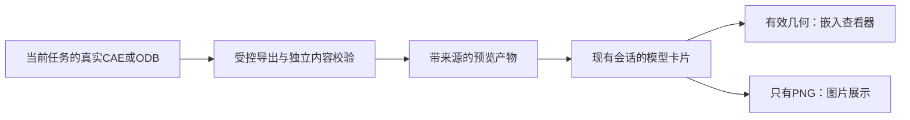

# 会话内模型预览：现成实践与导出验证

日期：2026-09-15。状态：调研、Abaqus原生OBJ导出边界、OBJ浏览器加载资格、真实会话内模型卡与真实Abaqus→artifact→会话内3D完整链路均已验证；当前资格范围为简单实体、基础装配、壳面与梁中心线显示。

用户当前范围：暂不做上传；优先在现有会话中直接查看生成的模型，图片也可作为交付形式。先调查现成实践，再实施。

## 结论

当前目标是生成模型的几何预览，推荐先验证Online 3D Viewer的嵌入引擎，而非自行组合三维引擎。它可以作为React会话中的一个展示组件，现有assistant-ui继续负责聊天，FastAPI继续提供绑定revision/hash的产物内容。

PNG路径已有本机Abaqus 2024确定性验证。OBJ随后也已打通一条有边界的原生路径：模型在导出前已经创建`rootAssembly`实例，viewport显示`rootAssembly`并`fitView()`，再调用`session.writeOBJFile(...)`。简单实体与两个instance的装配都在真实`cae noGUI`中产生了非空OBJ，并已由浏览器查看器读取。原先“仅35字节文件头”的探针也被重复复现，因此不能把`writeOBJFile`描述成任意Part状态下都可靠的通用几何导出器。

当前产品已经实现并完成真实E2E：“本轮`run_cae_script`产生有效OBJ→现有artifact API→真实会话对应CAE工具卡→可见3D模型”。真实`Abaqus2024Runner`已分别验证实体、壳与梁：实体OBJ以`v`/`f`组成面几何，壳OBJ同时包含面/线记录，梁OBJ由`v`/`l`组成中心线几何；三者均直接显示在同一次run的会话内`CAE 建模`工具卡。Provider仅用确定性`FunctionModel`控制步骤，没有fake Abaqus runner。PNG仍保留为可靠回退路径。

## 核对过的实践

| 项目 | 核对范围 | 可迁移部分 | 适用限制 |
|---|---|---|---|
| [Online 3D Viewer](https://github.com/kovacsv/Online3DViewer) | 官方嵌入文档、源码、npm 0.18.0 tarball与类型；MIT | OBJ/WRL/glTF等文件加载、相机交互、视口截图；直接使用引擎包 | 不读取CAE/ODB；后端必须先提供有效网格。嵌入引擎不自动包含完整网站的模型树等UI。 |
| [Google model-viewer](https://modelviewer.dev/) | 官方入口与项目定位 | 已有GLB/glTF的紧凑可交互模型卡片 | 当前Abaqus未具备GLB导出链，首版需要额外转换。 |
| [Tomsabay/abaqus_agent](https://github.com/Tomsabay/abaqus_agent) | `runner/preview.py`、`post/export_odb_mesh.py`源码 | CAE/ODB真实网格→有界数据→网页预览；区分模型数据与计算模型、按instance区分节点 | AGPL-3.0；本次只研究设计，没有复制代码。其近似表面、应力平均与自动ODB升级行为不成为本项目默认策略；未复验其上游运行声明。 |
| [Kitware Glance](https://github.com/Kitware/glance) | 官方README与打包部署说明 | 已有VTK数据的完整科学可视化应用 | BSD-3-Clause；可自托管，但整应用集成和VTK数据准备比单几何卡片更重。 |
| [Paraqus](https://github.com/InstituteOfMechanics/Paraqus) | 原仓库迁移声明及用途 | 将Abaqus结果转换为VTK，供未来结果后处理评估 | GPL-3.0；属于数据转换层，不是会话查看器，不能直接把其VTU输出等同vtk.js可用PolyData。 |

此前建议vtk.js是以未来结果云图为目标。本次用户收窄为会话中提供模型/截图，现成查看组件可减少相机、加载、截图等基础工作。若后续明确需要数值查询、字段切换、平均规则和帧选择，再单独评估科学结果视图。

### 可直接核对的源文件

- Online3DViewer主分支基线：`d025663dcdd101527e87971d9ae2cf16f02949b4`，仓库package标0.19.0；查询时npm发布版为0.18.0，二者不能混称同一版本。
- [`EmbeddedViewer`](https://github.com/kovacsv/Online3DViewer/blob/d025663dcdd101527e87971d9ae2cf16f02949b4/source/engine/viewer/embeddedviewer.js)：独立DOM容器、加载成功/失败回调、File列表加载、销毁接口。
- [`embed_selfhost_snapshot.html`](https://github.com/kovacsv/Online3DViewer/blob/d025663dcdd101527e87971d9ae2cf16f02949b4/sandbox/embed_selfhost_snapshot.html)：模型嵌入与`GetImageAsDataUrl`截图示例。npm 0.18.0包也核对到相同核心接口。
- npm 0.18.0 integrity：`sha512-y7ZlV/zkakNUyjqcXz6XecA7vXgLEUnaAey9tyx8o6/wcdV64RfjXAQOjGXGY2JOZoDi4Cg1ic9icSWMWAvRQA==`。本次在内存检查tarball，未安装到产品或修改lock。
- Tomsabay基线：`925a8f80845b686b28d5072fe1fc34650b388d6a`。[预览投影](https://github.com/Tomsabay/abaqus_agent/blob/925a8f80845b686b28d5072fe1fc34650b388d6a/runner/preview.py)、[ODB表面导出](https://github.com/Tomsabay/abaqus_agent/blob/925a8f80845b686b28d5072fe1fc34650b388d6a/post/export_odb_mesh.py)。只将代码路径存在视为实现证据，不将其README中的成功率或覆盖范围当本项目证据。
- Paraqus原仓库`tmfrln/paraqus`基线`aa4a2ccbf01433208b7cf1faf42c94cd9f172105`声明迁至`InstituteOfMechanics/Paraqus`；后续评估应重新固定新仓库版本。
- 本地LIRAM快照的`src/services/visualization.py`使用viewport和printToFile，并保持Viewer打开，不是网页内查看方案。
- 本地sim-plugin-abaqus的指南声称noGUI无viewport，但其`view_results.py`示例又使用noGUI和viewport；矛盾促成本次运行验证。研究快照中的文字不覆盖本机运行证据。

## 一次本机导出探针

探针只使用一个20×10×6的确定性长方体显示夹具；尺寸仅用于图形验证，不代表用户仿真或物理需求。

执行入口：现有`Abaqus2024Runner.run_cae_script`，`D:/SIMULIA/Commands/abq2024.bat cae noGUI=export_probe.py`；workspace/state分离，限时90秒，原始stdout/stderr保留。

| 检查 | 结果 |
|---|---|
| 调用数 | 1次CAE、0次Solver、0次模型请求 |
| 耗时 | 22.906秒，未超时 |
| 进程/阶段 | exit 0、stage_succeeded true，仅说明运行未报错 |
| `.cae` | 32768字节 |
| PNG | 457×285，2676字节；图片解码通过，人工查看确认可见实体及坐标轴 |
| OBJ | 35字节，仅`#OBJ File generated by Abaqus/CAE`；0顶点、0面，导出资格失败 |

证据在本工作树`var/audits/model-preview-research-20260915/`：`run_probe.py`、`workspace/export_probe.py`、`workspace/probe_report.json`、`execution.json`、`checks.json`及`state/executions/`原始日志。原探针和失败OBJ不覆盖、不回填。

- PNG SHA-256：`258e8a62133ed56a6a0ffac1531165facd78ab6b686ccf732911ead73112f6a9`。
- OBJ SHA-256：`bba33573efb44167a39cb7807ddc91d58bf0536a28327219221a410674d125ae`。
- 探针脚本 SHA-256：`27a05cbf10fdfc8aab16f1f30531753ca9963eb94a0188516eb517adfb06f9c0`。

该原始探针没有验证曲面、梁/壳、ODB结果图、无登录桌面环境或大模型性能；它不是CodingRun/Agent产品E2E、不是Gold，也不是物理验收。后续装配与产品E2E资格见下节。

## Abaqus原生OBJ导出边界复验

后续验证没有覆盖或改写上面的失败探针，而是围绕同一`writeOBJFile`接口逐项缩小边界。结果表明，35字节OBJ不是随机失败，也不是“Part不能导出”或“新viewport不能导出”的简单规则。

| 验证 | 结果 | 含义 |
|---|---|---|
| 原失败探针重复3次 | 3/3均为35字节、0顶点、0面；PNG均存在 | 原失败可稳定复现 |
| 已提前建立Assembly instance的2×2矩阵 | current viewport + Part：1253字节、32 `v`、12 `f`；current + Assembly：1411字节、35 `v`、12 `f`；new viewport + Part/Assembly均为1393字节、35 `v`、12 `f` | Part和new viewport本身不是失败充分条件 |
| 无Assembly instance的因素探针 | `saveAs`、显式`.obj`后缀、Iso、先导PNG及其组合全部仍为35字节 | 这些显示/命名因素不是根因 |
| 同一进程内A/B | bare Part先导出为空；之后再创建instance但继续沿用已初始化的Part显示状态仍为空 | 不能假定晚创建instance会修复既有bare-Part导出状态 |
| 两instance装配 | 2253字节、67 `v`、24 `f`，边界覆盖两个实体 | 基础多零件/装配显示可行 |
| 两instance OBJ浏览器资格 | Online 3D Viewer成功加载67顶点、24三角面；0控制台错误/警告、0外部网络请求 | 原生Abaqus装配OBJ可直接进入当前前端查看链 |
| 壳OBJ | 569字节、11个`v`、2个`f`、8个`l`；真实CAE导出成功 | 当前查看器可直接显示壳面 |
| 梁OBJ | 263字节、5个`v`、0个`f`、5个`l`；真实CAE导出成功 | Abaqus原生OBJ以线记录表达梁中心线，当前查看器可直接显示 |

当前产品侧可采用的稳定导出约定因此是：模型从导出前就建立真实`rootAssembly` instance，viewport显示`rootAssembly`，执行`fitView()`，再调用`session.writeOBJFile(...)`。导出后必须检查内容而非只看exit code或文件存在：至少要求存在顶点记录`v`，并至少存在可渲染的面`f`或线`l`记录后才展示3D卡；否则回退PNG或明确报告预览失败。

这只证明“适合作为分析模型预览的装配状态”下存在可工作的原生OBJ路线。当前没有把材质、section、颜色、instance语义或结果场编码进OBJ，也不把它描述成通用CAD交换格式。

## 推荐的产品交互

会话中交付模型后显示一个“模型预览”卡片：默认图片或轻量占位，点击后就地加载交互查看器；旋转、缩放、复位视角和放大查看。若有效模型数据不存在而PNG存在，直接呈现PNG，不能出现空白的成功模型卡。

相机视角和展开状态由UI拥有；模型来源、文件身份、revision、是否存在有效预览由宿主拥有。浏览器导出的当前视角图片属于该预览的派生图片，不等同Abaqus原始viewport截图。首版下载到用户浏览器即可；自动持久化派生图片需要单独命令，不能偷偷修改已验证的workspace。

首版只做几何查看，不新增应力外推/平均、求解、文件上传、参数编辑、CAD建模或外部网站iframe。

## 当前实现仍需解决的具体边界

1. **几何导出资格。** 当前已验证的原生OBJ约定是“提前建立Assembly instance→viewport显示`rootAssembly`→`fitView()`→`writeOBJFile`→内容校验”。bare Part/no-instance状态仍可能稳定地产生空OBJ，因此产品化时应把这一约定封装为明确导出步骤，并对`v`与至少一个`f`/`l`内容做硬校验。简单实体、基础装配、壳面和梁中心线已完成真实导出与会话内显示；高阶单元、特殊线/壳表示、ODB结果场和大模型仍必须显式验证或报告不支持；不能由LLM根据描述另画一个外形替代真实产物。
2. **执行归属。** 生成预览应在受控执行链中显式请求并记录预算；GET产物和打开卡片不运行Abaqus。当前verifier按每个invocation的最后一次stage判断，新增可视化调用必须区分用途，防止成功截图覆盖失败建模、或可选截图失败覆盖成功建模。沿用三个运行入口，必要的是用途/证据边界扩展。
3. **完成语义。** 可选预览失败与建模结果分别呈现；用户明确请求的图片/模型预览属于交付物，缺失不能忽略。生成PNG文件不足以证明画面对，OBJ文件存在不足以证明有几何。
4. **数据绑定。** 当前会话卡只对`run_cae_script`中同时出现在本次`changed_paths`与artifact列表里的新`.obj`显示预览，因此已避免把工作区旧OBJ直接冒充本轮工具产物。更完整的source artifact/hash、对象/step/frame、格式和导出器版本元数据仍未实现；追加要求后旧预览不能冒充本轮结果。
5. **库生命周期。** 当前React封装在卸载时调用`Destroy`，并使用`ResizeObserver`驱动画布尺寸更新；0.18.0 EmbeddedViewer构造器自身仍会添加匿名window resize监听，所读Destroy路径没有移除该监听。仍需补长时间切换会话/React重复挂载的资源验证；继续用按需挂载控制WebGL上下文数量。
6. **本地内容交付。** 库从现有鉴权API取得有界bytes，以保留后缀的File对象交给加载器，避免opaque file ID URL被当未知格式。OBJ配套MTL/纹理必须通过同一产物清单解析；库资源随静态包分发，不将模型传给公共3dviewer.net。
7. **真实浏览器验证。** 手写有效OBJ、真实Abaqus导出OBJ、真实会话卡以及真实`Abaqus2024Runner→artifact→会话卡`完整链路都已通过。后续剩余的是更长时间的revision切换、重复挂载与资源释放，以及更多几何家族覆盖。

## OBJ浏览器加载资格：2026-09-15后续验证

按用户“先验证obj加载”要求，建立隔离验证页，未修改产品前端依赖或接入会话。测试环境为React 19.2.3、Vite 7.3.6、Online 3D Viewer 0.18.0、Edge真实浏览器，运行production build。

正例为手写20×10×6长方体OBJ，仅测试读取器，不冒充Abaqus产物。负例原样复制前述35字节空OBJ。两者通过本机HTTP读取为bytes，再以保留文件后缀的浏览器File对象交给`LoadModelFromFileList`；此File对象用于前端内存导入，没有文件上传操作。

| 检查 | 结果 |
|---|---|
| 正例导入 | 8顶点、6四边形被读取为12三角面；画面人工查看通过 |
| 旋转/缩放 | 鼠标拖动和滚轮均改变实际相机数据 |
| 适配视图 | 调整相机距离使模型回到视口范围；该操作不重置原始朝向 |
| 当前视角截图 | 库返回有效PNG，800×500，PIL解码验证通过 |
| 空OBJ | 进入加载失败回调；画布隐藏、截图按钮禁用，未沿用正例成功状态 |
| 失败后恢复 | 同一查看器重新导入有效OBJ成功 |
| 窄屏 | 640px视口、592px画布，无横向溢出 |
| 资源请求 | JS/CSS/OBJ均为本机同源，无外部资源请求 |
| 构建/控制台 | production build通过；最终0错误/0警告；首版favicon 404已修正 |

查看器动态chunk为1,058.57kB，gzip 282.37kB；实际传输是否压缩取决于部署配置。本次只按需加载库验证，尚未测量多会话长期性能。未验证React StrictMode重复挂载、MTL/纹理、曲面、大模型或真实产物鉴权；壳/梁随后已通过真实Abaqus产品链验证，见下一节。现有匿名resize监听清理问题仍待正式封装处理。

原始记录：`var/audits/obj-loading-20260915/qualification.json`、`browser-checks.json`、`browser-console.log`、`build.log`、验证页源码和独立package-lock。截图：`output/playwright/obj-loading-final.png`、`obj-empty-rejected.png`、`obj-loading-narrow.png`。库直接导出的PNG为`var/audits/obj-loading-20260915/viewer-capture.png`，SHA-256：`c9e593302b562d4fffbe1c9aac14d1410bcfe2990183f46693814c638bf134dd`。

这一节的最初资格页本身使用0次Abaqus、0次模型，只证明有效OBJ→浏览器交互/截图可行。后续同一研究批次已经用真实Abaqus导出的简单实体和两instance装配OBJ继续验证，因此“查看器能读取真实Abaqus OBJ”也已成立；完整产品E2E见下一节。

## 真实会话内模型卡验证：2026-09-15

在现有React/Vite + assistant-ui + FastAPI/CodingRun架构内完成正式接线，没有新增独立预览页面作为产品入口。`Conversation.tsx`只在`run_cae_script`工具卡中寻找本次`changed_paths`对应的fresh `.obj` artifact；命中后由`ModelPreview.tsx`从现有run artifact API读取bytes，以保留`.obj`后缀的浏览器`File`交给Online 3D Viewer 0.18.0。

验证使用`output/playwright/model_preview_fixture_server.py`中的确定性产品fixture：它复用真实`create_app`、真实assistant-ui前端、真实artifact API、read-model和工具卡投影，只将Provider替换为`FunctionModel`并用fake runner生成合法cube-like `preview.obj`。因此这条测试故意不依赖外部模型服务、Abaqus许可证或Solver；它验证的是产品展示与artifact链路。

浏览器在真实run `web-525d5e23f6be4c0ab5a4009630ca8d38`中确认：

- 会话内`CAE 建模`工具卡显示`preview.obj`，同一卡片内直接出现可见三维几何，没有跳转到隔离viewer页面。
- 点击“适配视图”后模型重新进入合适视口范围。
- 在画布拖动后观察角度发生变化，旋转交互已确认。
- 浏览器接受在模型画布位置的滚轮事件；本次自动化随后读取动作后截图时被安全审核拦截，因此不把“本轮已目测确认缩放变化”写成完成项。独立OBJ资格页此前已经验证滚轮会改变实际相机数据。
- run保持`execution_evidence`验收范围，UI明确显示“未进行物理正确性验收”；该fixture不形成任何物理正确性结论。

随后增加`output/playwright/model_preview_real_abaqus_server.py`做真实产品链E2E。它继续用`FunctionModel`消除外部Provider随机性，但运行工具改为真实`Abaqus2024Runner`：Agent先写入已验证的Assembly导出脚本，再实际调用`run_cae_script`。run `web-9b259ca3e720400692cd64102f18d832`中：

- `run_cae_script`真实调用1次Abaqus、0次Solver，UI报告CAE阶段证据通过。
- 同一次工具调用把`public/fixtures/abaqus-box.obj`列为本次变更文件；工作区文件列表也将其标为当前修订产物。
- OBJ为1411字节，35个`v`记录、12个`f`记录，SHA-256为`26a4fa4f4f6c60699e40d2cb43acd9e2a010cc2575328c90b2b0a003bb81108d`。
- 浏览器在真实会话的“CAE 建模”工具卡内直接显示长方体3D几何；没有跳转到独立viewer页面。
- run最终仍是`execution_evidence`范围，页面明确保留“未进行物理正确性验收”的边界。

因此，“真实Abaqus→本轮run artifact→真实会话工具卡→可见3D模型”已经完成一次端到端资格。该结果覆盖简单实体装配显示，并与前面的两instance装配导出/浏览器资格相互补充；它不证明任意Abaqus对象、任意Part显示状态或结果场都能直接导成OBJ。

随后补做壳/梁拓扑资格，仍沿用同一产品链和真实`Abaqus2024Runner`，没有引入新的查看器或中间几何转换层：

- 壳 run `web-5ad50320df374104882286accc8d723e`：1次CAE、0次Solver，最终为`execution_evidence`通过；`public/fixtures/abaqus-shell.obj`含11个`v`、2个`f`、8个`l`。真实浏览器中的会话内`CAE 建模`卡片直接显示壳面，并提供“适配视图”和“可旋转、缩放”。
- 梁 run `web-634575b8010745e6b14555651e2baf5d`：1次CAE、0次Solver，最终为`execution_evidence`通过；`public/fixtures/abaqus-beam.obj`含5个`v`、0个`f`、5个`l`。Online 3D Viewer 0.18.0会把OBJ的`l`记录转换为Three.js线段，真实浏览器中的同一`CAE 建模`卡片已经可见梁中心线。
- 前端OBJ资格检查因此从“必须`v`+`f`”调整为“必须`v`，且至少有`f`或`l`”。这仍会拒绝此前稳定复现的35字节空OBJ。

这两条资格只证明壳面与梁中心线的几何显示。当前没有把梁截面厚度、壳厚度、section/material、instance语义或结果场编码到预览中，也不把中心线显示描述成梁的实体化渲染。

## 与当前工作台的关系

会话内OBJ模型卡已经接入当前工作台，并沿用现有artifact API、run状态与assistant-ui消息结构；没有引入Pi runtime/session语义，也没有改变CodingRun、prompt、Skill或三个Abaqus运行工具的默认执行边界。上传按用户要求暂缓。

当前产品层已经具备一条可用的基础3D预览链。下一步优先级应是把已验证的Assembly导出约定和OBJ内容校验收束成正式产品步骤，并保留PNG回退；随后再按真实需求覆盖高阶单元、结果场、梁截面实体化、revision切换与长期资源释放。当前没有理由为了基础几何显示再优先研究WRL或重写一套CAE/ODB表面导出器。
